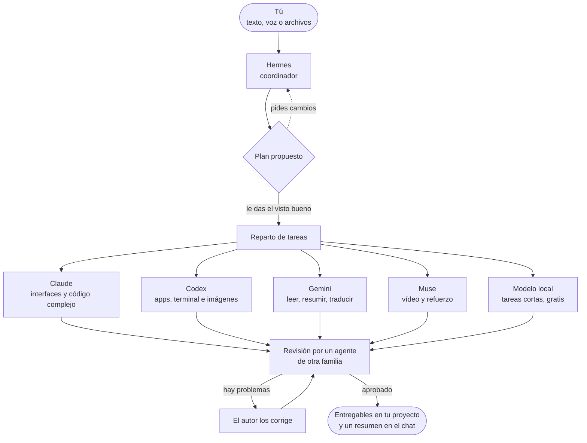

<div align="center">


# AI Cowork

### Tu propio equipo de agentes de IA, trabajando juntos y a la vista.

Pídelo una vez. Un coordinador planifica el trabajo, le da cada tarea al agente que mejor la hace (Claude, Codex, Gemini, Muse, un modelo local y muchos más) y tú ves a cada robot trabajar en un mundo 3D en directo. Después, los resultados te llegan ya revisados.

[English](README.md) · **Español** · [Português](README.pt-BR.md) · [Français](README.fr.md) · [简体中文](README.zh-CN.md)


<br>


[Qué es](#-qué-es) · [Por qué](#-por-qué-ai-cowork) · [Cómo funciona](#-cómo-funciona) · [Funciones](#-funciones) · [Desde donde estés](#-úsalo-desde-donde-estés) · [Temas](#-temas) · [Instalar](#-instalar) · [Privacidad](#-privacidad-y-seguridad)

</div>

<br>


## ✨ Qué es

AI Cowork convierte las suscripciones de IA que ya pagas (Claude, ChatGPT, Gemini, Meta y otras) en **un solo equipo que trabaja junto**. En vez de saltar de una app a otra copiando el contexto, lo pides una sola vez:

1. **🧭 Hermes, el coordinador,** entiende lo que quieres y te propone un plan: qué tareas hay, qué agente hará cada una y por qué.
2. **✅ Tú le das el visto bueno,** o le dices con tus palabras qué cambiar.
3. **⚙️ Los agentes trabajan,** en paralelo cuando compensa, en la carpeta de tu proyecto, cada uno con su programa oficial y tu propia sesión.
4. **🔍 Otro agente revisa el resultado** antes de que te llegue, y el autor corrige lo que encuentre.
5. **📦 Recibes los entregables** en el chat, agrupados y listos para abrir, con un resumen de lo que se hizo y de lo que costó.

La idea es sencilla: **deja una tarea y vuelve a encontrarte un resultado, nunca un error con las manos vacías.**

## 💡 Por qué AI Cowork

<table>
<tr>
<td width="50%" valign="top">

**💳 Tus suscripciones, no APIs de pago**<br>
Maneja las CLI oficiales (Claude Code, Codex CLI, Gemini CLI, Muse Code…) con tu propia sesión, así que funciona con la cuota de tus planes. La cabecera muestra la **cuota real que te queda** de Claude y GPT.

</td>
<td width="50%" valign="top">

**🎯 Cada tarea al agente que mejor la hace**<br>
El coordinador conoce los puntos fuertes, los modelos, la cuota y el historial de cada agente. Lo fácil va a un *becario* (el mismo agente con menos esfuerzo), lo normal al modelo principal y lo difícil al más potente.

</td>
</tr>
<tr>
<td valign="top">

**🏆 La calidad primero, de serie**<br>
Cada tarea tiene un criterio de aceptación. Un agente de otra familia revisa cada cambio, y en los trabajos que dependen del gusto (una web, un logo, una presentación) dos agentes hacen cada uno su versión y un tercero elige la ganadora.

</td>
<td valign="top">

**🛟 Pensado para no dejarte nunca con las manos vacías**<br>
Si un agente no puede terminar, otro igual de potente toma el relevo. Lo interrumpido se reanuda donde se quedó, un agente atascado se reinicia con un botón y cualquier cambio se puede deshacer.

</td>
</tr>
<tr>
<td valign="top">

**👀 Totalmente transparente**<br>
Cada agente te cuenta en frases cortas lo que está haciendo. Una vista paso a paso en directo muestra cada comando con su salida, cada archivo leído o editado (con sus cambios) y cada búsqueda.

</td>
<td valign="top">

**🔒 Privado por diseño**<br>
Todo se ejecuta en tu ordenador. El acceso remoto solo pasa por tu propia red Tailscale, el dictado por voz se hace en local y AI Cowork nunca ve ni guarda contraseñas.

</td>
</tr>
</table>

## 🧠 Cómo funciona



### El equipo

| | Agente | Funciona con | En qué destaca |
|---|---|---|---|
|  | **Hermes** | Hermes Agent | Coordinar: entiende la petición, planifica y reparte. Nunca ejecuta tareas él mismo. Si no está disponible, planifica Claude. |
|  | **Claude** | Claude Code (tu suscripción de Claude) | Interfaces y diseño, textos, código grande o complejo. |
|  | **Codex** | Codex CLI (tu cuenta de ChatGPT) | Apps y scripts de principio a fin, terminal, servidores y datos. Es el que genera imágenes. |
|  | **Gemini** | Gemini CLI | Leer y resumir muchísimo material (1 millón de tokens de contexto), traducciones e informes rápidos. |
|  | **Muse** | Muse Code (tu suscripción de Meta) | Entender vídeos. De refuerzo cuando los demás se quedan sin cuota. |
|  | **Local** | LM Studio u Ollama | Tareas cortas y sencillas, gratis y sin salir de tu ordenador. Con LM Studio también puede leer, crear y editar archivos. |

**Trae tus propios agentes.** El catálogo conecta muchos más con la cuenta que ya tienes: Aider, DeepSeek, OpenCode, GitHub Copilot CLI, Cursor, Amp, Goose, Kimi Code, Mistral Vibe, Grok Build, Cline, Continue, OpenHands, Factory Droid, Auggie, Junie, Crush, Open Interpreter, gptme, Letta Code, ForgeCode, OpenClaw, Kiro, Qwen Code, Antigravity CLI, Rovo Dev, MiniMax Code, Qoder CLI y más. Cada uno tiene su propio robot y su puesto en el mundo 3D, y tú eliges quién coordina.

## 🚀 Funciones

### 🗺️ Planificar y trabajar

- **Planes con tu visto bueno.** Nada empieza sin tu OK, y puedes cambiar el plan con una frase («mejor que lo haga Codex», «sáltate la investigación»). Apruébalo con un toque o simplemente respondiendo «sí». Si lo prefieres, desactiva la aprobación y deja que el equipo se ponga manos a la obra directamente.
- **Varias peticiones a la vez.** El trabajo nuevo va a los agentes libres sin tocar los archivos que otro agente está editando.
- **Criterios de aceptación por tarea**, y un aviso si un agente toca archivos que no eran suyos.
- **Dos manos para los trabajos de gusto.** Dos agentes de familias distintas hacen lo mismo por separado (opción A y opción B), y un tercero prueba las dos, las compara con tu petición y te dice cuál gana y por qué.
- **Revisión entre pares.** Cuando una tarea cambia archivos, un agente de otra familia la revisa en modo solo lectura, ejecuta las pruebas si puede y responde *aprobado* o *hay problemas*. El autor los corrige y el resultado se vuelve a revisar.
- **Reanudar y tomar el relevo.** Las tareas interrumpidas se reanudan donde se quedaron. Si un agente falla, otro agente potente se encarga de la tarea, nunca uno más flojo. Los agentes también retoman su propia sesión en los encargos de seguimiento.
- **Interruptor «Acceso completo».** Deja que los agentes instalen cosas y usen internet sin pedir permiso, o limítalos a editar la carpeta del proyecto.

### 📡 Seguir el trabajo

- **Mensajes cortos en directo** de cada agente mientras trabaja, con sus herramientas recogidas en una línea desplegable, como en la app de Claude.
- **Vista paso a paso en directo** de cualquier tarea: el razonamiento, cada comando y su salida, los archivos leídos y editados con sus cambios, las búsquedas y la respuesta final. Se guarda 30 días.
- **Progreso a la vista.** Las capturas e imágenes nuevas aparecen como miniaturas en el chat, y los documentos como tarjetas, mientras la tarea sigue en marcha.
- **Campana «Te necesita»**, que reúne todo lo que espera una decisión tuya (un plan, una pregunta, un permiso, un agente que no da señales) con sus botones, además de notificaciones en el móvil.
- **Espacio digital 3D** con todos los estados: trabajando, esperando a otro agente, delegando en un becario, sin cuota o con errores, y con los archivos viajando de un robot a otro.

### ↩️ Control y red de seguridad

- **Cambios por tarea, con Deshacer.** Se toma una instantánea antes y después de cada tarea, en un almacén aparte, nunca en el `.git` de tu proyecto. Mira «N archivos cambiados +a −b», revisa los cambios y deshaz una sola tarea. Si varias tareas se solapan, el resultado se guarda como copia aparte.
- **Reinicia un agente que falla** desde su panel: quita el bloqueo (cuota, sesión, error de la API), vuelve a comprobar su CLI y retoma lo que tenía pendiente.
- **Valora cualquier resultado** con «Me sirvió» / «No me sirvió». Las valoraciones llegan al coordinador, que así aprende quién cumple de verdad.
- **Panel «Cómo rinde cada agente…»**: tareas, veredictos de revisión, valoraciones, tiempo y coste por agente y dificultad.

### 🧩 Contexto y automatización

- **Memoria del proyecto** con instrucciones, decisiones, preferencias y pendientes, cada una con su autor y su estado. Todos los agentes la leen en cada tarea, aunque limpies el chat.
- **Un solo AGENTS.md para todo el equipo.** Cada CLI lee solo su propio archivo; AI Cowork les pasa los demás, así que con un único `AGENTS.md` todos los agentes siguen las mismas reglas.
- **Habilidades compartidas.** Procedimientos reutilizables en la carpeta `habilidades`, con el mismo formato `SKILL.md` que las skills de Claude.
- **Servidor MCP de AI Cowork.** Los agentes tienen herramientas para leer la memoria del proyecto y añadirle cosas, ver el estado del equipo, cargar una habilidad y hacerte una pregunta, con un token por tarea.
- **Rutinas.** Peticiones que se lanzan solas: a una hora fija, los días de la semana que elijas, cada N horas, desde un webhook (con firmas de GitHub) o cuando cambian archivos en una carpeta. Pasan por el mismo plan, los mismos agentes y la misma revisión que cualquier cosa que escribas.

### 📊 Cuota y coste

- **Cuota real** de Claude y GPT en la cabecera, además de grupos de cuota con presupuestos.
- **Consumo por petición:** tiempo, tokens y cuánta cuota gastó, para ver si un equipo compensa frente a un solo agente. Exportable a CSV.
- **Modelo y esfuerzo según la dificultad,** modelos que puedes cambiar desde el panel de cada robot y `/model` para cambiar el modelo de Hermes.

### 🎨 Comodidades

- **Dictado por voz en local** con Whisper en tu propio ordenador. Sin servicios externos, y el audio se borra después.
- **Once temas** que también cambian el estilo del mundo 3D. Algunos lo decoran y disfrazan a los robots.
- **Voces de los agentes,** cada una con su timbre, y texto que se escribe al ritmo de la voz, como en Animal Crossing.
- **Reproductor de música** con búsqueda en YouTube Music y cola de reproducción, y luces que siguen el BPM de la canción sin micrófono.
- **Asistente de configuración** que instala los programas que falten con sus instaladores oficiales y abre el inicio de sesión oficial de cada uno.
- **Modo demo** para enseñar la app sin gastar nada.

### ⌨️ Órdenes del chat

| Orden | Qué hace |
|---|---|
| `/model` | Ver y cambiar el modelo de Hermes |
| `/usage` | Consultar las cuotas al momento |
| `/recuerda …` | Guardar algo en la memoria del proyecto (`decisión:`, `pendiente:`, `preferencia:`) |
| `/rutina …` | Crear o gestionar una rutina |
| `/new` | Empezar una conversación nueva, guardando una copia de la anterior |

## 🌍 Úsalo desde donde estés

El ordenador donde está instalado AI Cowork (por ejemplo, un Mac mini siempre encendido) es el que hace el trabajo. Puedes llevártelo contigo de cuatro formas:

| | 🖥️ **Escritorio** | 💻 **Cliente de escritorio** | 🌐 **Navegador** | 📱 **Órbita (Android)** |
|---|---|---|---|---|
| **Qué es** | La app completa para Windows y macOS | La app en otro ordenador, conectada a tu AI Cowork principal | La misma interfaz desde cualquier dispositivo de tu red Tailscale | Una app nativa de Android hecha para el móvil |
| **Cómo se entra** | Abriendo la app | Emparejando una vez con un código de 6 cifras | Con un enlace y un código de acceso, una sola vez | Emparejando una vez con un código de 6 cifras |
| **Qué puedes hacer** | Todo | Todo, y además explorar los archivos del servidor y **sincronizar carpetas** en los dos sentidos | Chat, mundo 3D, archivos, resultados y aprobación de planes | Chat, planes, tareas, archivos, memoria, consumo y un mundo 3D nativo |
| **Actualizaciones** | ⋮ → «Buscar actualizaciones…» | Actualizaciones firmadas desde tu propio servidor | Siempre la última versión | Desde Ajustes, sin reinstalar |

<p align="center">
  
  &nbsp;
  
</p>

Órbita guarda la última copia para que puedas usarla **sin conexión**, deja tus mensajes en cola hasta que vuelve la conexión y se adapta a plegables y tablets. Más en [android/README.md](android/README.md).

## 🎨 Temas

⋮ → «Temas…» cambia al momento el aspecto de la app y de su mundo 3D.

<table>
  <tr>
    <td align="center"><br><b>Órbita</b>: cristal esmerilado</td>
    <td align="center"><br><b>Marfil</b>: claro y cálido</td>
    <td align="center"><br><b>Grafito</b>: negro y oro</td>
  </tr>
  <tr>
    <td align="center"><br><b>Bosque</b>: verde profundo y oro</td>
    <td align="center"><br><b>Matrix</b>: negro y verde neón</td>
    <td align="center"><br><b>EVA-01</b>: morado y verde lima</td>
  </tr>
</table>

Y cuatro que decoran el mundo, cambian la forma de su núcleo y, en los de fiesta, disfrazan a los robots:

<table>
  <tr>
    <td align="center"><br><b>Relicario</b>: un núcleo de cristal tallado y plataformas de vidrio y oro</td>
    <td align="center"><br><b>Telar</b>: membranas de hilos de plata con destellos dorados</td>
  </tr>
  <tr>
    <td align="center"><br><b>Halloween</b>: calabazas, velas, luna, murciélagos, una bruja y un vampiro</td>
    <td align="center"><br><b>Navidad</b>: nieve, árboles, regalos, una bola de nieve y gorros de Papá Noel</td>
  </tr>
</table>

## 📥 Instalar

### Requisitos

- **Windows 10/11 o macOS** (chip Apple o Intel).
- **Node.js** `^22.22.2 || ^24.15.0 || >=26.0.0`. Si falta, lo instala el asistente.
- Al menos un agente con la sesión iniciada: **Claude Code**, **Codex CLI**, **Gemini CLI**, **Muse Code** o cualquier agente del catálogo. Para coordinar, **Hermes Agent**; sin él, planifica Claude.
- Opcional: **LM Studio** u **Ollama** para el agente local, **git** para Deshacer y **Tailscale** para usarlo desde otros dispositivos.

### Windows

```bash
npm install
npm run dist:win
```

Esto genera `release/AI-Cowork-Setup-<version>.exe`. El instalador te deja elegir la carpeta y crea los accesos directos. Como no está firmado, puede que Windows te avise: «Más información» → «Ejecutar de todas formas».

### macOS

```bash
npm run fuente
```

Esto genera `release/AI-Cowork-fuente.zip`. En el Mac, descomprímelo y ejecuta esto dentro de la carpeta:

```bash
bash scripts/instalar-mac.sh
```

Compila la app para ese Mac, la copia a `/Applications` (o donde elijas) y la abre.

### Primera vez

La primera vez que la abres aparece el **asistente de configuración** (también en ⋮ → «Configurar agentes…»):

1. Eliges qué agentes usar.
2. Comprueba sus programas e instala los que falten con sus instaladores oficiales.
3. Abre el inicio de sesión oficial de cada agente. AI Cowork nunca ve ni guarda contraseñas.
4. Te resume lo que quede pendiente.

Para usarla desde el móvil o el portátil, abre ⋮ → «Acceso desde otros dispositivos…».

## 🔐 Privacidad y seguridad

- **En tu ordenador.** Proyectos, memoria, registros y consumo se guardan en tu carpeta de datos de usuario (`%APPDATA%\AI Cowork` en Windows, `~/Library/Application Support/AI Cowork` en macOS).
- **Acceso remoto cerrado.** El servidor escucha solo en tu IP de Tailscale y en `127.0.0.1`, nunca en la red local ni en internet, y pide un código en cada petición. Cada dispositivo emparejado tiene su propia llave, que puedes revocar por separado (además caduca tras 90 días sin usarse), o puedes revocarlas todas a la vez con un código nuevo. Los códigos de emparejamiento caducan a los 10 minutos y solo admiten unos pocos intentos.
- **Actualizaciones firmadas para los clientes.** Los clientes de escritorio solo instalan actualizaciones firmadas con tu propia clave privada, que nunca sale del ordenador que las publica.
- **Sin contraseñas.** Cada agente usa el inicio de sesión de su programa oficial. Las claves de API que añadas se cifran con el llavero del sistema.
- **Los agentes, en su carpeta.** Se les pide trabajar solo dentro de la carpeta del proyecto. Con «Acceso completo» desactivado, esa carpeta es lo único que pueden editar.
- **Voz en local.** El dictado usa Whisper en tu propio ordenador, y el audio se borra después.

## 🛠️ Desarrollo

```bash
npm install
npm run dev        # app de escritorio en modo desarrollo
npm run web        # solo la interfaz en el navegador (http://localhost:5199), en modo demo
npm run typecheck  # tipos
npx vitest run     # pruebas
```

**Tecnología:** Electron, React 19, TypeScript y Three.js (react-three-fiber) en el escritorio; Kotlin, Jetpack Compose y OpenGL ES en Órbita.

```
src/
  shared/      contrato entre el motor y la interfaz (tipos, valores por defecto)
  main/        motor: ventana, CLIs, planificación, tareas, cuotas, proyectos, servidor web y móvil
  preload/     puente seguro window.cowork
  renderer/    interfaz: chat, paneles y el espacio digital 3D
android/       Órbita, la app de Android
docs/          manual, guía de modelos y API móvil
```

## 📚 Documentación

- **[Manual](docs/MANUAL.md)**: todas las funciones en detalle.
- **[Guía de modelos](docs/GUIA-MODELOS.md)**: qué modelo y esfuerzo usa cada agente según la dificultad, con fuentes.
- **[Órbita](android/README.md)**: la app de Android, y cómo compilarla y publicarla.
- **[API móvil](docs/mobile-api/README.md)**: el contrato entre el servidor y Órbita.

<div align="center">
<br>
<sub>Hecho por todo un equipo de agentes de IA, coordinados por Hermes.</sub>
</div>
