<div align="center">


# kywai

<sub>Se pronuncia «ki-wai». Antes se llamaba <i>AI Cowork</i>.</sub>

### Cualquier agente de IA, de cualquier proveedor, todos los que quieras, trabajando como un solo equipo.

Pídelo una vez. Un coordinador planifica el trabajo y le da cada tarea al agente que mejor la hace: Claude, Codex, Gemini, DeepSeek, Qwen, Copilot, Cursor, un modelo local o cualquier agente de línea de comandos que añadas. Tú ves a cada robot trabajar en un mundo 3D en directo, y los resultados te llegan ya revisados.

[English](README.md) · **Español** · [Português](README.pt-BR.md) · [Français](README.fr.md) · [简体中文](README.zh-CN.md) · 🌐 [kywai.app](https://kywai.app)

[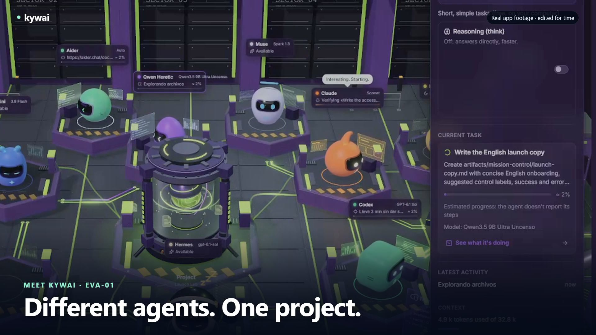](https://kywai.app/es/#video)

**[▶ Mira kywai en acción — 30 segundos](https://kywai.app/es/#video)** · [Descargar MP4](docs/video/kywai-promo-30s.mp4)
Grabación real de la app, música original y textos en inglés.

[](https://kywai.app)


[](https://ko-fi.com/yilsander)

<br>

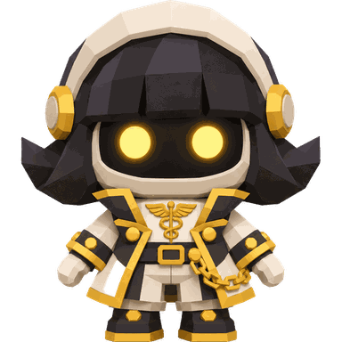
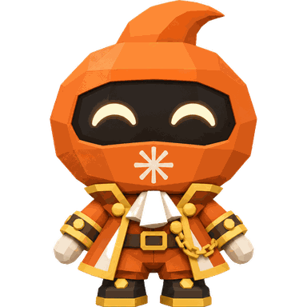
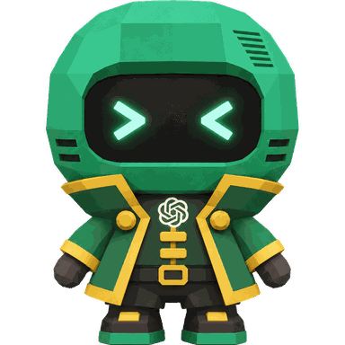
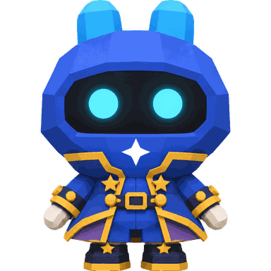
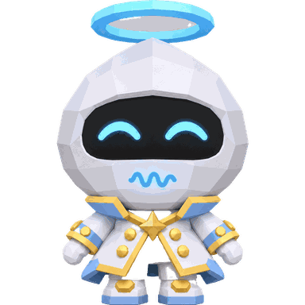
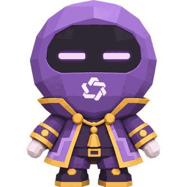
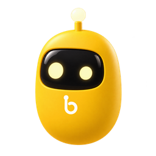

[Qué es](#-qué-es) · [Cualquier agente](#-cualquier-agente-de-cualquier-proveedor) · [Por qué](#-por-qué-kywai) · [Cómo funciona](#-cómo-funciona) · [Funciones](#-funciones) · [Extensiones](#-extensiones-mcp-skills-plugins-y-mods) · [Desde donde estés](#-úsalo-desde-donde-estés) · [Temas](#-temas) · [Instalar](#-instalar) · [Privacidad](#-privacidad-y-seguridad) · [Apoyar](#-apoya-el-proyecto)

</div>

<br>

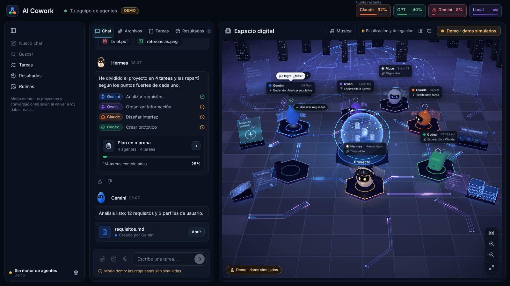

## ✨ Qué es

kywai convierte los agentes de IA y las suscripciones que ya tienes, de cualquier proveedor, en **un solo equipo que trabaja junto**. En vez de saltar de una app a otra copiando el contexto, lo pides una sola vez:

1. **🧭 Hermes, el coordinador,** entiende lo que quieres y te propone un plan: qué tareas hay, qué agente hará cada una y por qué.
2. **✅ Tú le das el visto bueno,** o le dices con tus palabras qué cambiar.
3. **⚙️ Los agentes trabajan,** en paralelo cuando compensa, en la carpeta de tu proyecto, cada uno con su propio programa y tu propia sesión o clave de API.
4. **🔍 Otro agente revisa el resultado** antes de que te llegue, y el autor corrige lo que encuentre.
5. **📦 Recibes los entregables** en el chat, agrupados y listos para abrir, con un resumen de lo que se hizo y de lo que costó.

La idea es sencilla: **deja una tarea y vuelve a encontrarte un resultado, nunca un error con las manos vacías.**

## 🔌 Cualquier agente, de cualquier proveedor

kywai no está atado a un conjunto fijo de modelos. Es una plataforma en la que **tú montas tu propio equipo**:

- **Añade todos los agentes que quieras** desde ⚙ → «Configurar agentes…» → «Añadir un agente». El catálogo ya sabe lanzar más de 30, cada uno con la cuenta o suscripción que usa: Claude Code, Codex CLI, Gemini CLI, Antigravity CLI, Muse Code, Aider, DeepSeek, Qwen Code, Kimi Code, MiniMax Code, Mistral Vibe, Grok Build, GitHub Copilot CLI, Cursor, Amp, Goose, OpenCode, Cline, Continue, OpenHands, Factory Droid, Auggie, Junie, Kiro, Rovo Dev, Qoder CLI, Crush, Open Interpreter, gptme, Letta Code, ForgeCode, OpenClaw, Kilo CLI y más.
- **Encuentra opciones gratuitas.** El filtro «Solo gratis» del catálogo destaca los agentes con opciones gratuitas, incluido Kilo CLI con Kilo Auto Free. Cada ficha explica los requisitos y los límites del proveedor.
- **O conecta cualquier otro programa** con «Otro programa…»: indica su comando, cómo recibe la tarea (por stdin, en un archivo o como argumento) y sus argumentos, y pasa a formar parte del equipo.
- **Suscripciones o claves de API.** Los agentes funcionan con la sesión que ya tienes iniciada en su propio programa. Los que usan una clave de API (DeepSeek, Kiro, Junie, Factory Droid, Amp…) te la piden una sola vez; se cifra con el llavero del sistema y solo se le pasa a ese agente.
- **También modelos locales.** Cualquier modelo que ejecutes en LM Studio u Ollama, gratis y sin salir de tu ordenador.
- **El agente local se las apaña solo.** Enciende LM Studio por sí mismo cuando lo necesita, y el interruptor «Razonamiento (think)» de su tarjeta deja que el modelo piense antes de responder solo cuando tú quieras (apagado por defecto, así responde mucho más rápido).
- **Tú eliges quién coordina.** Hermes es el coordinador por defecto, pero cualquier agente puede planificar y repartir («Hacer coordinador»). Si no está disponible, toma el relevo el siguiente.
- **Cada agente es un miembro de pleno derecho del equipo,** con su propio robot y su puesto en el mundo 3D, sus estadísticas de rendimiento y el mismo plan, la misma revisión y el mismo Deshacer que los demás.

## 💡 Por qué kywai

<table>
<tr>
<td width="50%" valign="top">

**💳 Los agentes que ya pagas**<br>
Maneja el propio programa de cada agente con tu sesión, así que funciona con la cuota de tus planes en lugar de con costes extra de API, y también valen las claves de API o los modelos locales gratuitos. La cabecera muestra la **cuota real que te queda** de Claude y GPT.

</td>
<td width="50%" valign="top">

**🎯 Cada tarea al agente que mejor la hace**<br>
El coordinador conoce los puntos fuertes, los modelos, la cuota y el historial de cada agente. Lo fácil va a un *becario* (el mismo agente con menos esfuerzo), lo normal al modelo principal y lo difícil al más potente.

</td>
</tr>
<tr>
<td valign="top">

**🏆 La calidad primero, de serie**<br>
Cada tarea tiene un criterio de aceptación. Un agente de otra familia revisa cada cambio, ejecuta él mismo las pruebas y solo un *aprobado* explícito lo da por bueno. En los trabajos que dependen del gusto (una web, un logo, una presentación) puedes pedir dos versiones y un tercero elige la ganadora.

</td>
<td valign="top">

**🛟 Pensado para no dejarte nunca con las manos vacías**<br>
Si un agente no puede terminar, otro igual de potente toma el relevo. Lo interrumpido se reanuda donde se quedó, un agente atascado se reinicia con un botón y cualquier cambio se puede deshacer.

</td>
</tr>
<tr>
<td valign="top">

**👀 Totalmente transparente**<br>
Cada agente te cuenta en frases cortas lo que está haciendo. Una vista paso a paso en directo muestra cada comando con su salida, cada archivo leído o editado (con sus cambios) y cada búsqueda.

</td>
<td valign="top">

**🔒 Privado por diseño**<br>
Todo se ejecuta en tu ordenador. El acceso remoto solo pasa por tu propia red Tailscale, el dictado por voz se hace en local y kywai nunca ve ni guarda contraseñas.

</td>
</tr>
</table>

## 🧠 Cómo funciona

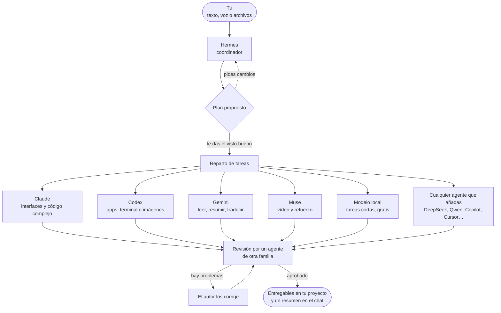

### El equipo por defecto

Este es el equipo que viene de serie. Puedes quitar a cualquiera de ellos y añadir todos los demás que quieras.

| | Agente | Funciona con | En qué destaca |
|---|---|---|---|
|  | **Hermes** | Hermes Agent | Coordinar: entiende la petición, planifica y reparte. Nunca ejecuta tareas él mismo. Si no está disponible, planifica Claude. |
|  | **Claude** | Claude Code (tu suscripción de Claude) | Interfaces y diseño, textos, código grande o complejo. |
|  | **Codex** | Codex CLI (tu cuenta de ChatGPT) | Apps y scripts de principio a fin, terminal, servidores y datos. Es el que genera imágenes. |
|  | **Gemini** | Gemini CLI | Leer y resumir muchísimo material (1 millón de tokens de contexto), traducciones e informes rápidos. |
|  | **Muse** | Muse Code (tu suscripción de Meta) | Entender vídeos. De refuerzo cuando los demás se quedan sin cuota. |
|  | **Local** | LM Studio u Ollama | Tareas cortas y sencillas, gratis y sin salir de tu ordenador. Con LM Studio también puede leer, crear y editar archivos. |

Cualquier agente que añadas desde el catálogo o con «Otro programa…» funciona exactamente igual que estos: el coordinador lo conoce, le asigna tareas y aparece en el mundo 3D. Consulta [Cualquier agente, de cualquier proveedor](#-cualquier-agente-de-cualquier-proveedor).

## 🚀 Funciones

### 🗺️ Planificar y trabajar

- **Planes con tu visto bueno.** Nada empieza sin tu OK, y puedes cambiar el plan con una frase («mejor que lo haga Codex», «sáltate la investigación»). Apruébalo con un toque o simplemente respondiendo «sí». Si lo prefieres, desactiva la aprobación y deja que el equipo se ponga manos a la obra directamente.
- **Varias peticiones a la vez.** El trabajo nuevo va a los agentes libres sin tocar los archivos que otro agente está editando.
- **Más rápido, sin bajar el listón.** Un agente empieza su siguiente tarea mientras se revisa la anterior, Hermes lanza a la vez las tareas que no dependen entre sí, las pruebas y las capturas van en paralelo y, entre revisores igual de fiables, se elige el claramente más rápido. Los agentes en mala racha dejan de recibir lo que no sea fácil.
- **Sin trabajo repetido.** Hermes no repite una tarea que ya está en marcha, y el chat te avisa si una petición nueva se parece a una en curso.
- **Habla directo con un agente.** Escribe `@Claude …` (o `/directo Claude …`) y tu texto le llega tal cual a ese agente, sin plan, revisión ni resumen de Hermes. Al teclear `@` sale la lista de agentes, en el escritorio, en el navegador y en Órbita.
- **Criterios de aceptación por tarea**, y un aviso si un agente toca archivos que no eran suyos.
- **Dos manos para los trabajos de gusto, si lo pides.** Dos agentes de familias distintas hacen lo mismo por separado (opción A y opción B), y un tercero prueba las dos, las compara con tu petición y te dice cuál gana y por qué.
- **Revisión estricta y con pruebas de verdad.** Cuando una tarea cambia archivos, un agente de otra familia la revisa en modo solo lectura, ejecuta él mismo las pruebas y responde *aprobado* o *hay problemas*; solo un *aprobado* explícito la da por buena. Si no da veredicto, se pide a otro revisor fiable. Cada tarea tiene hasta dos correcciones y un relevo a otro agente potente; si aun así falla, aparece en «Te necesita» como que requiere tu intervención.
- **Reanudar y tomar el relevo.** Las tareas interrumpidas se reanudan donde se quedaron. Si un agente falla, otro agente potente se encarga de la tarea, nunca uno más flojo. Los agentes también retoman su propia sesión en los encargos de seguimiento.
- **Interruptor «Acceso completo».** Deja que los agentes instalen cosas y usen internet sin pedir permiso, o limítalos a editar la carpeta del proyecto.

### 📡 Seguir el trabajo

- **Mensajes cortos en directo** de cada agente mientras trabaja, con sus herramientas recogidas en una línea desplegable, como en la app de Claude.
- **Vista paso a paso en directo** de cualquier tarea: el razonamiento, cada comando y su salida, los archivos leídos y editados con sus cambios, las búsquedas y la respuesta final. Se guarda 30 días.
- **Progreso a la vista.** Las capturas e imágenes nuevas aparecen como miniaturas en el chat, y los documentos como tarjetas, mientras la tarea sigue en marcha.
- **Cada tarea en su bloque.** En el chat cada tarea lleva su número, sus etapas reales (trabajando, corrigiendo, pruebas, revisión) y la revisión firmada por el agente que la hizo. Nada más enviar, una fila te dice que Hermes prepara el plan, y si un agente se queda callado ves «sin novedades desde hace N min» en vez de una barra de progreso inventada.
- **Vista previa de archivos al lado del chat.** Pulsa un adjunto, un entregable o el nombre de un archivo y se abre en un panel lateral, como en Claude: documentos, código, imágenes y PDF, con miniaturas de las imágenes adjuntas. Órbita tiene el mismo lector con ‹ ›, vista de código, copiar y «Abrir con otra app».
- **Campana «Te necesita»** solo con lo que de verdad espera por ti (un plan, una pregunta, un permiso, un agente que no da señales o una tarea en pausa con Reanudar / Quitar), con sus botones y notificaciones en el móvil. Lo terminado va a Resultados como «Recién terminado».
- **Espacio digital 3D** con todos los estados: trabajando, en revisión, esperando la revisión de otro agente, delegando en un becario, sin cuota o con errores, con los archivos viajando de un robot a otro y una chispa por cada paso real del agente.
- **Un equipo que se siente vivo.** Los robots libres juegan con un documento de juguete o una pelota de colores, se visitan y despiertan a un compañero dormido con un susto amistoso. Reaccionan, sonríen y vuelven al puesto en cuanto los necesita el trabajo real; reducir efectos desactiva estas animaciones locales. También comparten bailes, juegan a imitarse, chocan las antenas y visitan al compañero cansado para darle ánimos. Con música sonando, los libres permanecen despiertos y bailan siguiendo el pulso del reproductor o de la música ambiental; su etiqueta muestra «Bailando».
- **Robots con carácter.** Sus ojos muestran lo que hace de verdad cada uno (concentrado, pensando, cansado, dormido, con un error, terminado), cada uno tiene su personalidad y sus bocadillos en tu idioma, y cuando escribes en el chat se despiertan y se giran a mirarte.

<p align="center">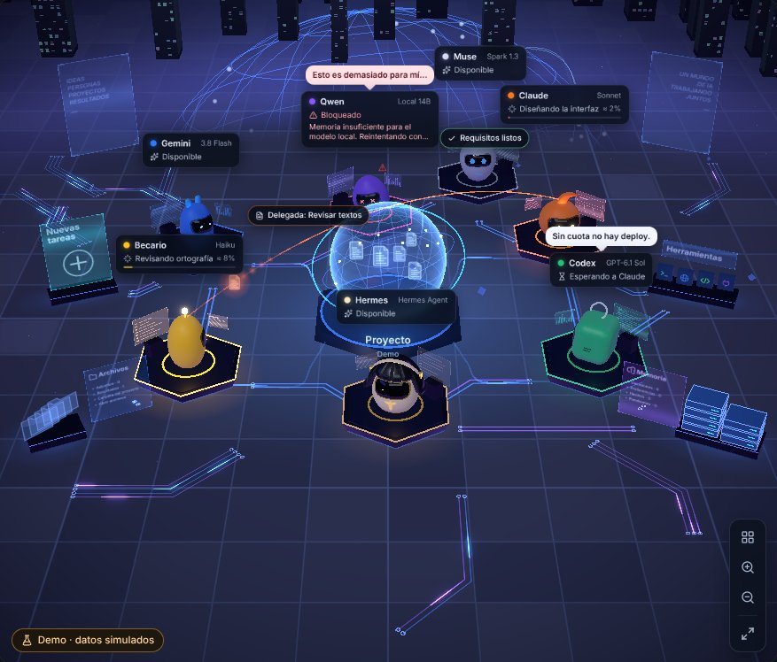</p>

### ↩️ Control y red de seguridad

- **Cambios por tarea, con Deshacer.** Se toma una instantánea antes y después de cada tarea, en un almacén aparte, nunca en el `.git` de tu proyecto. Mira «N archivos cambiados +a −b», revisa los cambios y deshaz una sola tarea. Si varias tareas se solapan, el resultado se guarda como copia aparte.
- **Reinicia un agente que falla** desde su panel: quita el bloqueo (cuota, sesión, error de la API), vuelve a comprobar su CLI y retoma lo que tenía pendiente.
- **Valora cualquier resultado** con «Me sirvió» / «No me sirvió». Las valoraciones llegan al coordinador, que así aprende quién cumple de verdad.
- **Panel «Cómo rinde cada agente…»**: tareas, veredictos de revisión, valoraciones, tiempo y coste por agente y dificultad.

### 🧩 Contexto y automatización

- **Trae el trabajo que ya tienes.** Importa sesiones locales de Claude Code, Codex y Hermes (incluido Hermes Desktop), o exportaciones JSON/ZIP de ChatGPT y Claude.ai, desde ⚙ → Importar de otras apps. Conserva conversaciones, recupera los proyectos y documentos de Claude incluidos y continúa con tu equipo. Los originales se conservan; las sesiones locales se buscan en el servidor. Los chats de Claude.ai van a su propio proyecto, y volver a importar nunca duplica nada.
- **Conversaciones como en Claude.** Una barra lateral con tus proyectos, los fijados y los chats recientes. Se pliega en una columna de iconos, otro clic en el proyecto abierto lo pliega y el clic derecho (mantener pulsado en Órbita) permite fijar, cambiar el nombre, bifurcar, mover o eliminar. «Nuevo chat» empieza una conversación nueva sin perder la anterior, y cualquiera se retoma después con sus tareas y la sesión de cada agente. Ctrl+K busca en conversaciones, tareas, resultados y memoria de todos los proyectos.
- **Memoria del proyecto** con instrucciones, decisiones, preferencias y pendientes, cada una con su autor y su estado. Todos los agentes la leen en cada tarea, aunque limpies el chat.
- **Un solo AGENTS.md para todo el equipo.** Cada CLI lee solo su propio archivo; kywai les pasa los demás, así que con un único `AGENTS.md` todos los agentes siguen las mismas reglas.
- **Rutinas.** Programa una petición para una sola vez, a una hora fija, ciertos días, cada N horas, por webhook firmado de GitHub o cuando cambien archivos de una carpeta. Puedes crearlas con /rutina, revisar su historial y decidir si requieren visto bueno. Las propuestas del coordinador solo se guardan cuando las confirmas.
- **Plantillas de tareas.** Tarjetas encima del cuadro de chat para revisar PR, resumir carpetas, buscar fallos o crear tus propias peticiones. Rellena campos, usa su orden /…, envíalas al equipo o directamente a un agente y convierte las compatibles en rutinas.
- **Entregables descargables.** Abre o descarga cada archivo desde el chat y Resultados, o guarda un conjunto en ZIP. Disponible en escritorio, cliente, navegador y Órbita: también puedes llevarte el resultado desde el móvil.

### 🧰 Extensiones: MCP, skills, plugins y mods

En **⚙ → Ajustes → Extensiones** puedes ampliar las herramientas de los agentes y personalizar kywai:

- **Servidores MCP.** Busca en el catálogo o añade una orden, un JSON o una dirección. Elige qué agentes pueden usar cada servidor: kywai comprueba que responde y muestra sus herramientas antes de activarlo. Si falta uv o Node.js, puedes instalarlo desde su tarjeta.
- **Skills compartidas.** Busca habilidades en skills.sh o instálalas desde un repositorio o una carpeta de GitHub. Se conserva el `SKILL.md` con sus scripts y referencias, y todo el equipo puede consultar esas habilidades cuando las necesita.
- **Plugins.** Explora los catálogos de plugins de Anthropic o añade otro catálogo o plugin de GitHub. kywai convierte sus skills, órdenes y perfiles de subagentes en habilidades compartidas, e importa sus MCP apagados para que tú elijas a quién activárselos.
- **Mods.** Instala desde GitHub o una carpeta local extensiones de kywai con órdenes /… del chat, hooks al empezar o terminar trabajos y paneles propios. Los hooks requieren tu permiso; los paneles se abren aislados en escritorio, web y Órbita.

**Compatibilidad:** los MCP del usuario se conectan a Claude, Codex, Gemini y Hermes; los agentes no compatibles aparecen desactivados. Los remotos requieren un token si piden autorización: OAuth y SSE todavía no están admitidos. Los plugins importan los componentes compatibles; sus hooks y LSP no se ejecutan como en Claude Code. El MCP interno de kywai se ofrece actualmente a Claude en tareas coordinadas.

Detalles y ejemplo de mod en el [manual](docs/MANUAL.md#extensiones-tus-servidores-mcp-para-los-agentes) y en [Notas rápidas](docs/mods/notas-rapidas).

### 📊 Cuota y coste

- **Cuotas que siguen a tu equipo.** La cabecera se actualiza al añadir, quitar, activar o desactivar agentes. Muestra datos reales de Claude y GPT y distingue los presupuestos o estimaciones de otros proveedores y los modelos locales.
- **Uso y coste.** Consulta tiempo y tokens por petición, coste por agente, planes de suscripción, API, gratuitos o locales, y compara el uso con lo que pagas. Configura precios y un presupuesto mensual con aviso; exporta el consumo a CSV. Las estimaciones se indican como tales.
- **Modelo y esfuerzo según la dificultad,** modelos que puedes cambiar desde el panel de cada robot y `/model` para cambiar el modelo de Hermes.

### 🎨 Comodidades

**Fondo marino** añade bancos de peces, ballenas, medusas y una ciudad sumergida alrededor de una perla luminosa. Relicario, Telar, Halloween y Navidad estrenan escenarios completos de santuario, islas de cristal, abadía gótica y villa nevada, conservando las preferencias existentes.

**Refugio Kywai** añade un observatorio-invernadero frente al mar: cúpula de madera y cristal, cielo y agua animados, talleres individuales, árbol compartido y asiento turquesa. Cambia al modo noche junto a Música; se recuerda por dispositivo.

- **El chat, lo primero.** En ventanas pequeñas ocupa más sitio, puedes arrastrar su borde al ancho que quieras (doble clic para volver al automático) y en ventanas estrechas el chat y el mundo 3D pasan a ser dos pestañas.
- **Un chat fácil de leer,** con respuestas sin caja, más aire entre párrafos y un botón de copiar en la esquina de cada bloque de código o de comandos. Hermes y los agentes escriben breve y con el resultado primero.
- **Dictado por voz en local** con Whisper en tu propio ordenador. Sin servicios externos, y el audio se borra después.
- **Mapas, colores y decorados.** Siete mapas 3D, la Ciudad digital en siete colores y cuatro decorados. El tema puede seguir al servidor o ser propio de cada dispositivo; Órbita adapta su paleta, sin reproducir los mapas del escritorio.
- **Voces de los agentes,** cada una con su timbre, y texto que se escribe al ritmo de la voz, como en Animal Crossing.
- **Reproductor de música** con búsqueda en YouTube Music, Audius y radios de SomaFM sin anuncios, y cola de reproducción, y luces que siguen el BPM de la canción sin micrófono.
- **Asistente de configuración** que instala los programas que falten con sus instaladores oficiales y abre el inicio de sesión oficial de cada uno.
- **Modo demo** para enseñar la app sin gastar nada.

### ⌨️ Órdenes del chat

| Orden | Qué hace |
|---|---|
| `/model` | Ver y cambiar el modelo de Hermes |
| `/usage` | Consultar las cuotas al momento |
| `/recuerda …` | Guardar algo en la memoria del proyecto (`decisión:`, `pendiente:`, `preferencia:`) |
| `/rutina …` | Crear o gestionar una rutina |
| `/new` | Empezar una conversación nueva, guardando una copia de la anterior |
| `@Agente …` | Mandar el texto tal cual a un agente, sin pasar por Hermes (también `/directo Agente …`) |

## 🌍 Úsalo desde donde estés

El ordenador donde está instalado kywai (por ejemplo, un Mac mini siempre encendido) es el que hace el trabajo. Puedes llevártelo contigo de cuatro formas:

| | 🖥️ **Escritorio** | 💻 **Cliente de escritorio** | 🌐 **Navegador** | 📱 **Órbita (Android)** |
|---|---|---|---|---|
| **Qué es** | La app completa para Windows, macOS y Linux | La app en otro ordenador, conectada a tu kywai principal | La misma interfaz desde cualquier dispositivo de tu red Tailscale | Una app nativa de Android hecha para el móvil |
| **Cómo se entra** | Abriendo la app | Emparejando una vez con un código de 6 cifras | Con un enlace y un código de acceso, una sola vez | Emparejando una vez con un código de 6 cifras |
| **Qué puedes hacer** | Todo | Todo, y además explorar los archivos del servidor y **sincronizar carpetas** en los dos sentidos | Chat, mundo 3D, archivos, resultados y aprobación de planes | Chat, planes, tareas, archivos, memoria, consumo y un mundo 3D nativo |
| **Actualizaciones** | ⚙ → «Buscar actualizaciones…» | Actualizaciones firmadas desde tu propio servidor | Siempre la última versión | Desde Ajustes, sin reinstalar. Las versiones nuevas se publican solas |

<p align="center">
  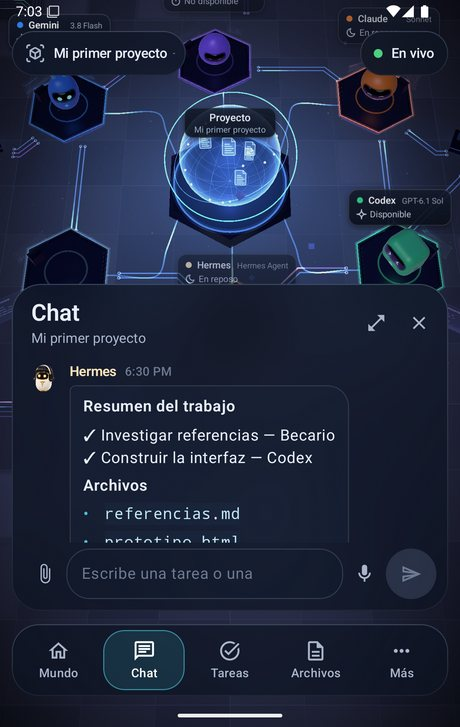
  &nbsp;
  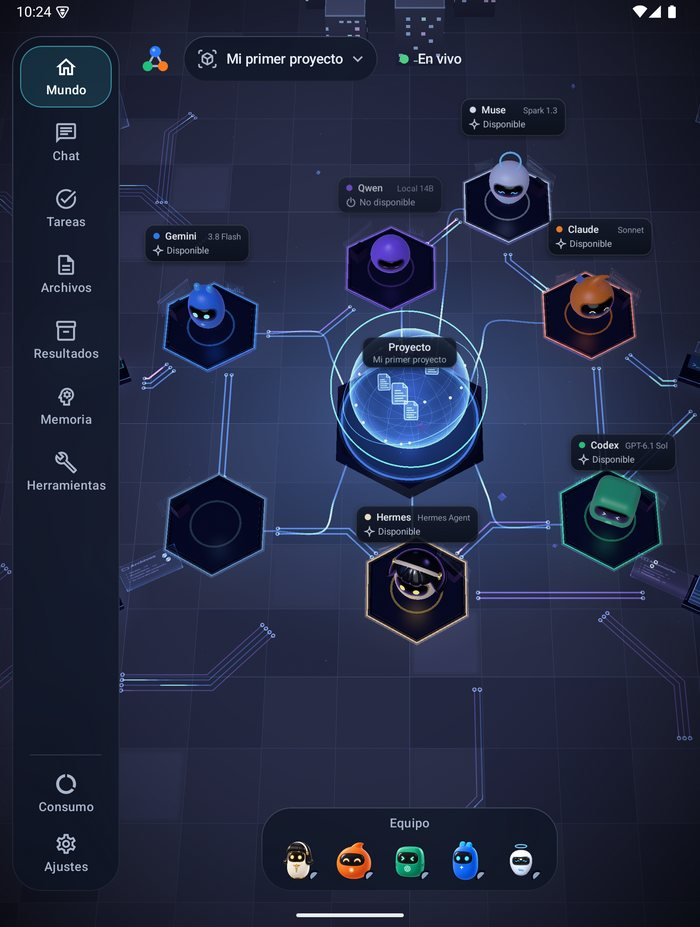
</p>

Órbita guarda la última copia para que puedas usarla **sin conexión**, deja tus mensajes en cola hasta que vuelve la conexión y se adapta a plegables y tablets. Más en [android/README.md](android/README.md).

En el chat, Órbita tiene **dictado en directo** (un toque en el micrófono; mantenlo pulsado para grabar una nota de voz que tu ordenador pasa a texto con Whisper), un **botón de cámara** para hacer una foto o elegirla de la galería, y los mismos menús al mantener pulsado que el clic derecho del escritorio.

¿Un ordenador era cliente y quieres que sea el servidor? Pulsa **«Usar este equipo como servidor»** en la pantalla de conectar o en ⚙ → Ajustes → Conexión.

## 🎨 Temas

La galería de **Ajustes → Temas** reúne siete mapas (Clásico, Órbita, Marfil, Grafito, Bosque, Matrix y EVA-01), la Ciudad digital con siete colores y cuatro decorados. Puedes compartir el tema del servidor o elegir uno propio en cada dispositivo. En Órbita se adapta la paleta, no los escenarios del escritorio. Estas imágenes muestran algunos colores y decorados:

<table>
  <tr>
    <td align="center">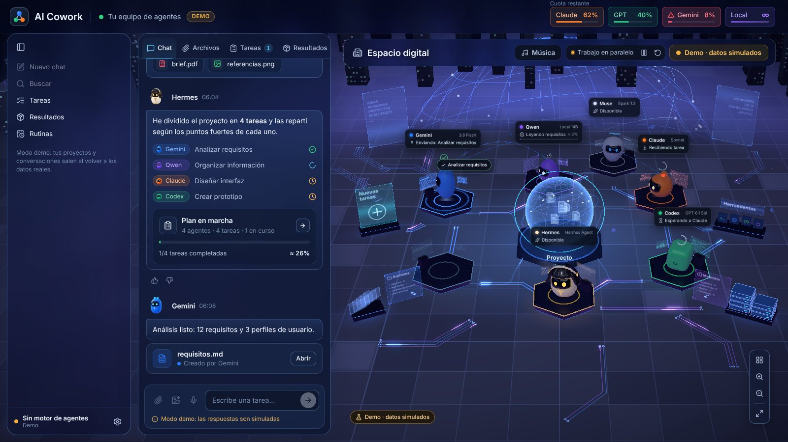<br><b>Frost Glass</b>: cristal esmerilado</td>
    <td align="center">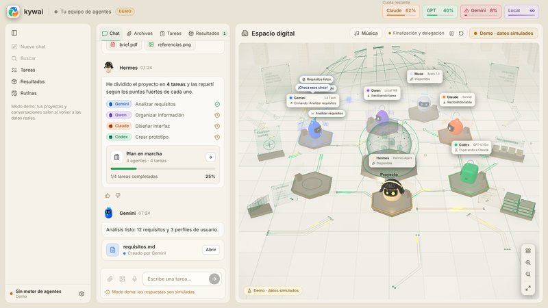<br><b>Perla</b>: claro y cálido</td>
    <td align="center">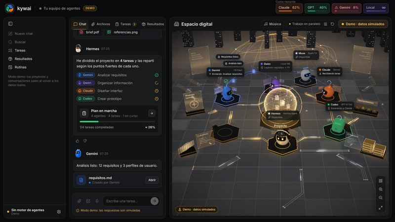<br><b>Ónix</b>: negro y oro</td>
  </tr>
  <tr>
    <td align="center">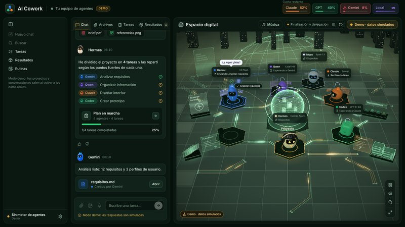<br><b>Esmeralda</b>: verde profundo y oro</td>
    <td align="center">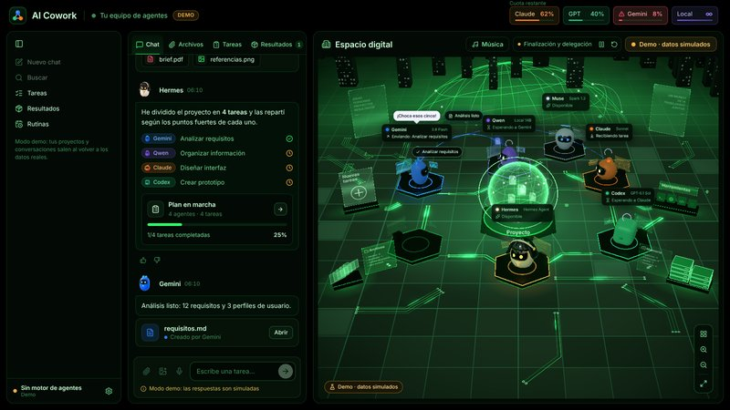<br><b>Neón</b>: negro y verde neón</td>
    <td align="center">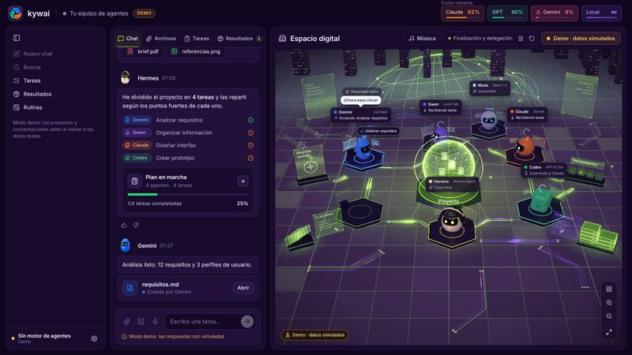<br><b>Ultravioleta</b>: morado y verde lima</td>
  </tr>
</table>

Y cuatro que decoran el mundo, cambian la forma de su núcleo y, en los de fiesta, disfrazan a los robots:

<table>
  <tr>
    <td align="center">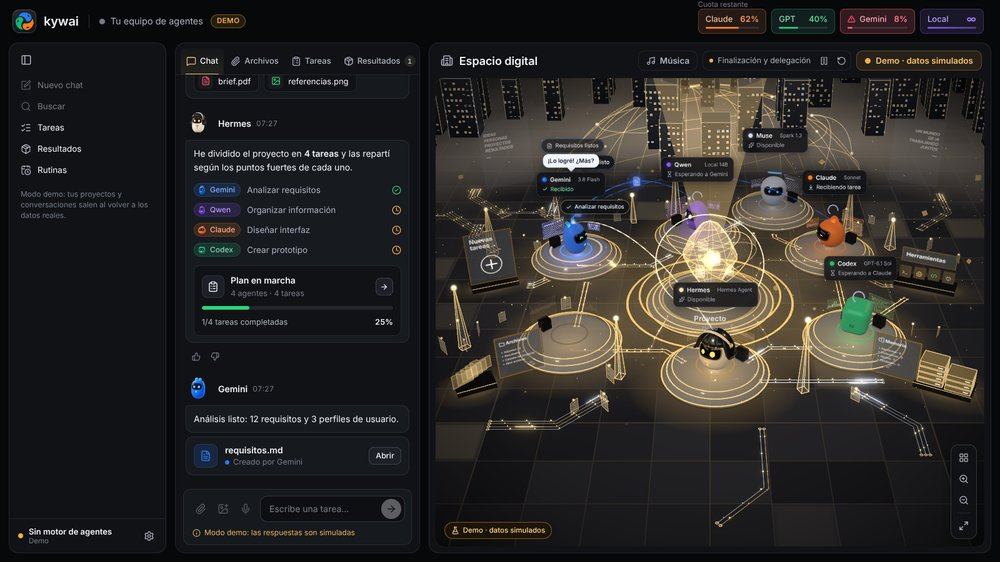<br><b>Relicario</b>: un núcleo de cristal tallado y plataformas de vidrio y oro</td>
    <td align="center">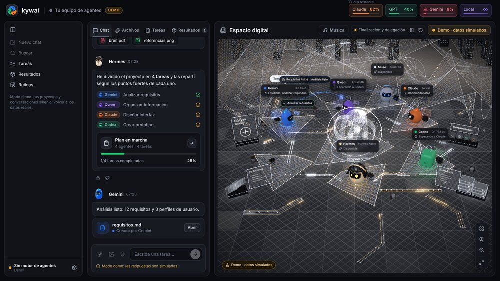<br><b>Telar</b>: membranas de hilos de plata con destellos dorados</td>
  </tr>
  <tr>
    <td align="center">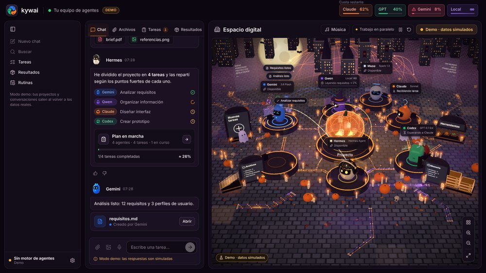<br><b>Halloween</b>: calabazas, velas, luna, murciélagos, una bruja y un vampiro</td>
    <td align="center">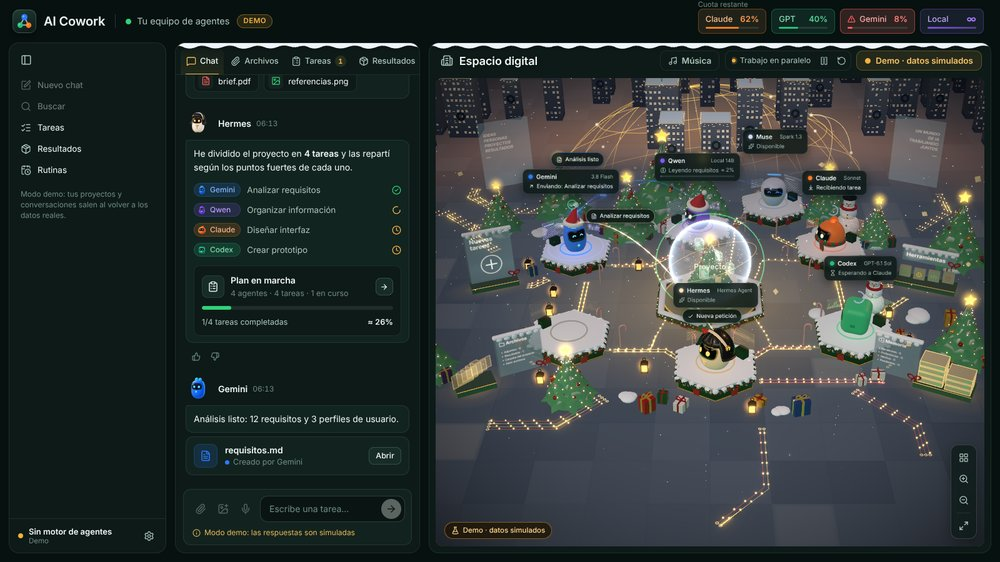<br><b>Navidad</b>: nieve, árboles, regalos, una bola de nieve y gorros de Papá Noel</td>
  </tr>
</table>

## 📥 Instalar

### Requisitos

- **Windows 10/11, macOS** (chip Apple o Intel) **o Linux** (x64 o ARM; Ubuntu, Debian, Fedora, Arch, openSUSE…).
- **Node.js** `^22.22.2 || ^24.15.0 || >=26.0.0`. Si falta, lo instala el asistente.
- Al menos un agente: cualquiera del catálogo (Claude Code, Codex CLI, Gemini CLI, DeepSeek, Qwen Code, Copilot…), un modelo local o cualquier agente de línea de comandos. **Hermes Agent** coordina por defecto, pero puede hacerlo cualquier agente.
- Opcional: **LM Studio** u **Ollama** para el agente local, **git** para Deshacer y **Tailscale** para usarlo desde otros dispositivos.

> **Idioma:** la app está en español, inglés, portugués, francés y chino. Se abre en el idioma del sistema y se cambia en ⚙ → Ajustes → «Idioma · Language». El portugués, el francés y el chino se tradujeron a máquina; se agradecen correcciones.

### Descargar (lo más fácil)

Baja el instalador de tu sistema desde la **[última versión](https://github.com/Yiku21/kywai/releases/latest)**: `.exe` para Windows, `.dmg` para macOS (Apple silicon o Intel) y `.AppImage` para Linux. Android: baja `kywai-orbita.apk` de la misma versión. Una vez instalada, la app busca una versión nueva cada vez que se abre y se actualiza sola (en macOS te avisa y abre la descarga).

Aún no van firmadas: en Windows pulsa «Más información» → «Ejecutar de todas formas»; en macOS, la primera vez, clic derecho en la app → Abrir (si dice que está dañada, ejecuta `xattr -cr "/Applications/kywai.app"`); en Linux dale permiso de ejecución al AppImage con `chmod +x`.

O compílala tú:

### Windows

```bash
npm install
npm run dist:win
```

Esto genera `release/kywai-Setup-<version>.exe`. El instalador te deja elegir la carpeta y crea los accesos directos. Como no está firmado, puede que Windows te avise: «Más información» → «Ejecutar de todas formas».

### macOS

```bash
npm run fuente
```

Esto genera `release/kywai-fuente.zip`. En el Mac, descomprímelo y ejecuta esto dentro de la carpeta:

```bash
bash scripts/instalar-mac.sh
```

Compila la app para ese Mac, la copia a `/Applications` (o donde elijas) y la abre.

### Linux

Con Node.js y git instalados, clona el repositorio y ejecuta esto dentro de la carpeta:

```bash
bash scripts/instalar-linux.sh
```

Compila la app para ese equipo, la deja en `~/.local/share/ai-cowork` sin pedir administrador, la añade al menú de aplicaciones y crea la orden `ai-cowork`. También puedes generar una AppImage con `npm run dist:linux`. Detalles en el [manual](docs/MANUAL.md#linux-se-compila-en-el-propio-equipo).

### Primera vez

La primera vez que la abres aparece el **asistente de configuración** (también en ⚙ → «Configurar agentes…»):

1. Eliges qué agentes usar.
2. Comprueba sus programas e instala los que falten con sus instaladores oficiales.
3. Abre el inicio de sesión oficial de cada agente. kywai nunca ve ni guarda contraseñas.
4. Te resume lo que quede pendiente.

Para usarla desde el móvil o el portátil, abre ⚙ → «Acceso desde otros dispositivos…».

## 🔐 Privacidad y seguridad

- **En tu ordenador.** Proyectos, memoria, registros y consumo se guardan en tu carpeta de datos de usuario (`%APPDATA%\AI Cowork` en Windows, `~/Library/Application Support/AI Cowork` en macOS, `~/.config/AI Cowork` en Linux).
- **Acceso remoto cerrado.** El servidor escucha solo en tu IP de Tailscale y en `127.0.0.1`, nunca en la red local ni en internet, y pide un código en cada petición. Cada dispositivo emparejado tiene su propia llave, que puedes revocar por separado (además caduca tras 90 días sin usarse), o puedes revocarlas todas a la vez con un código nuevo. Los códigos de emparejamiento caducan a los 10 minutos y solo admiten unos pocos intentos.
- **Actualizaciones firmadas para los clientes.** Los clientes de escritorio solo instalan actualizaciones firmadas con tu propia clave privada, que nunca sale del ordenador que las publica.
- **Sin contraseñas.** Cada agente usa el inicio de sesión de su programa oficial. Las claves de API que añadas se cifran con el llavero del sistema.
- **Los agentes, en su carpeta.** Se les pide trabajar solo dentro de la carpeta del proyecto. Con «Acceso completo» desactivado, esa carpeta es lo único que pueden editar.
- **Voz en local.** El dictado usa Whisper en tu propio ordenador, y el audio se borra después.

## 🛠️ Desarrollo

```bash
npm install
npm run dev        # app de escritorio en modo desarrollo
npm run web        # solo la interfaz en el navegador (http://localhost:5199), en modo demo
npm run typecheck  # tipos
npx vitest run     # pruebas
```

**Tecnología:** Electron, React 19, TypeScript y Three.js (react-three-fiber) en el escritorio; Kotlin, Jetpack Compose y OpenGL ES en Órbita.

```
src/
  shared/      contrato entre el motor y la interfaz (tipos, valores por defecto)
  main/        motor: ventana, CLIs, planificación, tareas, cuotas, proyectos, servidor web y móvil
  preload/     puente seguro window.cowork
  renderer/    interfaz: chat, paneles y el espacio digital 3D
android/       Órbita, la app de Android
docs/          manual, guía de modelos y API móvil
```

## 📚 Documentación

- **[Manual](docs/MANUAL.md)**: todas las funciones en detalle.
- **[Guía de modelos](docs/GUIA-MODELOS.md)**: qué modelo y esfuerzo usa cada agente según la dificultad, con fuentes.
- **[Órbita](android/README.md)**: la app de Android, y cómo compilarla y publicarla.
- **[API móvil](docs/mobile-api/README.md)**: el contrato entre el servidor y Órbita.

## ☕ Apoya el proyecto

kywai es gratis y de código abierto. Si te ahorra tiempo y quieres darme las gracias, puedes **[invitarme a un café en Ko-fi](https://ko-fi.com/yilsander)**. También lo tienes en la app: ⚙ → «Apoyar kywai ☕» en el escritorio, y al final de Ajustes en Órbita.

[](https://ko-fi.com/yilsander)

## 📄 Licencia

[MIT](LICENSE). Puedes usar, cambiar y compartir kywai libremente, siempre que mantengas el aviso de copyright.

<div align="center">
<br>
<sub>Hecho por todo un equipo de agentes de IA, coordinados por Hermes.</sub>
</div>
