<div align="center">

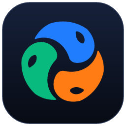

# AI Cowork

### Autant d'agents IA que vous voulez, de n'importe quel fournisseur, réunis en une seule équipe.

Une seule demande suffit. Un coordinateur planifie le travail et confie chaque tâche à l'agent le plus compétent : Claude, Codex, Gemini, DeepSeek, Qwen, Copilot, Cursor, un modèle local ou n'importe quel agent en ligne de commande que vous ajoutez. Vous regardez chaque robot travailler dans un monde 3D en direct, puis les résultats vous reviennent, déjà vérifiés.

[English](README.md) · [Español](README.es.md) · [Português](README.pt-BR.md) · **Français** · [简体中文](README.zh-CN.md)

<a href="docs/video/ai-cowork-presentacion.mp4" title="Découvrez AI Cowork en 44 secondes">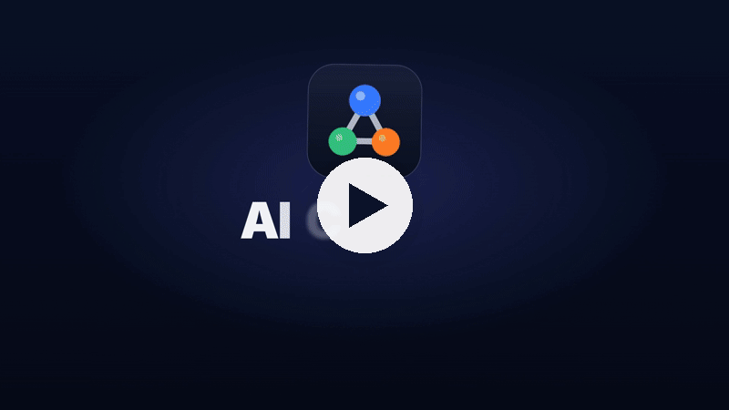</a>

<sub><a href="docs/video/ai-cowork-presentacion.mp4">▶ Regardez la présentation de 44 secondes (avec le son)</a></sub>


<br>


[Ce que c'est](#-ce-que-cest) · [Tout agent](#-tout-agent-tout-fournisseur) · [Pourquoi](#-pourquoi-ai-cowork) · [Fonctionnement](#-comment-ça-marche) · [Fonctionnalités](#-fonctionnalités) · [Partout](#-utilisez-le-de-partout) · [Thèmes](#-thèmes) · [Installation](#-installation) · [Confidentialité](#-confidentialité-et-sécurité)

</div>

<br>

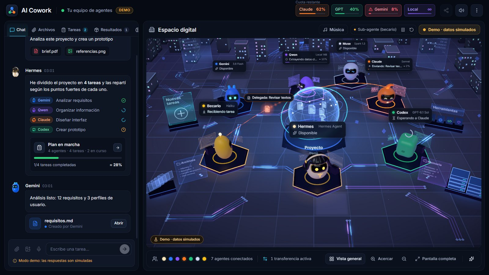

## ✨ Ce que c'est

AI Cowork transforme les agents et abonnements IA que vous avez déjà, quel que soit leur fournisseur, en **une seule équipe qui travaille ensemble**. Au lieu de passer d'une application à l'autre en recopiant le contexte, vous faites une seule demande :

1. **🧭 Hermes, le coordinateur,** comprend ce que vous voulez et propose un plan : quelles sont les tâches, quel agent se charge de chacune et pourquoi.
2. **✅ Vous l'approuvez,** ou vous lui dites simplement ce qu'il faut changer.
3. **⚙️ Les agents travaillent,** en parallèle quand c'est utile, dans le dossier de votre projet, chacun avec son propre programme et votre propre connexion ou clé d'API.
4. **🔍 Un autre agent vérifie le résultat** avant qu'il ne vous parvienne, et l'auteur corrige ce qui a été relevé.
5. **📦 Vous recevez les livrables** dans le chat, regroupés et prêts à ouvrir, avec un résumé de ce qui a été fait et de ce que cela a coûté.

L'objectif est simple : **lancer une tâche et revenir à un résultat, jamais à une erreur sans rien à montrer.**

## 🔌 Tout agent, tout fournisseur

AI Cowork n'est pas lié à un ensemble figé de modèles. C'est une plateforme où **vous composez votre propre équipe** :

- **Ajoutez autant d'agents que vous voulez** via ⋮ → « Configurer les agents… » → « Ajouter un agent ». Le catalogue sait déjà en lancer plus de 30, avec le compte ou l'abonnement que chacun utilise : Claude Code, Codex CLI, Gemini CLI, Antigravity CLI, Muse Code, Aider, DeepSeek, Qwen Code, Kimi Code, MiniMax Code, Mistral Vibe, Grok Build, GitHub Copilot CLI, Cursor, Amp, Goose, OpenCode, Cline, Continue, OpenHands, Factory Droid, Auggie, Junie, Kiro, Rovo Dev, Qoder CLI, Crush, Open Interpreter, gptme, Letta Code, ForgeCode, OpenClaw et d'autres encore.
- **Ou connectez n'importe quel autre programme** avec « Autre programme… » : indiquez sa commande, la façon dont il reçoit la tâche (stdin, un fichier ou un argument) et ses arguments, et il rejoint l'équipe.
- **Abonnements ou clés d'API.** Les agents s'exécutent avec la connexion que vous avez déjà dans leur propre programme. Ceux qui utilisent une clé d'API (DeepSeek, Kiro, Junie, Factory Droid, Amp…) vous la demandent une seule fois ; elle est chiffrée avec le trousseau du système et transmise uniquement à cet agent.
- **Les modèles locaux aussi.** N'importe quel modèle que vous faites tourner dans LM Studio ou Ollama, gratuitement et sans quitter votre ordinateur.
- **C'est vous qui choisissez qui coordonne.** Hermes est le coordinateur par défaut, mais n'importe quel agent peut planifier et attribuer les tâches (« Nommer coordinateur »). S'il n'est pas disponible, le suivant prend le relais.
- **Chaque agent est un membre à part entière de l'équipe,** avec son propre robot et son poste dans le monde 3D, ses statistiques de performance et les mêmes plans, relectures et annulations que les autres.

## 💡 Pourquoi AI Cowork

<table>
<tr>
<td width="50%" valign="top">

**💳 Les agents que vous payez déjà**<br>
Il pilote le programme propre à chaque agent avec votre session, et consomme donc le quota de vos forfaits plutôt que des coûts d'API supplémentaires ; les clés d'API et les modèles locaux gratuits fonctionnent aussi. L'en-tête affiche le **quota restant réel** de Claude et de GPT.

</td>
<td width="50%" valign="top">

**🎯 Chaque tâche à l'agent le plus compétent**<br>
Le coordinateur connaît les points forts, les modèles, le quota et l'historique de chaque agent. Le travail facile va à un *stagiaire* (le même agent, avec moins d'effort), le travail normal au modèle principal et le travail difficile au plus puissant.

</td>
</tr>
<tr>
<td valign="top">

**🏆 La qualité d'abord, par défaut**<br>
Chaque tâche a un critère d'acceptation. Un agent d'une autre famille relit chaque modification et, pour le travail qui relève du goût (un site web, un logo, une présentation), deux agents réalisent chacun leur version et un troisième désigne la gagnante.

</td>
<td valign="top">

**🛟 Conçu pour ne jamais vous laisser les mains vides**<br>
Si un agent ne peut pas terminer, un autre agent puissant prend le relais. Le travail interrompu reprend là où il s'était arrêté, un agent bloqué redémarre d'un seul bouton, et chaque modification peut être annulée.

</td>
</tr>
<tr>
<td valign="top">

**👀 Totalement transparent**<br>
Chaque agent vous dit en quelques mots ce qu'il est en train de faire. Une vue pas à pas en direct montre chaque commande avec sa sortie, chaque fichier lu ou modifié (avec le diff) et chaque recherche.

</td>
<td valign="top">

**🔒 Privé dès la conception**<br>
Tout s'exécute sur votre ordinateur. L'accès à distance passe uniquement par votre propre réseau Tailscale, la dictée vocale fonctionne en local, et AI Cowork ne voit ni ne stocke jamais de mots de passe.

</td>
</tr>
</table>

## 🧠 Comment ça marche


### L'équipe par défaut

Voici l'équipe dont vous disposez dès l'installation. Vous pouvez retirer n'importe lequel de ses membres et en ajouter autant d'autres que vous le souhaitez.

| | Agent | Fonctionne avec | Excelle en |
|---|---|---|---|
|  | **Hermes** | Hermes Agent | Coordination : comprend la demande, planifie et attribue. Il n'exécute jamais de tâches lui-même. S'il n'est pas disponible, c'est Claude qui planifie. |
|  | **Claude** | Claude Code (votre abonnement Claude) | Interfaces et design, rédaction, code volumineux ou complexe. |
|  | **Codex** | Codex CLI (votre compte ChatGPT) | Applications et scripts de bout en bout, terminal, serveurs et données. C'est lui qui génère les images. |
|  | **Gemini** | Gemini CLI | Lire et résumer d'énormes quantités de documents (contexte d'un million de tokens), traductions et rapports rapides. |
|  | **Muse** | Muse Code (votre abonnement Meta) | Comprendre la vidéo. Renfort quand les autres ont épuisé leur quota. |
|  | **Local** | LM Studio ou Ollama | Tâches courtes et simples, gratuitement et sans quitter votre ordinateur. Avec LM Studio, il peut aussi lire, créer et modifier des fichiers. |

Tout agent que vous ajoutez depuis le catalogue ou avec « Autre programme… » fonctionne exactement comme ceux-ci : le coordinateur le connaît, lui attribue des tâches, et il apparaît dans le monde 3D. Voir [Tout agent, tout fournisseur](#-tout-agent-tout-fournisseur).

## 🚀 Fonctionnalités

### 🗺️ Planification et travail

- **Des plans que vous approuvez.** Rien ne démarre sans votre accord, et vous pouvez modifier le plan d'une simple phrase (« laisse Codex s'en charger », « saute la recherche »). Approuvez d'un geste ou simplement en répondant « oui ». Si vous préférez, désactivez l'approbation et laissez l'équipe se mettre directement au travail.
- **Plusieurs demandes à la fois.** Le nouveau travail va aux agents libres, sans toucher aux fichiers qu'un autre agent est en train de modifier.
- **Critères d'acceptation par tâche**, et un avertissement si un agent touche à des fichiers qui ne le concernent pas.
- **Deux mains pour le travail qui relève du goût.** Deux agents de familles différentes réalisent la même chose séparément (option A et option B), puis un troisième teste les deux, les compare à votre demande et vous dit laquelle l'emporte et pourquoi.
- **Relecture par les pairs.** Quand une tâche modifie des fichiers, un agent d'une autre famille la vérifie en lecture seule, lance les tests s'il le peut et répond *validé* ou *problèmes*. L'auteur les corrige (jusqu'à deux fois), et chaque correction est vérifiée à nouveau. Si cela échoue encore, un autre agent solide reprend la tâche une fois ; sinon, elle arrive dans « On a besoin de vous » comme *intervention requise*. Seul un *validé* explicite approuve une tâche : une relecture sans verdict clair est redemandée et, à défaut, reste *non vérifiée*, jamais approuvée.
- **Reprise et relais.** Les tâches interrompues reprennent là où elles s'étaient arrêtées. Si un agent échoue, un autre agent puissant reprend la tâche, jamais un plus faible. Les agents reprennent aussi leur propre session lors des demandes de suivi.
- **Interrupteur d'accès complet.** Laissez les agents installer des programmes et utiliser Internet sans demander, ou limitez-les à la modification du dossier du projet.

### 📡 Suivre le travail

- **De courtes mises à jour en direct** de chaque agent pendant qu'il travaille, avec ses outils regroupés sur une seule ligne dépliable, comme dans l'application Claude.
- **Vue pas à pas en direct** de n'importe quelle tâche : raisonnement, chaque commande et sa sortie, fichiers lus et modifiés avec leurs changements, recherches et réponse finale. Conservée pendant 30 jours.
- **Une progression visible.** Les nouvelles captures d'écran et images apparaissent en miniatures dans le chat, et les documents sous forme de cartes, pendant que la tâche est encore en cours.
- **Cloche « On a besoin de vous »** qui rassemble tout ce qui attend votre décision (un plan, une question, une autorisation, un agent silencieux) avec ses boutons, ainsi que des notifications sur votre téléphone.
- **Espace numérique 3D** qui montre chaque état : au travail, en attente d'un autre agent, en délégation à un stagiaire, à court de quota ou en échec, avec des fichiers qui circulent entre les robots.

### ↩️ Contrôle et filet de sécurité

- **Modifications par tâche, avec Annuler.** Un instantané est pris avant et après chaque tâche, dans un stockage séparé, jamais dans le `.git` de votre projet. Consultez « N fichiers modifiés +a −b », examinez le diff et annulez une seule tâche. Si des tâches se chevauchent, le résultat est conservé dans une copie séparée.
- **Redémarrez un agent en échec** depuis son panneau : il lève le blocage (quota, session, erreur d'API), revérifie sa CLI et reprend tout ce qui l'attendait.
- **Notez n'importe quel résultat** 👍 / 👎. Les notes alimentent le coordinateur, qui apprend ainsi qui livre vraiment.
- **Panneau « Performances de chaque agent »** : tâches, verdicts de relecture, notes, temps et coût par agent et par difficulté.

### 🧩 Contexte et automatisation

- **Mémoire du projet** avec instructions, décisions, préférences et tâches à faire, chacune avec son auteur et son statut. Chaque agent la lit à chaque tâche, même après que vous avez vidé le chat.
- **Un seul AGENTS.md pour toute l'équipe.** Chaque CLI ne lit que son propre fichier ; AI Cowork transmet les autres, si bien qu'un seul `AGENTS.md` donne les mêmes règles à tous les agents.
- **Compétences partagées.** Des procédures réutilisables dans le dossier `habilidades`, au même format `SKILL.md` que les skills de Claude.
- **Serveur MCP d'AI Cowork.** Les agents disposent d'outils pour lire et enrichir la mémoire du projet, consulter l'état de l'équipe, charger une compétence et vous poser une question, avec un jeton par tâche.
- **Routines.** Des demandes qui se lancent toutes seules : à une heure fixe, certains jours de la semaine, toutes les N heures, depuis un webhook (avec signatures GitHub) ou quand des fichiers changent dans un dossier. Elles passent par le même plan, les mêmes agents et la même relecture que tout ce que vous tapez.

### 📊 Quota et coût

- **Quota réel** de Claude et de GPT dans l'en-tête, ainsi que des groupes de quota avec budgets.
- **Consommation par demande :** temps, tokens et part du quota utilisée, pour voir si une équipe fait mieux qu'un agent seul. Export en CSV.
- **Modèle et effort selon la difficulté,** modèles interchangeables depuis le panneau de chaque robot, et `/model` pour changer le modèle de Hermes.

### 🎨 Confort

- **Dictée vocale locale** avec Whisper sur votre propre ordinateur. Aucun service externe, et l'audio est supprimé ensuite.
- **Onze thèmes** qui redessinent aussi le monde 3D. Certains le décorent et habillent les robots.
- **Voix des agents,** chacune avec son propre timbre, et un texte qui s'écrit au rythme de la voix, comme dans Animal Crossing.
- **Lecteur de musique** avec recherche YouTube Music et file d'attente, et des lumières qui suivent le BPM du morceau sans microphone.
- **Assistant de configuration** qui installe les programmes manquants avec leurs installateurs officiels et ouvre chaque page de connexion officielle.
- **Mode démo** pour présenter l'application sans rien dépenser.

### ⌨️ Commandes du chat

| Commande | Ce qu'elle fait |
|---|---|
| `/model` | Voir et changer le modèle de Hermes |
| `/usage` | Consulter les quotas en temps réel |
| `/recuerda …` | Enregistrer quelque chose dans la mémoire du projet (`decisión:`, `pendiente:`, `preferencia:`) |
| `/rutina …` | Créer ou gérer une routine |
| `/new` | Démarrer une nouvelle conversation en gardant une copie de la précédente |

## 🌍 Utilisez-le de partout

L'ordinateur sur lequel AI Cowork est installé (par exemple un Mac mini toujours allumé) fait le travail. Vous pouvez l'emporter avec vous de quatre façons :

| | 🖥️ **Bureau** | 💻 **Client de bureau** | 🌐 **Navigateur** | 📱 **Órbita (Android)** |
|---|---|---|---|---|
| **Ce que c'est** | L'application complète pour Windows et macOS | L'application sur un autre ordinateur, connectée à votre AI Cowork principal | La même interface depuis n'importe quel appareil de votre réseau Tailscale | Une application Android native conçue pour le téléphone |
| **Comment y accéder** | Ouvrir l'application | Appairage unique avec un code à 6 chiffres | Un lien avec un code d'accès, une seule fois | Appairage unique avec un code à 6 chiffres |
| **Ce que vous pouvez faire** | Tout | Tout, plus parcourir les fichiers du serveur et **synchroniser des dossiers** dans les deux sens | Chat, monde 3D, fichiers, résultats et approbation des plans | Chat, plans, tâches, fichiers, mémoire, consommation et un monde 3D natif |
| **Mises à jour** | ⋮ → « Rechercher des mises à jour… » | Mises à jour signées depuis votre propre serveur | Toujours la dernière version | Depuis les Réglages, sans réinstaller |

<p align="center">
  
  &nbsp;
  
</p>

Órbita conserve la dernière copie pour que vous puissiez l'utiliser **hors ligne**, met vos messages en file d'attente jusqu'au retour de la connexion, et s'adapte aux appareils pliables et aux tablettes. Plus d'informations dans [android/README.md](android/README.md).

## 🎨 Thèmes

⋮ → « Thèmes… » change instantanément l'apparence de l'application et de son monde 3D.

<table>
  <tr>
    <td align="center">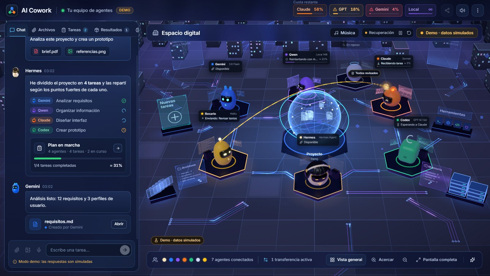<br><b>Órbita</b> : verre dépoli</td>
    <td align="center">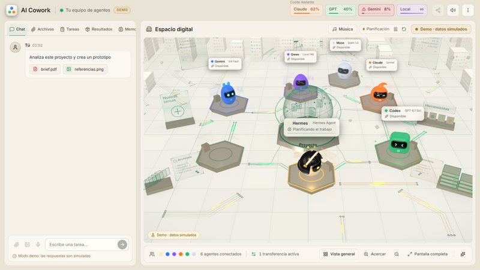<br><b>Marfil</b> : clair et chaleureux</td>
    <td align="center">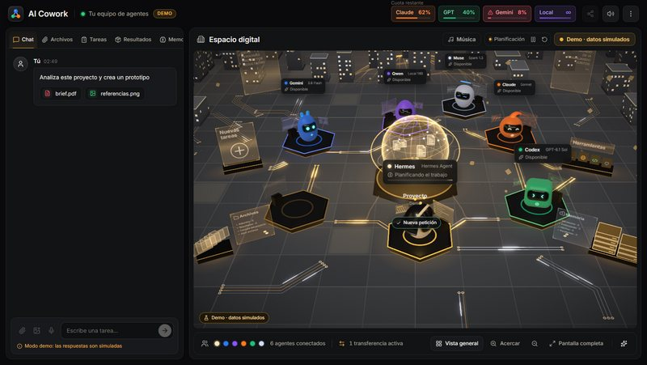<br><b>Grafito</b> : noir et or</td>
  </tr>
  <tr>
    <td align="center">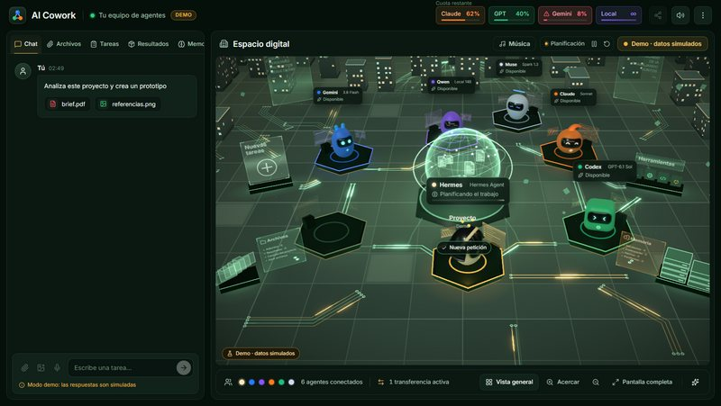<br><b>Bosque</b> : vert profond et or</td>
    <td align="center">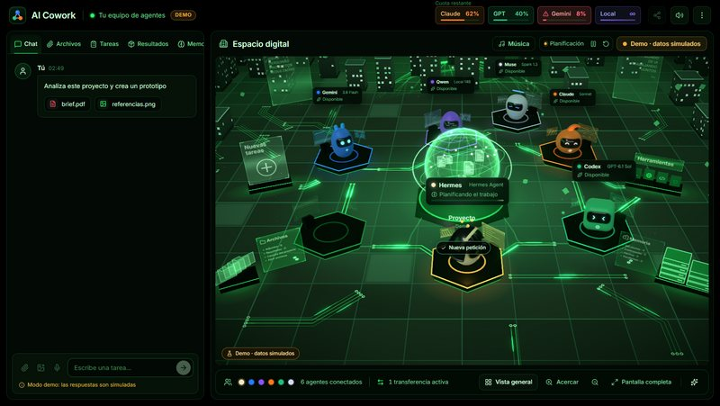<br><b>Matrix</b> : noir et vert néon</td>
    <td align="center">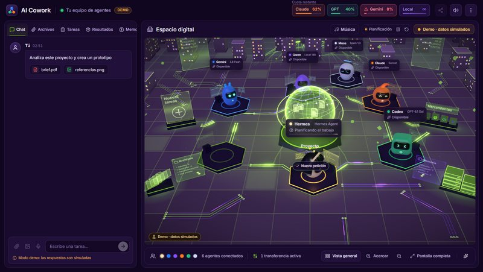<br><b>EVA-01</b> : violet et vert citron</td>
  </tr>
</table>

Et quatre qui décorent le monde, remodèlent son noyau et, pour les thèmes festifs, habillent les robots :

<table>
  <tr>
    <td align="center">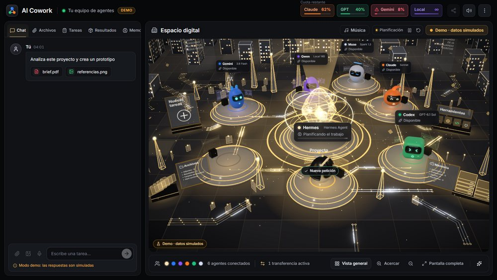<br><b>Relicario</b> : un noyau en cristal taillé et des plateformes de verre et d'or</td>
    <td align="center">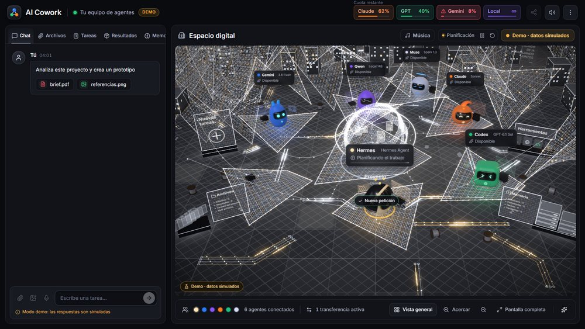<br><b>Telar</b> : des membranes de fils d'argent aux étincelles dorées</td>
  </tr>
  <tr>
    <td align="center">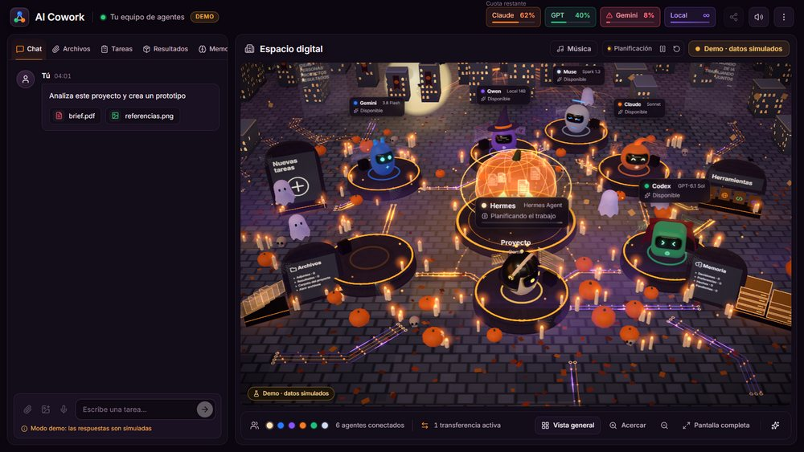<br><b>Halloween</b> : citrouilles, bougies, lune, chauves-souris, une sorcière et un vampire</td>
    <td align="center">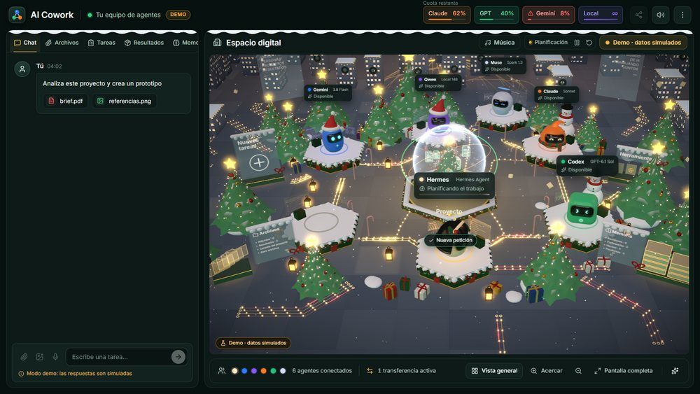<br><b>Navidad</b> : neige, sapins, cadeaux, une boule à neige et des bonnets de père Noël</td>
  </tr>
</table>

## 📥 Installation

### Prérequis

- **Windows 10/11 ou macOS** (Apple silicon ou Intel).
- **Node.js** `^22.22.2 || ^24.15.0 || >=26.0.0`. L'assistant l'installe s'il est absent.
- Au moins un agent : n'importe lequel du catalogue (Claude Code, Codex CLI, Gemini CLI, DeepSeek, Qwen Code, Copilot…), un modèle local ou n'importe quel agent en ligne de commande. **Hermes Agent** coordonne par défaut, mais n'importe quel agent peut le faire.
- Facultatif : **LM Studio** ou **Ollama** pour l'agent local, **git** pour Annuler, et **Tailscale** pour l'utiliser depuis d'autres appareils.

> **Remarque :** l'interface de l'application est pour l'instant en espagnol. Les noms des menus sont traduits dans ce README.

### Windows

```bash
npm install
npm run dist:win
```

Cela crée `release/AI-Cowork-Setup-<version>.exe`. L'installateur vous laisse choisir le dossier et crée les raccourcis. Comme il n'est pas signé numériquement, Windows peut afficher un avertissement : « Informations complémentaires » → « Exécuter quand même ».

### macOS

```bash
npm run fuente
```

Cela crée `release/AI-Cowork-fuente.zip`. Sur le Mac, décompressez-le et exécutez ceci dans le dossier :

```bash
bash scripts/instalar-mac.sh
```

Le script compile l'application pour ce Mac, la copie dans `/Applications` (ou à l'emplacement de votre choix) et l'ouvre.

### Premier lancement

L'**assistant de configuration** s'ouvre au premier lancement (il est aussi accessible via ⋮ → « Configurer les agents… ») :

1. Choisissez les agents à utiliser.
2. Il vérifie leurs programmes et installe ceux qui manquent avec leurs installateurs officiels.
3. Il ouvre la page de connexion officielle de chaque agent. AI Cowork ne voit ni ne stocke jamais de mots de passe.
4. Il récapitule ce qui reste à faire.

Pour l'utiliser depuis votre téléphone ou votre ordinateur portable, ouvrez ⋮ → « Accès depuis d'autres appareils… ».

## 🔐 Confidentialité et sécurité

- **Sur votre ordinateur.** Les projets, la mémoire, les journaux et la consommation sont stockés dans votre dossier de données utilisateur (`%APPDATA%\AI Cowork` sous Windows, `~/Library/Application Support/AI Cowork` sous macOS).
- **Accès à distance fermé.** Le serveur n'écoute que sur votre IP Tailscale et sur `127.0.0.1`, jamais sur le réseau local ni sur Internet, et demande un code à chaque requête. Chaque appareil appairé a sa propre clé, que vous pouvez révoquer individuellement (elle expire aussi après 90 jours sans utilisation), ou vous pouvez toutes les révoquer d'un coup avec un nouveau code. Les codes d'appairage expirent au bout de 10 minutes et n'autorisent que quelques tentatives.
- **Mises à jour des clients signées.** Les clients de bureau n'installent que des mises à jour signées avec votre propre clé privée, qui ne quitte jamais l'ordinateur qui les publie.
- **Aucun mot de passe.** Chaque agent utilise la connexion propre à son programme officiel. Les clés d'API que vous ajoutez sont chiffrées avec le trousseau du système.
- **Les agents restent dans leur dossier.** On leur demande de travailler uniquement dans le dossier du projet. Avec « Accès complet » désactivé, c'est le seul dossier qu'ils peuvent modifier.
- **Voix locale.** La dictée utilise Whisper sur votre propre ordinateur, et l'audio est supprimé ensuite.

## 🛠️ Développement

```bash
npm install
npm run dev        # application de bureau en mode développement
npm run web        # uniquement l'interface dans le navigateur (http://localhost:5199), en mode démo
npm run typecheck  # types
npx vitest run     # tests
```

**Stack :** Electron, React 19, TypeScript et Three.js (react-three-fiber) sur le bureau ; Kotlin, Jetpack Compose et OpenGL ES dans Órbita.

```
src/
  shared/      contract between the engine and the interface (types, defaults)
  main/        engine: window, CLIs, planning, tasks, quotas, projects, web and mobile server
  preload/     secure window.cowork bridge
  renderer/    interface: chat, panels and the 3D digital space
android/       Órbita, the Android app
docs/          manual, model guide and mobile API
```

## 📚 Documentation

La documentation détaillée est en espagnol :

- **[Manuel](docs/MANUAL.md)** : chaque fonctionnalité en détail.
- **[Guide des modèles](docs/GUIA-MODELOS.md)** : le modèle et l'effort qu'utilise chaque agent selon la difficulté, avec les sources.
- **[Órbita](android/README.md)** : l'application Android, et comment la compiler et la publier.
- **[API mobile](docs/mobile-api/README.md)** : le contrat entre le serveur et Órbita.

<div align="center">
<br>
<sub>Créé par toute une équipe d'agents IA, coordonnée par Hermes.</sub>
</div>
