<div align="center">

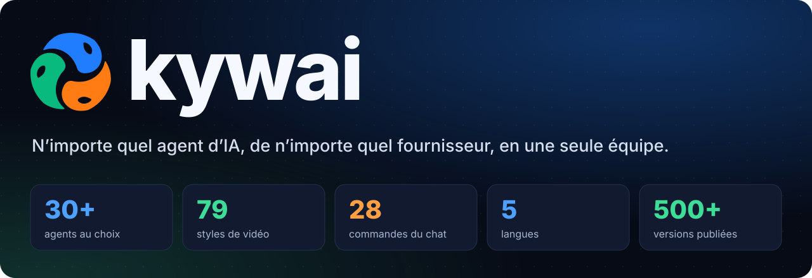

<sub>Se prononce « ki-waï ». Anciennement <i>AI Cowork</i>.</sub>

Une seule demande suffit. Un coordinateur planifie le travail et confie chaque tâche à l'agent le plus compétent : Claude, Codex, Gemini, DeepSeek, Qwen, Copilot, Cursor, un modèle local ou n'importe quel agent en ligne de commande que vous ajoutez. Vous regardez chaque robot travailler dans un monde 3D en direct, puis les résultats vous reviennent, déjà vérifiés.

[English](README.md) · [Español](README.es.md) · [Português](README.pt-BR.md) · **Français** · [简体中文](README.zh-CN.md) · 🌐 [kywai.app](https://kywai.app)

[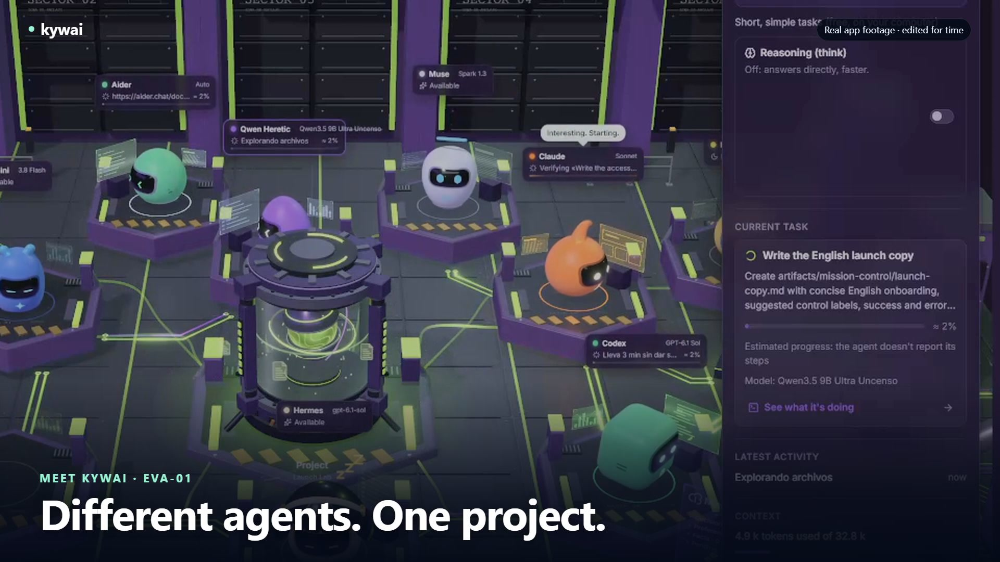](https://kywai.app/fr/#video)

**[▶ Découvrez kywai en action — 30 secondes](https://kywai.app/fr/#video)** · [Télécharger le MP4](docs/video/kywai-promo-30s.mp4)
Capture réelle de l’application, musique originale et textes en anglais.

[](https://kywai.app)

**[⚡ Installez-la en une seule commande](#-installation)**


[](https://ko-fi.com/yilsander)

<br>

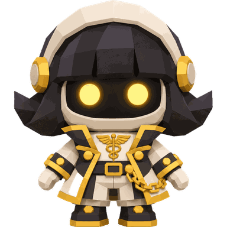
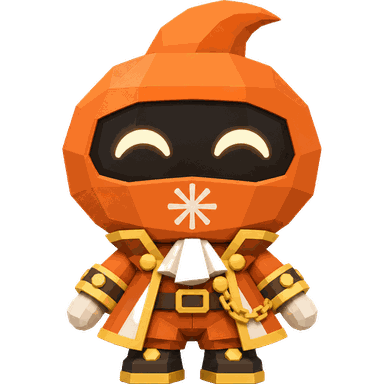
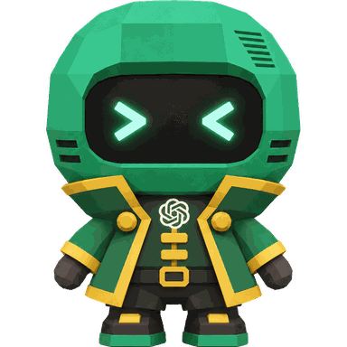
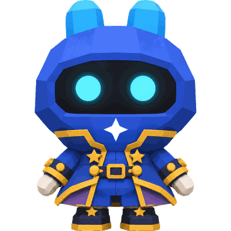
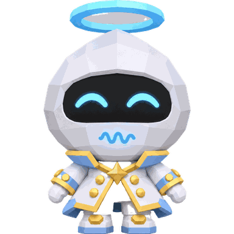
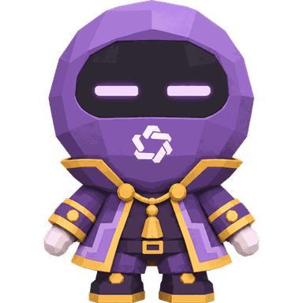
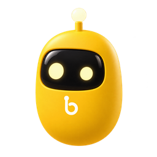

[Ce que c'est](#-ce-que-cest) · [Nouveautés](#-nouveautés) · [Tout agent](#-tout-agent-tout-fournisseur) · [Pourquoi](#-pourquoi-kywai) · [Fonctionnement](#-comment-ça-marche) · [Fonctionnalités](#-fonctionnalités) · [Extensions](#-extensions--mcp-skills-plugins-et-mods) · [Partout](#-utilisez-le-de-partout) · [Thèmes](#-thèmes) · [Installation](#-installation) · [Confidentialité](#-confidentialité-et-sécurité) · [Soutenir](#-soutenez-le-projet) · [Journal des modifications](CHANGELOG.md)

</div>

<br>

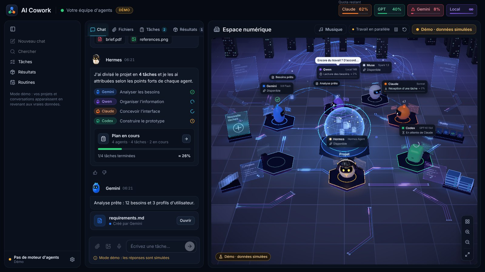

## ✨ Ce que c'est

kywai transforme les agents et abonnements IA que vous avez déjà, quel que soit leur fournisseur, en **une seule équipe qui travaille ensemble**. Au lieu de passer d'une application à l'autre en recopiant le contexte, vous faites une seule demande :

1. **🧭 Hermes, le coordinateur,** comprend ce que vous voulez et propose un plan : quelles sont les tâches, quel agent se charge de chacune et pourquoi.
2. **✅ Vous l'approuvez,** ou vous lui dites simplement ce qu'il faut changer.
3. **⚙️ Les agents travaillent,** en parallèle quand c'est utile, dans le dossier de votre projet, chacun avec son propre programme et votre propre connexion ou clé d'API.
4. **🔍 Un autre agent vérifie le résultat** avant qu'il ne vous parvienne, et l'auteur corrige ce qui a été relevé.
5. **📦 Vous recevez les livrables** dans le chat, regroupés et prêts à ouvrir, avec un résumé de ce qui a été fait et de ce que cela a coûté.

L'objectif est simple : **lancer une tâche et revenir à un résultat, jamais à une erreur sans rien à montrer.**

## 🆕 Nouveautés

Les derniers ajouts à kywai (la liste complète, jour par jour et version par version, est dans le **[journal des modifications](CHANGELOG.md)**, en espagnol) :

- **🌐 Un navigateur pour les agents.** Vous vous connectez à vos comptes dans un navigateur intégré à kywai et Claude, Codex, Gemini ou Hermes lisent et parcourent ces pages pour vous, sans jamais voir vos mots de passe. Cliquer ou écrire demande toujours votre permission.
- **📋 Tableau des tâches.** Déposez des tâches dans « À faire » et l’équipe les prend seule, l’une après l’autre.
- **🧑‍⚖️ `/consejo` et `/radar`.** La même question à plusieurs agents à la fois avec une réponse qui réunit le meilleur, et les sujets qui montent en ce moment dans votre niche, avec des titres et une vidéo prête à faire.
- **🤖 Personnages.** Les agents sont des personnages 3D animés, avec quatre apparences au choix : Personnages, Classique, Refuge Kywai et Pixel.
- **💬 Deux chats à la fois,** des conversations qui travaillent en parallèle et des copies d’un même agent (« Claude 2 ») pour en faire plus en même temps.
- **❓ Questions à choix.** Quand un agent hésite, il vous demande avec des boutons, une option recommandée et un champ pour votre propre réponse.
- **🎬 Un studio vidéo plus riche :** 79 styles, « Discussion et tutoriel » avec des robots sur un plateau 3D, voix avec émotion, `/editar`, `/recortes`, `/demo`, `/miniatura`, `/doblar` et `/sprite`.
- **🌙 Mode nuit** avec une vraie lumière dans tous les thèmes, ou « Auto » selon l’heure, et le thème **Bureau** pour le travail.
- **⚡ Plus léger.** La 3D tourne à 30 images par seconde et descend à 10 quand rien ne se passe.

## 🎬 Ce que vous pouvez demander

Quelques exemples réels de ce que fait l’équipe pendant que vous faites autre chose :

| Vous écrivez | Ce qui se passe |
|---|---|
| « Fais-moi une page d’accueil pour ma boulangerie » | Claude la conçoit et la construit, un autre agent l’ouvre dans un navigateur et vérifie captures et tests, et vous recevez les fichiers prêts à publier. Ajoutez « deux options » et un troisième choisit la meilleure. |
| « Trouve pourquoi la connexion échoue et corrige-la » | Codex reproduit le bug, le corrige et lance les tests ; un relecteur d’une autre famille le confirme. Si quelque chose casse, Annuler remet vos fichiers exactement comme avant. |
| « Résume ces 300 PDF et compare-les » | Gemini lit énormément de documents d’un coup et rend un rapport avec l’essentiel et un tableau. Glissez les fichiers dans le chat, même depuis le téléphone. |
| « Crée l’image de couverture de mon article » | L’image est générée avec l’outil d’images de Codex (pas dessinée avec du code) et apparaît dans le chat en miniature à ouvrir, télécharger ou faire modifier. |
| « Chaque matin à 9 h, relis les nouvelles PR » | Une routine la lance chaque jour sur votre ordinateur toujours allumé. Vous lisez le résultat sur votre téléphone, et « On a besoin de vous » ne sonne que si une décision vous attend. |
| « Fais une vidéo verticale pour TikTok sur la naissance d’une étoile » | Un agent écrit le script et kywai fait le reste : voix, images, musique, bruitages et montage. Vous ne recevez que le MP4, lu dans le chat, et `/tiktok` ou `/instagram` le publient. |
| « Documente dans un PDF les étapes de mon workflow GoHighLevel » | Vous vous connectez une fois dans le navigateur de kywai. Un agent parcourt les écrans, fait des captures et vous laisse le PDF, sans voir votre mot de passe. |
| « /consejo Quelle base de données pour cette app ? » | La question part vers plusieurs agents à la fois, chacun répond de son côté, et un autre réunit le meilleur et vous dit où ils sont d’accord ou non. |
| Laisser cinq tâches sur le Tableau avant de dormir | L’équipe les prend l’une après l’autre, chacune avec sa vérification, et le matin elles sont dans « Fait ». |
| « @Qwen écris-moi cinq titres » | Les petites choses vont directement à l’agent nommé, sans plan ni relecture. Avec un modèle local, c’est gratuit et rien ne quitte votre ordinateur. |

## 🔌 Tout agent, tout fournisseur

kywai n'est pas lié à un ensemble figé de modèles. C'est une plateforme où **vous composez votre propre équipe** :

- **Ajoutez autant d'agents que vous voulez** via ⚙ → « Configurer les agents… » → « Ajouter un agent ». Le catalogue sait déjà en lancer plus de 30, avec le compte ou l'abonnement que chacun utilise : Claude Code, Codex CLI, Gemini CLI, Antigravity CLI, Muse Code, Aider, DeepSeek, Qwen Code, Kimi Code, MiniMax Code, Mistral Vibe, Grok Build, GitHub Copilot CLI, Cursor, Amp, Goose, OpenCode, Cline, Continue, OpenHands, Factory Droid, Auggie, Junie, Kiro, Rovo Dev, Qoder CLI, Crush, Open Interpreter, gptme, Letta Code, ForgeCode, OpenClaw et d'autres encore.
- **Trouvez des options gratuites.** Le filtre « Gratuits uniquement » du catalogue met en avant les agents avec des options gratuites, dont Kilo CLI avec Kilo Auto Free. Chaque fiche précise les exigences et limites du fournisseur. Aider est livré avec le modèle gratuit Nemotron 3 Ultra d’OpenRouter.
- **Ou connectez n'importe quel autre programme** avec « Autre programme… » : indiquez sa commande, la façon dont il reçoit la tâche (stdin, un fichier ou un argument) et ses arguments, et il rejoint l'équipe.
- **Abonnements ou clés d'API.** Les agents s'exécutent avec la connexion que vous avez déjà dans leur propre programme. Ceux qui utilisent une clé d'API (DeepSeek, Kiro, Junie, Factory Droid, Amp…) vous la demandent une seule fois ; elle est chiffrée avec le trousseau du système et transmise uniquement à cet agent.
- **Les modèles locaux aussi.** N'importe quel modèle que vous faites tourner dans LM Studio ou Ollama, gratuitement et sans quitter votre ordinateur.
- **L'agent local se débrouille seul.** Il allume LM Studio tout seul quand il en a besoin, et l'interrupteur « Raisonnement (think) » de sa carte laisse le modèle réfléchir avant de répondre seulement quand vous le voulez (éteint par défaut, pour des réponses bien plus rapides). En plus de LM Studio et Ollama, il prend en charge **Colibri** pour les grands modèles à mélange d’experts, et l’indicateur Local a un bouton **Installer** pour chacun.
- **C'est vous qui choisissez qui coordonne.** Hermes est le coordinateur par défaut, mais n'importe quel agent peut planifier et attribuer les tâches (« Nommer coordinateur »). S'il n'est pas disponible, le suivant prend le relais.
- **Chaque agent est un membre à part entière de l'équipe,** avec son propre robot et son poste dans le monde 3D, ses statistiques de performance et les mêmes plans, relectures et annulations que les autres.

## 💡 Pourquoi kywai

<table>
<tr>
<td width="50%" valign="top">

**💳 Les agents que vous payez déjà**<br>
Il pilote le programme propre à chaque agent avec votre session, et consomme donc le quota de vos forfaits plutôt que des coûts d'API supplémentaires ; les clés d'API et les modèles locaux gratuits fonctionnent aussi. L'en-tête affiche le **quota restant réel** de Claude et de GPT.

</td>
<td width="50%" valign="top">

**🎯 Chaque tâche à l'agent le plus compétent**<br>
Le coordinateur connaît les points forts, les modèles, le quota et l'historique de chaque agent. Le travail facile va à un *stagiaire* (le même agent, avec moins d'effort), le travail normal au modèle principal et le travail difficile au plus puissant.

</td>
</tr>
<tr>
<td valign="top">

**🏆 La qualité d'abord, par défaut**<br>
Chaque tâche a un critère d'acceptation. Un agent d'une autre famille relit chaque modification, lance lui-même les tests et seul un *validé* explicite l'accepte. Pour le travail qui relève du goût (un site web, un logo, une présentation), vous pouvez demander deux versions et un troisième agent désigne la gagnante.

</td>
<td valign="top">

**🛟 Conçu pour ne jamais vous laisser les mains vides**<br>
Si un agent ne peut pas terminer, un autre agent puissant prend le relais. Le travail interrompu reprend là où il s'était arrêté, un agent bloqué redémarre d'un seul bouton, et chaque modification peut être annulée.

</td>
</tr>
<tr>
<td valign="top">

**👀 Totalement transparent**<br>
Chaque agent vous dit en quelques mots ce qu'il est en train de faire. Une vue pas à pas en direct montre chaque commande avec sa sortie, chaque fichier lu ou modifié (avec le diff) et chaque recherche.

</td>
<td valign="top">

**🔒 Privé dès la conception**<br>
Tout s'exécute sur votre ordinateur. L'accès à distance passe uniquement par votre propre réseau Tailscale, la dictée vocale fonctionne en local, et kywai ne voit ni ne stocke jamais de mots de passe.

</td>
</tr>
</table>

## 🧠 Comment ça marche

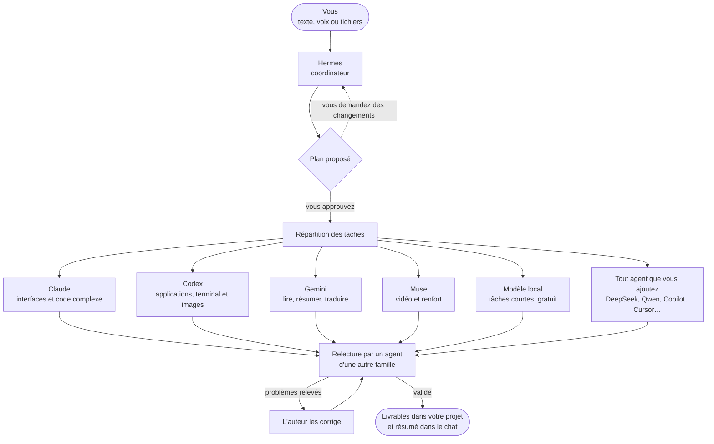

### L'équipe par défaut

Voici l'équipe dont vous disposez dès l'installation. Vous pouvez retirer n'importe lequel de ses membres et en ajouter autant d'autres que vous le souhaitez.

| | Agent | Fonctionne avec | Excelle en |
|---|---|---|---|
|  | **Hermes** | Hermes Agent | Coordination : comprend la demande, planifie et attribue. Il n'exécute jamais de tâches lui-même. S'il n'est pas disponible, c'est Claude qui planifie. |
|  | **Claude** | Claude Code (votre abonnement Claude) | Interfaces et design, rédaction, code volumineux ou complexe. |
|  | **Codex** | Codex CLI (votre compte ChatGPT) | Applications et scripts de bout en bout, terminal, serveurs et données. C'est lui qui génère les images. |
|  | **Gemini** | Gemini CLI | Lire et résumer d'énormes quantités de documents (contexte d'un million de tokens), traductions et rapports rapides. |
|  | **Muse** | Muse Code (votre abonnement Meta) | Comprendre la vidéo. Renfort quand les autres ont épuisé leur quota. |
|  | **Local** | LM Studio ou Ollama | Tâches courtes et simples, gratuitement et sans quitter votre ordinateur. Avec LM Studio, il peut aussi lire, créer et modifier des fichiers. |

Tout agent que vous ajoutez depuis le catalogue ou avec « Autre programme… » fonctionne exactement comme ceux-ci : le coordinateur le connaît, lui attribue des tâches, et il apparaît dans le monde 3D. Voir [Tout agent, tout fournisseur](#-tout-agent-tout-fournisseur).

## 🚀 Fonctionnalités

### 🗺️ Planification et travail

- **Des plans que vous approuvez.** Rien ne démarre sans votre accord, et vous pouvez modifier le plan d'une simple phrase (« laisse Codex s'en charger », « saute la recherche »). Approuvez d'un geste ou simplement en répondant « oui ». Si vous préférez, désactivez l'approbation et laissez l'équipe se mettre directement au travail.
- **Plusieurs demandes à la fois.** Le nouveau travail va aux agents libres, sans toucher aux fichiers qu'un autre agent est en train de modifier.
- **Plus rapide, sans baisser la barre.** Un agent commence sa tâche suivante pendant que la précédente est relue, Hermes lance en même temps les tâches indépendantes, tests et captures tournent en parallèle et, entre relecteurs aussi fiables, le nettement plus rapide est choisi. Les agents en mauvaise passe ne reçoivent plus que des tâches faciles.
- **Pas de travail en double.** Hermes ne relance pas une tâche déjà en cours, et le chat vous prévient si une nouvelle demande ressemble à une demande en cours.
- **Parlez directement à un agent.** Placez `@Claude` n’importe où dans le message (au début, au milieu ou à la fin) et le texte part tel quel vers cet agent, sans plan, relecture ni résumé d’Hermes. Taper `@` affiche tous les agents avec leur modèle, et `/` liste toutes les commandes avec ce qu’elles font, sur le bureau, dans le navigateur et dans Órbita.
- **Critères d'acceptation par tâche**, et un avertissement si un agent touche à des fichiers qui ne le concernent pas.
- **Réparti comme une vraie équipe.** Les gros travaux aux parties séparables (moteur, interface, serveur…) sont répartis en parallèle entre les meilleurs agents, avec un contrat commun écrit par le coordinateur (quels fichiers sont à qui et comment les parties communiquent), et une tâche finale « Intégrer et tester » qui lance les tests et vérifie l’ensemble par rapport à la demande.
- **Des images générées, pas dessinées.** Demandez une illustration, une affiche, un logo ou une icône et elle va à l’agent qui a un outil d’images, qui la génère au lieu de la dessiner lentement en SVG ou en scripts. Pour quelque chose d’exact ou de modifiable, dites-le et ce sera fait en code.
- **Deux mains pour le travail qui relève du goût, si vous le demandez.** Deux agents de familles différentes réalisent la même chose séparément (option A et option B), puis un troisième teste les deux, les compare à votre demande et vous dit laquelle l'emporte et pourquoi.
- **Relecture stricte, avec de vrais tests.** Quand une tâche modifie des fichiers, un agent d'une autre famille la vérifie en lecture seule, lance lui-même les tests et répond *validé* ou *problèmes* ; seul un *validé* explicite l'accepte. Sans verdict, un autre relecteur fiable est sollicité. Chaque tâche a droit à deux corrections et un relais vers un autre agent solide ; si elle échoue encore, elle apparaît dans « On a besoin de vous » comme nécessitant votre intervention.
- **Reprise et relais.** Les tâches interrompues reprennent là où elles s'étaient arrêtées. Si un agent échoue, un autre agent puissant reprend la tâche, jamais un plus faible. Les agents reprennent aussi leur propre session lors des demandes de suivi.
- **Les permissions des agents, à votre façon.** Accès complet (installer et utiliser internet sans demander), seulement le dossier du projet, ou **« Me demander avant »** : les agents demandent dans le chat avec **Refuser / Autoriser une fois / Autoriser pour cette session**, comme Claude Code, au lieu de rester bloqués.
- **Bloquée n’est pas une erreur.** Si un agent s’arrête parce qu’il lui manque quelque chose (une clé, une décision, un fichier), vous recevez ce qu’il a déjà fait et décidez dans « On a besoin de vous » : l’accepter, lui répondre ou le confier à un autre agent.
- **Tableau des tâches.** Un Kanban par projet avec « À faire », « En cours », « Vous attend » et « Fait ». Déposez des tâches dans « À faire » et l’équipe les prend seule, l’une après l’autre ; vide, il montre des exemples à cliquer.
- **Plus de bras avec le même agent.** Dans ⚙ → Réglages → Agents, vous choisissez combien de tâches chaque agent mène à la fois : kywai ouvre des copies (« Claude 2 », « Claude 3 ») qui travaillent en parallèle avec leur propre session.
- **Questions à choix.** Quand un agent doit trancher, il demande avec des boutons, marque l’option recommandée, accepte plusieurs choix et laisse un champ pour écrire le vôtre.
- **Répondre à un agent.** Sous chaque réponse, un bouton « Répondre » lui demande de la revoir ou de la poursuivre, avec le message cité.
- **Conseil d’agents (`/consejo`).** La même question à plusieurs agents à la fois ; un autre réunit le meilleur et vous dit où ils sont d’accord ou non.
- **Radar de sujets (`/radar`).** Ce qui monte en ce moment sur YouTube et le web pour votre niche, noté, avec cinq titres, trois angles et sa `/video` prête.
- **Le navigateur de kywai.** Un vrai navigateur dans l’app, avec sa propre session, où vous vous connectez à vos comptes (un CRM, le tableau de bord de votre site, GoHighLevel…). Les agents peuvent lire, faire des captures et naviguer sans demander ; cliquer, écrire ou appuyer sur des touches demande toujours votre permission, et ils ne lisent jamais mots de passe, codes ni cartes. Vous suivez en direct avec un bouton « Arrêter », aussi depuis le client ou le web.
- **Réponses rapides aux questions rapides.** Hermes répond lui-même aux choses simples, sans plan ni répartition, et les questions qui demandent seulement de regarder le projet reviennent tout de suite. Ce qui modifie des fichiers garde son plan et sa relecture complets.

### 📡 Suivre le travail

- **De courtes mises à jour en direct** de chaque agent pendant qu'il travaille, avec ses outils regroupés sur une seule ligne dépliable, comme dans l'application Claude.
- **Vue pas à pas en direct** de n'importe quelle tâche : raisonnement, chaque commande et sa sortie, fichiers lus et modifiés avec leurs changements, recherches et réponse finale. Conservée pendant 30 jours.
- **Une progression visible.** Les nouvelles captures d'écran et images apparaissent en miniatures dans le chat, et les documents sous forme de cartes, pendant que la tâche est encore en cours.
- **Des réponses, pas seulement des ✓.** À la fin d’une demande, le coordinateur lit les vrais résultats et écrit ce qui a été fait et où, comment l’essayer, ce qui a été décidé et ce qui reste. Sous chaque plan, vous voyez son temps, ses tokens et le quota utilisé (« 14 min · 339 k tokens · Claude 5 h +5 % »).
- **Chaque tâche dans son bloc.** Dans le chat, chaque tâche a son numéro, ses vraies étapes (travail, correction, tests, relecture) et la relecture signée par l'agent qui l'a faite. Dès l'envoi, une ligne indique qu'Hermes prépare le plan, et si un agent se tait vous voyez « rien de neuf depuis N min » au lieu d'une fausse barre de progression.
- **Aperçu des fichiers à côté du chat.** Cliquez sur une pièce jointe, un livrable ou un nom de fichier et il s'ouvre dans un panneau latéral, comme dans Claude : documents, code, images et PDF, avec des miniatures des images jointes. Órbita a le même lecteur avec ‹ ›, vue du code, copier et « Ouvrir avec une autre app ».
- **Une alerte qu’on ne rate pas.** Quand quelque chose vous attend, la cloche palpite avec sa propre sonnerie et le coordinateur vous appelle depuis l’espace 3D ; un clic ouvre exactement ce qui a besoin de vous.
- **Cloche « On a besoin de vous »** uniquement pour ce qui vous attend vraiment (un plan, une question, une autorisation, un agent silencieux ou une tâche en pause avec Reprendre / Retirer), avec ses boutons et des notifications sur votre téléphone. Le travail terminé va dans Résultats comme « Tout juste terminé ».
- **Espace numérique 3D** qui montre chaque état : au travail, en relecture, en attente de la relecture d'un autre agent, en délégation à un stagiaire, à court de quota ou en échec, avec des fichiers qui circulent entre les robots et une étincelle à chaque vraie étape d'un agent. Les agents forment un polygone régulier autour du Projet (triangle à trois, carré à quatre…), les stagiaires en plus alignés derrière le premier.
- **Une équipe pleine de vie.** Les robots libres se lancent un document jouet ou une balle colorée, se rendent visite et réveillent un collègue endormi en lui faisant gentiment peur. Ils réagissent, sourient et retournent à leur poste dès que le travail réel les réclame ; réduire les effets désactive ces animations locales. Ils dansent aussi ensemble, jouent à s’imiter, se saluent en entrechoquant leurs antennes et encouragent un collègue fatigué. Quand la musique joue, les robots libres restent éveillés et dansent au rythme du lecteur ou de la musique d’ambiance ; leur étiquette indique « Danse ».
- **Des personnages à votre goût.** Dans ⚙ → Réglages → Agents → « Apparence des agents », vous choisissez leur look : **Personnages** (figurines 3D animées de chaque agent), **Classique** (les robots d’origine), **Refuge Kywai** ou **Pixel**. L’icône du chat change avec eux.
- **Des robots qui ont du caractère.** Leurs yeux montrent ce que chacun fait vraiment (concentré, en réflexion, fatigué, endormi, en erreur, terminé), chacun a sa personnalité et ses bulles dans votre langue, et quand vous écrivez dans le chat ils se réveillent et se tournent vers vous.

<p align="center">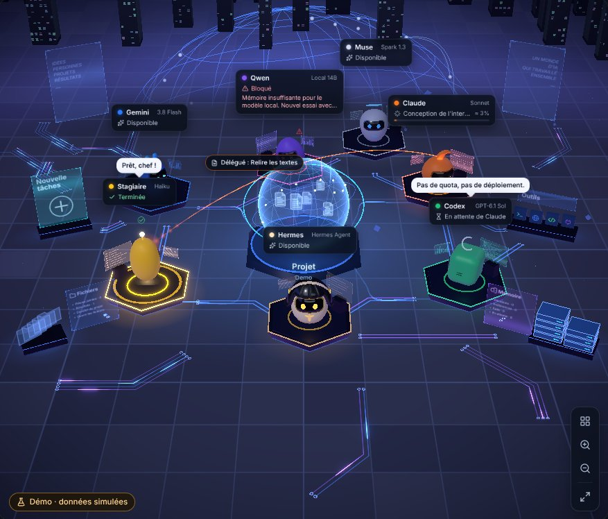</p>

### ↩️ Contrôle et filet de sécurité

- **Modifications par tâche, avec Annuler.** Un instantané est pris avant et après chaque tâche, dans un stockage séparé, jamais dans le `.git` de votre projet. Consultez « N fichiers modifiés +a −b », examinez le diff et annulez une seule tâche. Si des tâches se chevauchent, le résultat est conservé dans une copie séparée.
- **Redémarrez un agent en échec** depuis son panneau : il lève le blocage (quota, session, erreur d'API), revérifie sa CLI et reprend tout ce qui l'attendait.
- **Notez n'importe quel résultat** 👍 / 👎. Les notes alimentent le coordinateur, qui apprend ainsi qui livre vraiment.
- **Panneau « Performances de chaque agent »** : tâches, 👍, relectures validées du premier coup, corrections, temps et coût par agent, par difficulté et par type de tâche (visuel, web, code, texte, recherche). Le coordinateur s’en sert pour répartir le travail : il apprend qui assure vraiment.

### 🧩 Contexte et automatisation

- **Importez votre travail existant.** Importez les sessions locales de Claude Code, Codex et Hermes (dont Hermes Desktop) ou les archives JSON/ZIP de ChatGPT et Claude.ai depuis ⚙ → Importer depuis d’autres applications. Conservez vos conversations, récupérez les projets et documents Claude inclus et poursuivez avec votre équipe. Les originaux sont conservés ; les sessions locales sont lues sur le serveur. Les chats Claude.ai sont rangés dans leur propre projet, et réimporter ne crée jamais de doublons.
- **Des conversations comme dans Claude.** Une barre latérale avec vos projets, ceux épinglés et les discussions récentes. Elle se replie en une colonne d'icônes, un autre clic sur le projet ouvert le replie et le clic droit (appui long dans Órbita) permet d'épingler, renommer, dupliquer, déplacer ou supprimer. « Nouveau chat » démarre une nouvelle conversation sans perdre la précédente, et chacune peut être reprise plus tard avec ses tâches et la session de chaque agent. Ctrl+K cherche dans les conversations, tâches, résultats et la mémoire de tous les projets.
- **Recherche et historique.** Ctrl+K cherche à la fois dans toutes les conversations, tâches, résultats et notes de mémoire, avec phrase exacte (« … ») et filtres par date et auteur, et ouvre le chat directement sur le message trouvé, surligné. La fenêtre Historique regroupe toutes les conversations de tous les projets par Aujourd’hui, Hier, 7 et 30 derniers jours et par mois. Aussi dans Órbita.
- **Plusieurs conversations à la fois.** Changez de chat ou commencez-en un autre pendant que l’équipe travaille : chaque conversation continue de son côté. Faites glisser un chat vers la droite de la fenêtre pour avoir **deux chats côte à côte**, ou ouvrez-le dans sa propre fenêtre avec la molette.
- **Une barre latérale à votre mesure.** Faites glisser chats et projets pour les ranger ou les mettre en **Favoris**, élargissez la barre en tirant son bord et filtrez les projets ; chaque projet affiche ses trois chats les plus récents et « Voir les X restants ».
- **Un menu sur chaque message.** Clic droit (ou appui long dans Órbita) pour copier, répondre, créer une branche de la conversation à partir de là ou modifier votre message dans une nouvelle branche. Le crayon modifie vos messages.
- **Des fichiers faciles à trouver.** Dans Fichiers et Résultats, filtrez par type (Photos, Vidéos, Audio, Documents, Code et Autres), voyez les miniatures des photos et vidéos, et les dossiers sont repliés par demande.
- **Mémoire du projet** avec instructions, décisions, préférences et tâches à faire, chacune avec son auteur et son statut. Chaque agent la lit à chaque tâche, même après que vous avez vidé le chat.
- **Ce que l’un apprend, tous le savent.** Quand un agent trouve comment faire quelque chose, il le garde comme compétence provisoire dans « Compétences apprises » et le reste de l’équipe la reçoit dans ses tâches. Chaque tâche laisse un résumé « Fait dans… » pour la suivante.
- **Un seul AGENTS.md pour toute l'équipe.** Chaque CLI ne lit que son propre fichier ; kywai transmet les autres, si bien qu'un seul `AGENTS.md` donne les mêmes règles à tous les agents.
- **Routines.** Programmez une demande une seule fois, à heure fixe, certains jours, toutes les N heures, par webhook GitHub signé ou lorsqu’un dossier change. Créez-les avec /rutina, consultez leur historique et choisissez si une approbation est requise. Les propositions du coordinateur ne sont enregistrées qu’après votre confirmation.
- **Modèles de tâches.** Des cartes au-dessus du chat pour relire des PR, résumer des dossiers, chercher des bugs ou créer vos demandes. Remplissez les champs, utilisez la commande /…, envoyez à l’équipe ou directement à un agent et transformez les modèles compatibles en routines.
- **Livrables téléchargeables.** Ouvrez ou téléchargez chaque fichier depuis le chat et Résultats, ou enregistrez un ensemble en ZIP. Sur ordinateur, client, navigateur et Órbita, y compris depuis votre téléphone. L’onglet Résultats les range dans **un dossier par tâche**, avec le fichier principal (vidéo, page, document) en tête et les fichiers de travail repliés.

### 🧰 Extensions : MCP, skills, plugins et mods

Dans **⚙ → Réglages → Extensions**, enrichissez les outils des agents et personnalisez kywai :

- **Serveurs MCP.** Cherchez dans le catalogue ou ajoutez une commande, un JSON ou une adresse. Choisissez les agents autorisés à utiliser chaque serveur : kywai vérifie sa réponse et liste ses outils avant de l’activer. Installez uv ou Node.js depuis sa fiche si nécessaire. Firecrawl, Perplexity et PostHog font partie des serveurs mis en avant.
- **Skills partagées.** Cherchez des compétences sur skills.sh ou installez-les depuis un dépôt ou un dossier GitHub. `SKILL.md` reste avec ses scripts et références, et toute l’équipe peut consulter ces compétences au besoin. Avant une tâche, Hermes peut proposer des skills de skills.sh qui aideraient, avec un bouton **Installer** (il n’installe jamais seul), et **`/aprende`** transforme une vidéo ou un lien en nouvelle skill pour toute l’équipe. Un interrupteur par projet, **« Code sobre (Ponytail) »**, demande moins de code aux agents.
- **Plugins.** Explorez les catalogues de plugins d’Anthropic ou ajoutez un catalogue ou plugin GitHub. kywai transforme les skills, commandes et profils de sous-agents en compétences partagées et importe les MCP désactivés : vous choisissez les agents qui y auront accès.
- **Mods.** Installez depuis GitHub ou un dossier local des extensions de kywai avec commandes /… du chat, hooks au début ou à la fin des travaux et panneaux personnalisés. Les hooks nécessitent votre permission ; les panneaux sont isolés sur ordinateur, web et Órbita.

**Compatibilité :** les MCP de l’utilisateur se connectent à Claude, Codex, Gemini et Hermes ; les agents incompatibles sont désactivés. Les serveurs distants qui demandent une autorisation nécessitent un jeton : OAuth et SSE ne sont pas encore pris en charge. Les plugins importent les composants compatibles ; leurs hooks et LSP ne s’exécutent pas comme dans Claude Code. Le MCP interne de kywai est actuellement proposé à Claude dans les tâches coordonnées.

Détails et exemple de mod dans le [manuel](docs/MANUAL.md#extensiones-tus-servidores-mcp-para-los-agentes) et [Notes rapides](docs/mods/notas-rapidas).

### 🎥 Studio vidéo

Tapez **`/video`** et le sujet (ou appuyez sur **« Créer une vidéo de ceci »** sous n’importe quelle réponse) et vous recevez **uniquement le MP4 terminé**, lu dans le chat. Pas de plan à approuver ni de fichiers en vrac. Tout se fait sur votre ordinateur.

- **Choisissez en quatre étapes :** type (texte animé, dessin animé avec présentateur, mixte, « Discussion et tutoriel » avec des robots sur un plateau 3D ou « Sketch d’humour »), personnage (aucun, les robots de kywai ou le vôtre, réutilisable), style et voix, chacun avec un aperçu. Puis écrivez le sujet. En vertical pour TikTok, Reels ou Shorts avec « vertical » ou « pour TikTok ».
- **79 styles de film** avec un exemple (aquarelle, Pixel RPG, dessin animé des années 30, ukiyo-e, papier découpé, pub d’app, dix styles maison et plus) et **9 rendus d’image par IA** à essayer sur votre propre scène avant de choisir. Joignez un reel ou vos images et il copie leur style.
- **Voix, musique et vrais sons.** Des voix naturelles à écouter avant (Kokoro, Edge, Gemini, Voicebox, Chatterbox avec de l’émotion dans chaque phrase et, pour comparer, ElevenLabs v3), des dialogues à deux voix, et la voix choisie fixe la langue de la vidéo. Une musique originale qui baisse quand la voix parle et de vrais bruitages (whoosh, pop, impacts) sous licence libre.
- **Des images qui bougent.** Images avec **ComfyUI** sur votre propre ordinateur, Gemini en secours, scènes 3D vivantes, animations de formules et de schémas avec **Manim**, et une accroche dans les deux premières secondes.
- **Montez et réutilisez vos images.** **`/editar`** nettoie votre enregistrement (tics de langage, silences, prises répétées) et ajoute des sous-titres ; **`/recortes`** tire les meilleurs moments d’une longue vidéo en clips verticaux ; **`/doblar`** double la dernière vidéo dans une autre langue ; **`/miniatura`** fait trois vignettes ; **`/demo`** transforme un site ou un dépôt en publicité, avec un robot présentateur si vous le demandez ; et **`/sprite`** dessine un personnage en pixel art pour votre jeu.
- **Séries et lots.** **`/serie`** crée des épisodes avec les mêmes personnages, chacun finissant sur une question A/B pour votre public ; « `/serie` suivant, B a gagné » continue. « Fais-moi 3 vidéos sur… » en crée plusieurs d’un coup, sous des angles différents.
- **Publiez quand vous voulez.** **`/instagram`** et **`/tiktok`** écrivent la légende et publient sur le compte que vous connectez, en brouillon ou directement, toujours après votre clic, avec une couverture accrocheuse. **`/ig-plan`**, **`/ig-viral`**, **`/ig-reel`** et compagnie gèrent le compte avec de vraies données, et **`/turno-noche`** cherche la nuit les reels qui marchent dans votre niche et vous laisse un nouveau reel d’essai le matin.
- **Il s’installe tout seul.** Le studio (HyperFrames, voix, banque de sons) s’installe en arrière-plan au premier démarrage de kywai.

### 📊 Quota et coût

- **Des quotas qui suivent votre équipe.** L’en-tête se met à jour lorsque vous ajoutez, retirez, activez ou désactivez des agents. Il affiche les données réelles de Claude et GPT et distingue les budgets ou estimations des autres fournisseurs et les modèles locaux.
- **Utilisation et coût.** Consultez durée et tokens par demande, coût par agent, abonnements, API, offres gratuites ou locales et comparez l’usage avec vos dépenses. Configurez les prix et une alerte de budget mensuel ; exportez en CSV. Les estimations sont signalées.
- **Modèle et effort selon la difficulté,** modèles interchangeables depuis le panneau de chaque robot, et `/model` pour changer le modèle de Hermes.

### 🎨 Confort

**Fonds marins** ajoute des bancs de poissons, des baleines, des méduses et une cité engloutie autour d’une perle lumineuse. Relicario, Telar, Halloween et Noël possèdent désormais des univers de sanctuaire, d’îles de cristal, d’abbaye gothique et de village enneigé, tout en conservant les choix existants.

**Refuge Kywai** ajoute un observatoire-serre face à la mer : dôme de bois et de verre, ciel et eau animés, ateliers individuels, arbre commun et siège turquoise. Activez le mode nuit à côté de Musique ; le choix est mémorisé par appareil.

- **Les nouveautés après la mise à jour.** Après chaque mise à jour, une fenêtre vous dit ce qui a changé (sur l’ordinateur, le web, le client et Órbita).
- **Le son, séparément.** « Musique de fond », « Effets et alertes » et « Voix des agents » ont chacun leur interrupteur.
- **Le chat d'abord.** Dans les petites fenêtres il prend plus de place, vous pouvez faire glisser son bord à la largeur voulue (double-clic pour revenir en automatique) et dans les fenêtres étroites le chat et le monde 3D deviennent deux onglets.
- **Une taille de texte à votre goût.** Ctrl + molette agrandit ou réduit le texte du chat, et le chat occupe toute la largeur disponible. Le JSON qu’un agent laisse en vrac s’affiche dans sa propre carte avec un bouton copier.
- **Un chat facile à lire,** avec des réponses sans cadre, plus d'espace entre les paragraphes et un bouton copier dans le coin de chaque bloc de code ou de commandes. Hermes et les agents écrivent court, le résultat d'abord.
- **Dictée vocale locale** avec Whisper sur votre propre ordinateur. Aucun service externe, et l'audio est supprimé ensuite.
- **Cartes, couleurs et décors.** Sept cartes 3D, la Cité numérique en sept couleurs et quatre décors. Suivez le thème du serveur ou choisissez-en un par appareil ; Órbita adapte sa palette sans reproduire les cartes de l’ordinateur. Le sélecteur de thèmes montre une vraie photo de chaque monde, quatre par ligne.
- **Voix des agents,** chacune avec son propre timbre, et un texte qui s'écrit au rythme de la voix, comme dans Animal Crossing.
- **Lecteur de musique** avec recherche YouTube Music, Audius, Spotifast et les radios SomaFM sans publicité (et votre compte YouTube pour Premium), file d’attente, et des lumières qui suivent le BPM du morceau sans microphone.
- **Assistant de configuration** qui installe les programmes manquants avec leurs installateurs officiels et ouvre chaque page de connexion officielle.
- **Mode démo** pour présenter l'application sans rien dépenser.
- **Léger pour votre ordinateur.** La 3D s’affiche à 30 images par seconde au plus et descend à 10 quand rien ne se passe ; vous pouvez la fermer complètement et afficher un indicateur de performance dans les Réglages. La qualité s’adapte seule à votre machine sans saccades, se met en pause quand la fenêtre est cachée et ralentit quand vous êtes dans une autre application, et « Réduire les effets » retire le superflu. L’équipe continue de travailler fenêtre fermée.

### ⌨️ Commandes du chat

| Commande | Ce qu'elle fait |
|---|---|
| `/model` | Voir et changer le modèle de Hermes |
| `/usage` | Consulter les quotas en temps réel |
| `/recuerda …` | Enregistrer quelque chose dans la mémoire du projet (`decisión:`, `pendiente:`, `preferencia:`) |
| `/rutina …` | Créer ou gérer une routine |
| `/new` | Démarrer une nouvelle conversation en gardant une copie de la précédente |
| `@Agent …` | Envoyer le texte tel quel à un agent, sans passer par Hermes (aussi `/directo Agent …`) |
| `/video …` | Créer une vidéo (ouvre le sélecteur en quatre étapes) |
| `/serie …` | Une série de vidéos en épisodes avec les mêmes personnages |
| `/aprende …` | Transformer une vidéo ou un lien en skill |
| `/editar` · `/recortes` | Nettoyer votre enregistrement ou tirer des clips verticaux d’une longue vidéo |
| `/demo` · `/miniatura` · `/doblar` | Une pub pour un site, trois vignettes ou la dernière vidéo dans une autre langue |
| `/sprite …` | Un personnage en pixel art pour votre jeu, animé en 4 ou 8 directions |
| `/radar …` | Les sujets qui montent dans votre niche, avec des titres et leur `/video` |
| `/consejo …` | La même question à plusieurs agents et une réponse qui réunit le meilleur |
| `/instagram` · `/tiktok` | Préparer et publier la dernière vidéo |
| `/ig-plan` · `/ig-viral` · `/ig-reel` · `/turno-noche` | Gérer Instagram : plan de la semaine, ce qui marche, scripts et un nouveau reel chaque nuit |

Tapez `/` dans la zone de chat pour voir toutes les commandes (y compris vos modèles et mods) avec ce qu’elles font.

## 🌍 Utilisez-le de partout

L'ordinateur sur lequel kywai est installé (par exemple un Mac mini toujours allumé) fait le travail. Vous pouvez l'emporter avec vous de quatre façons :

| | 🖥️ **Bureau** | 💻 **Client de bureau** | 🌐 **Navigateur** | 📱 **Órbita (Android)** |
|---|---|---|---|---|
| **Ce que c'est** | L'application complète pour Windows, macOS et Linux | L'application sur un autre ordinateur, connectée à votre kywai principal | La même interface depuis n'importe quel appareil de votre réseau Tailscale | Une application Android native conçue pour le téléphone |
| **Comment y accéder** | Ouvrir l'application | Appairage unique avec un code à 6 chiffres | Un lien avec un code d'accès, une seule fois | Appairage unique avec un code à 6 chiffres |
| **Ce que vous pouvez faire** | Tout | Tout, plus parcourir les fichiers du serveur et **synchroniser des dossiers** dans les deux sens | Chat, monde 3D, fichiers, résultats et approbation des plans | Chat, plans, tâches, fichiers, mémoire, consommation et un monde 3D natif |
| **Mises à jour** | ⚙ → « Rechercher des mises à jour… » | Mises à jour signées depuis votre propre serveur | Toujours la dernière version | Depuis les Réglages, sans réinstaller. Les nouvelles versions sont publiées automatiquement |

<p align="center">
  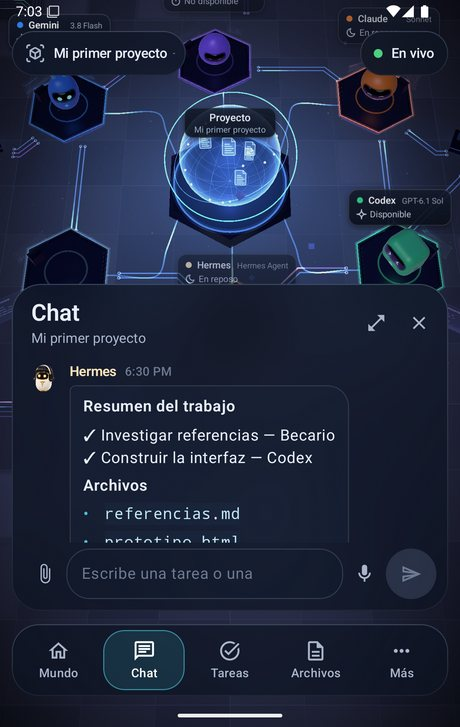
  &nbsp;
  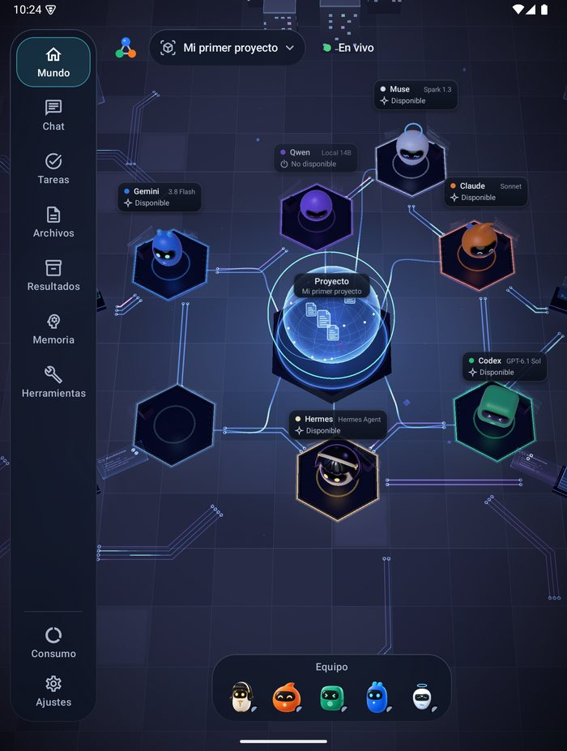
</p>

Órbita conserve la dernière copie pour que vous puissiez l'utiliser **hors ligne**, met vos messages en file d'attente jusqu'au retour de la connexion, et s'adapte aux appareils pliables et aux tablettes. Plus d'informations dans [android/README.md](android/README.md).

Órbita s’appaire une seule fois avec un code à 6 chiffres et reste appairée même quand kywai redémarre ou se met à jour. Elle se met à jour toute seule depuis votre ordinateur, vous prévient de ce qui vous attend même en arrière-plan et a le même historique, la même recherche, les mêmes résultats et la même consommation que le bureau.

Dans le chat, Órbita propose la **dictée en direct** (un appui sur le micro ; maintenez-le pour enregistrer une note vocale que votre ordinateur transcrit avec Whisper), un **bouton appareil photo** pour prendre une photo ou la choisir dans la galerie, et les mêmes menus à l'appui long que le clic droit du bureau.

Un ordinateur était client et vous voulez qu'il devienne le serveur ? Appuyez sur **« Utiliser cet ordinateur comme serveur »** sur l'écran de connexion ou dans ⚙ → Réglages → Connexion.

## 🎨 Thèmes

La galerie **Réglages → Thèmes** réunit sept cartes (Clásico, Órbita, Marfil, Grafito, Bosque, Matrix et EVA-01), la Cité numérique en sept couleurs, le Refuge Kywai, les Fonds marins, le **Bureau** (sobre, pour le travail) et quatre décors. Tous ont un **Mode nuit** avec une vraie lumière (torches, réverbères, bioluminescence…) ou **Auto**, qui suit l’heure. Suivez le thème du serveur ou choisissez-en un par appareil. Órbita adapte la palette, pas les scènes de l’ordinateur. Ces images montrent quelques couleurs et décors :

<table>
  <tr>
    <td align="center">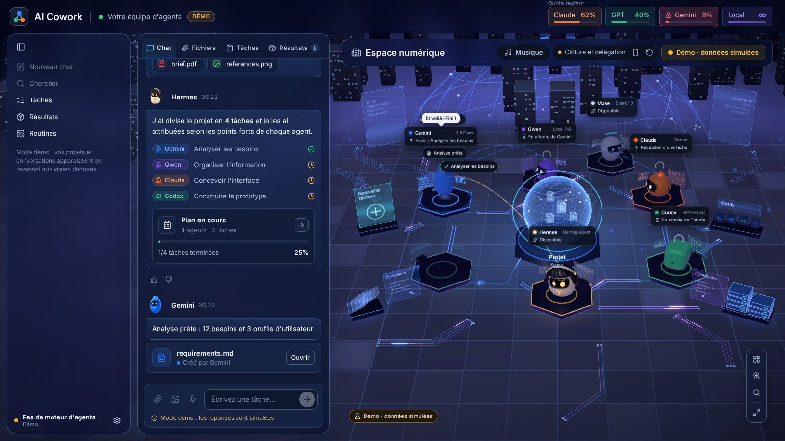<br><b>Frost Glass</b> : verre dépoli</td>
    <td align="center">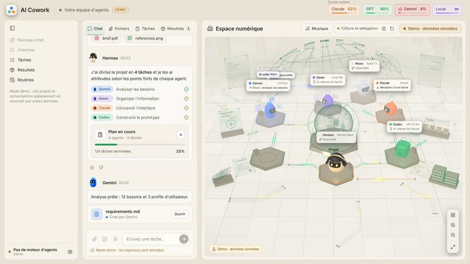<br><b>Perle</b> : clair et chaleureux</td>
    <td align="center">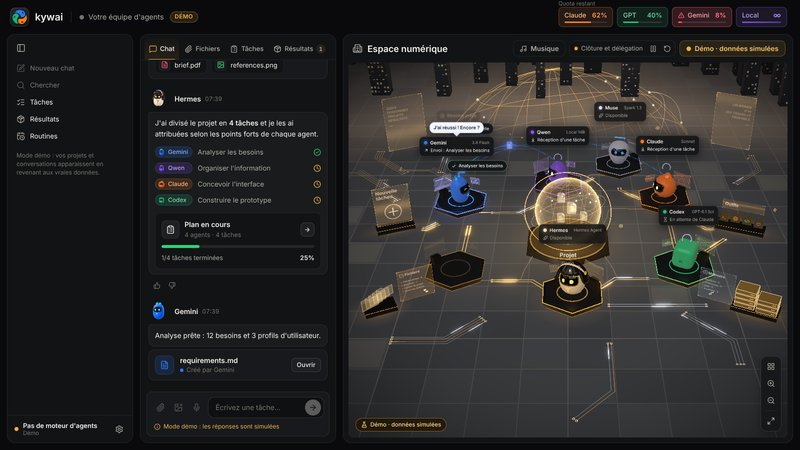<br><b>Onyx</b> : noir et or</td>
  </tr>
  <tr>
    <td align="center">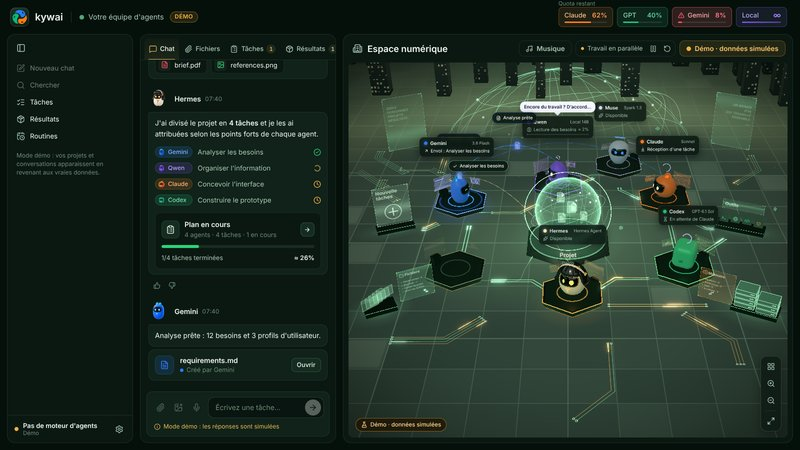<br><b>Émeraude</b> : vert profond et or</td>
    <td align="center">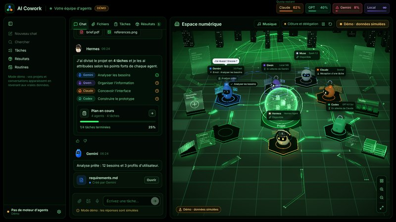<br><b>Néon</b> : noir et vert néon</td>
    <td align="center">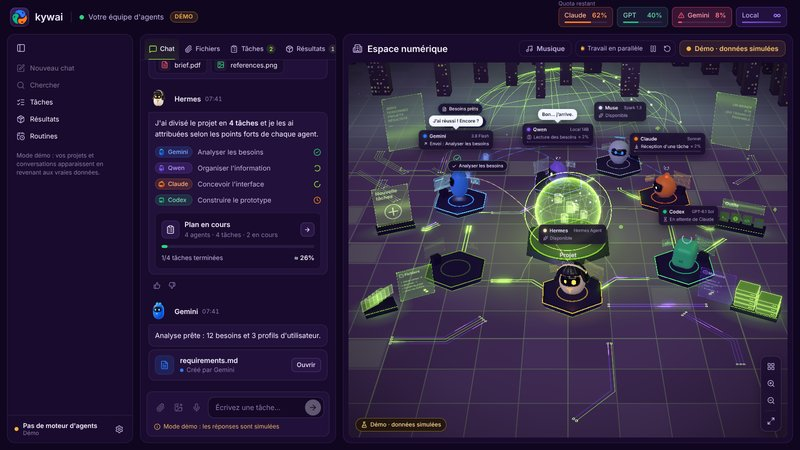<br><b>Ultraviolet</b> : violet et vert citron</td>
  </tr>
</table>

Et quatre qui décorent le monde, remodèlent son noyau et, pour les thèmes festifs, habillent les robots :

<table>
  <tr>
    <td align="center">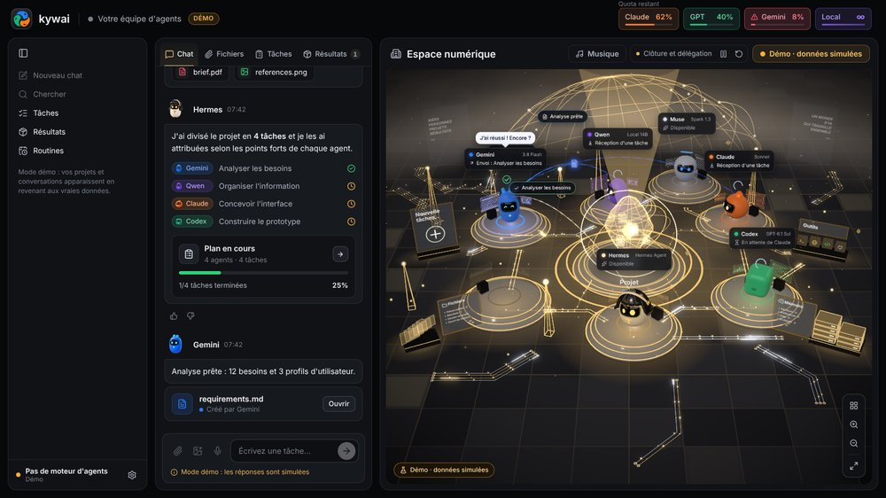<br><b>Relicario</b> : un noyau en cristal taillé et des plateformes de verre et d'or</td>
    <td align="center">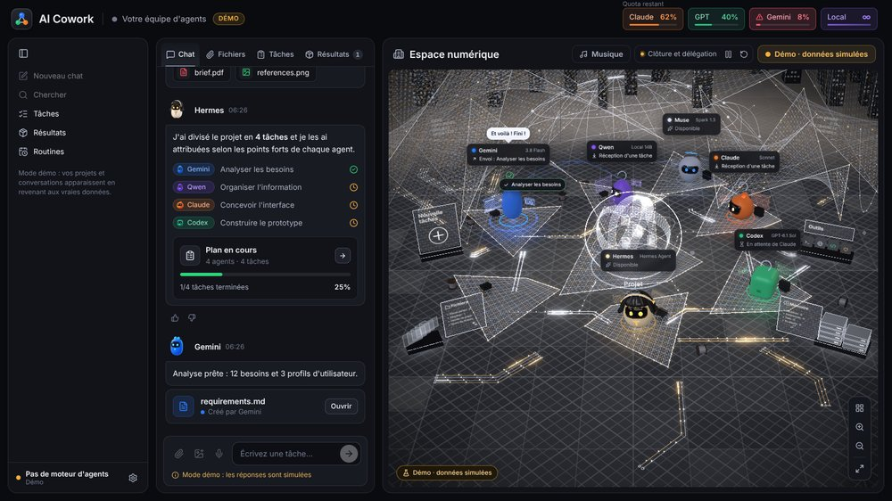<br><b>Telar</b> : des membranes de fils d'argent aux étincelles dorées</td>
  </tr>
  <tr>
    <td align="center">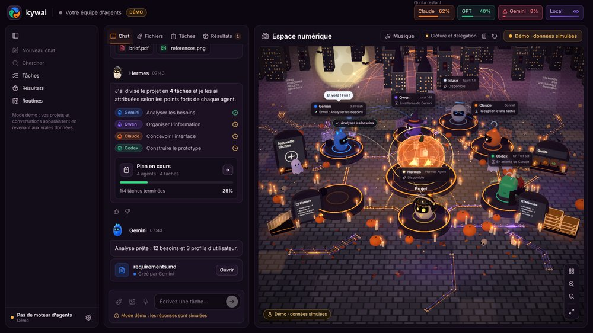<br><b>Halloween</b> : citrouilles, bougies, lune, chauves-souris, une sorcière et un vampire</td>
    <td align="center">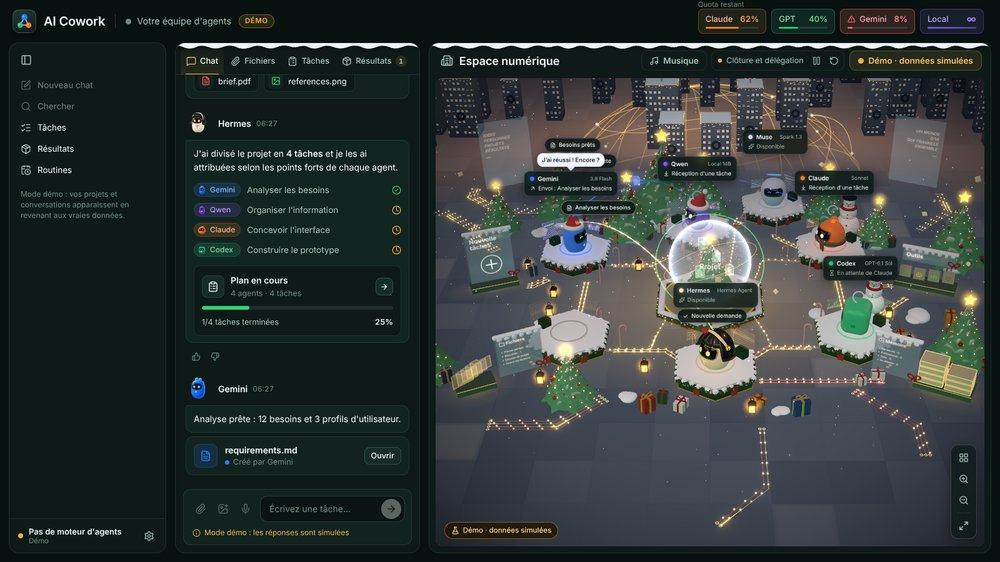<br><b>Navidad</b> : neige, sapins, cadeaux, une boule à neige et des bonnets de père Noël</td>
  </tr>
</table>

## 📥 Installation

### ⚡ Installer en une seule commande

Collez une ligne dans un terminal. Elle vous guide pas à pas (« Étape 1 sur 3… Terminé »), télécharge depuis les Releases la dernière version pour votre ordinateur, l’installe et l’ouvre. Relancez-la quand vous voulez réinstaller ou mettre à jour : vos projets et réglages sont conservés.

**Windows 10/11** : ouvrez **PowerShell** et collez :

```powershell
irm https://kywai.app/install.ps1 | iex
```

**macOS et Linux** : ouvrez le **Terminal** et collez :

```bash
curl -fsSL https://kywai.app/install.sh | bash
```

- **Windows :** s’installe pour votre utilisateur seulement (sans droits administrateur), avec des raccourcis sur le Bureau et dans le menu Démarrer.
- **macOS :** choisit Apple silicon ou Intel (pas besoin de Homebrew : l’assistant installe ce qui manque), place `kywai.app` dans Applications et lève le blocage « app endommagée », donc pas besoin du clic droit → Ouvrir.
- **Linux** (x64 ou ARM) : place l’AppImage dans `~/.local/share/kywai`, l’ajoute au menu des applications et crée la commande `kywai`. Il ne demande votre mot de passe que pour installer libfuse2 si besoin.

Vous voulez le lire avant ? Voici les scripts : [install.sh](https://github.com/Yiku21/kywai/blob/master/scripts/instalar-kywai.sh) et [install.ps1](https://github.com/Yiku21/kywai/blob/master/scripts/instalar-kywai.ps1).

### Prérequis

- **Windows 10/11, macOS** (Apple silicon ou Intel) **ou Linux** (x64 ou ARM ; Ubuntu, Debian, Fedora, Arch, openSUSE…).
- **Node.js** `^22.22.2 || ^24.15.0 || >=26.0.0`. L'assistant l'installe s'il est absent.
- Au moins un agent : n'importe lequel du catalogue (Claude Code, Codex CLI, Gemini CLI, DeepSeek, Qwen Code, Copilot…), un modèle local ou n'importe quel agent en ligne de commande. **Hermes Agent** coordonne par défaut, mais n'importe quel agent peut le faire.
- Facultatif : **LM Studio** ou **Ollama** pour l'agent local, **git** pour Annuler, et **Tailscale** pour l'utiliser depuis d'autres appareils.

> **Langue :** l'application est disponible en anglais, espagnol, portugais, français et chinois. Elle s'ouvre dans la langue du système et se change dans ⚙ → Réglages → « Idioma · Language ». Le portugais, le français et le chinois ont été traduits automatiquement ; les corrections sont les bienvenues.

### Télécharger (le plus simple)

Récupérez l’installateur de votre système dans la **[dernière version](https://github.com/Yiku21/kywai/releases/latest)** : `.exe` pour Windows, `.dmg` pour macOS (Apple silicon ou Intel) et `.AppImage` pour Linux. Android : récupérez `kywai-orbita.apk` dans la même version. Une fois installée, l’app cherche une nouvelle version à chaque ouverture et se met à jour toute seule (sur macOS aussi : elle télécharge, vérifie et remplace l’app toute seule). La roue ⚙ s’allume en jaune quand une mise à jour attend et, après la mise à jour, une fenêtre **Nouveautés** raconte ce qui a changé.

Elles ne sont pas encore signées : sous Windows, cliquez sur « Informations complémentaires » → « Exécuter quand même » ; sur macOS, la première fois, clic droit sur l’app → Ouvrir (si elle est dite endommagée, lancez `xattr -cr "/Applications/kywai.app"`) ; sous Linux, rendez l’AppImage exécutable avec `chmod +x`.

Ou compilez-la vous-même :

### Windows

```bash
npm install
npm run dist:win
```

Cela crée `release/kywai-Setup-<version>.exe`. L'installateur vous laisse choisir le dossier et crée les raccourcis. Comme il n'est pas signé numériquement, Windows peut afficher un avertissement : « Informations complémentaires » → « Exécuter quand même ».

### macOS

```bash
npm run fuente
```

Cela crée `release/kywai-fuente.zip`. Sur le Mac, décompressez-le et exécutez ceci dans le dossier :

```bash
bash scripts/instalar-mac.sh
```

Le script compile l'application pour ce Mac, la copie dans `/Applications` (ou à l'emplacement de votre choix) et l'ouvre.

### Linux

Avec Node.js et git installés, clonez le dépôt et exécutez ceci dans le dossier :

```bash
bash scripts/instalar-linux.sh
```

Le script compile l'application pour cet ordinateur, l'installe dans `~/.local/share/ai-cowork` sans droits d'administrateur, l'ajoute au menu des applications et crée la commande `ai-cowork`. Vous pouvez aussi générer une AppImage avec `npm run dist:linux`. Détails dans le [manuel](docs/MANUAL.md#linux-se-compila-en-el-propio-equipo) (en espagnol).

### Premier lancement

L'**assistant de configuration** s'ouvre au premier lancement (il est aussi accessible via ⚙ → « Configurer les agents… ») :

1. Choisissez les agents à utiliser.
2. Il vérifie leurs programmes et installe ceux qui manquent avec leurs installateurs officiels.
3. Il ouvre la page de connexion officielle de chaque agent, avec les étapes expliquées pour chacun. kywai ne voit ni ne stocke jamais de mots de passe. S’il en manque un plus tard, Hermes met une carte « Connecter des agents » dans le chat.
4. Il récapitule ce qui reste à faire.

Pour l'utiliser depuis votre téléphone ou votre ordinateur portable, ouvrez ⚙ → « Accès depuis d'autres appareils… ».

## 🔐 Confidentialité et sécurité

- **Sur votre ordinateur.** Les projets, la mémoire, les journaux et la consommation sont stockés dans votre dossier de données utilisateur (`%APPDATA%\AI Cowork` sous Windows, `~/Library/Application Support/AI Cowork` sous macOS, `~/.config/AI Cowork` sous Linux).
- **Accès à distance fermé.** Le serveur n'écoute que sur votre IP Tailscale et sur `127.0.0.1`, jamais sur le réseau local ni sur Internet, et demande un code à chaque requête. Chaque appareil appairé a sa propre clé, que vous pouvez révoquer individuellement (elle expire aussi après 90 jours sans utilisation), ou vous pouvez toutes les révoquer d'un coup avec un nouveau code. Les codes d'appairage expirent au bout de 10 minutes et n'autorisent que quelques tentatives.
- **Mises à jour des clients signées.** Les clients de bureau n'installent que des mises à jour signées avec votre propre clé privée, qui ne quitte jamais l'ordinateur qui les publie.
- **Aucun mot de passe.** Chaque agent utilise la connexion propre à son programme officiel. Les clés d'API que vous ajoutez sont chiffrées avec le trousseau du système.
- **Les agents restent dans leur dossier.** On leur demande de travailler uniquement dans le dossier du projet. Avec « Accès complet » désactivé, c'est le seul dossier qu'ils peuvent modifier.
- **Voix locale.** La dictée utilise Whisper sur votre propre ordinateur, et l'audio est supprimé ensuite.

## 🛠️ Développement

```bash
npm install
npm run dev        # application de bureau en mode développement
npm run web        # uniquement l'interface dans le navigateur (http://localhost:5199), en mode démo
npm run typecheck  # types
npx vitest run     # tests
```

**Stack :** Electron, React 19, TypeScript et Three.js (react-three-fiber) sur le bureau ; Kotlin, Jetpack Compose et OpenGL ES dans Órbita.

```
src/
  shared/      contract between the engine and the interface (types, defaults)
  main/        engine: window, CLIs, planning, tasks, quotas, projects, web and mobile server
  preload/     secure window.cowork bridge
  renderer/    interface: chat, panels and the 3D digital space
android/       Órbita, the Android app
docs/          manual, model guide and mobile API
```

## 📚 Documentation

La documentation détaillée est en espagnol :

- **[Manuel](docs/MANUAL.md)** : chaque fonctionnalité en détail.
- **[Journal des modifications](CHANGELOG.md)** : toutes les améliorations depuis le premier jour, par date et par version.
- **[Guide des modèles](docs/GUIA-MODELOS.md)** : le modèle et l'effort qu'utilise chaque agent selon la difficulté, avec les sources.
- **[Órbita](android/README.md)** : l'application Android, et comment la compiler et la publier.
- **[API mobile](docs/mobile-api/README.md)** : le contrat entre le serveur et Órbita.

## ☕ Soutenez le projet

kywai est gratuit et open source. S'il vous fait gagner du temps et que vous voulez dire merci, vous pouvez **[m'offrir un café sur Ko-fi](https://ko-fi.com/yilsander)**. C'est aussi dans l'application : ⚙ → « Soutenir kywai ☕ » sur le bureau, et à la fin des Réglages dans Órbita.

[](https://ko-fi.com/yilsander)

## 📄 Licence

[MIT](LICENSE). Vous pouvez utiliser, modifier et partager kywai librement, à condition de conserver la mention de copyright.

<div align="center">
<br>
<sub>Créé par toute une équipe d'agents IA, coordonnée par Hermes.</sub>
</div>
