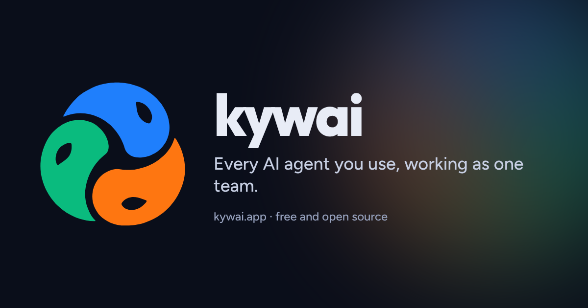
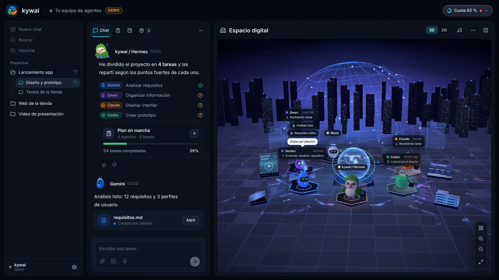
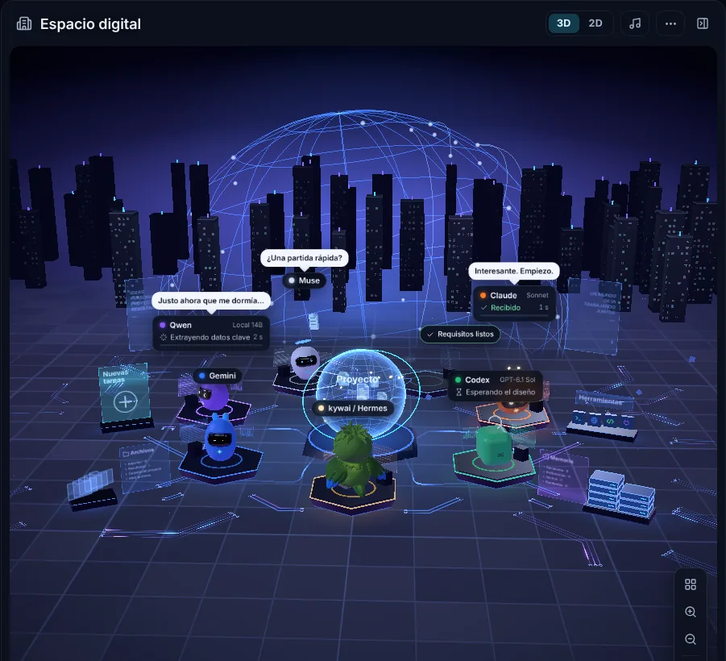
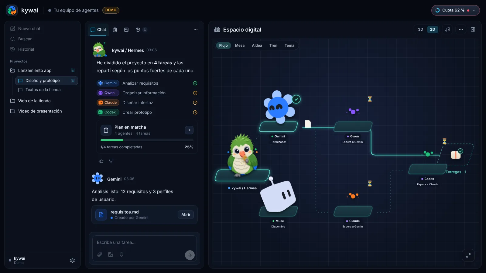
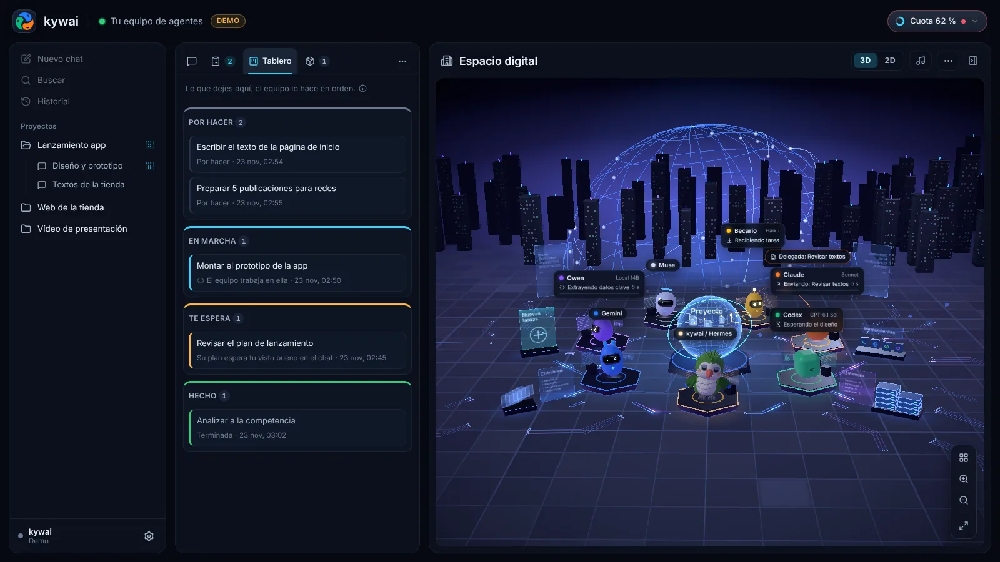
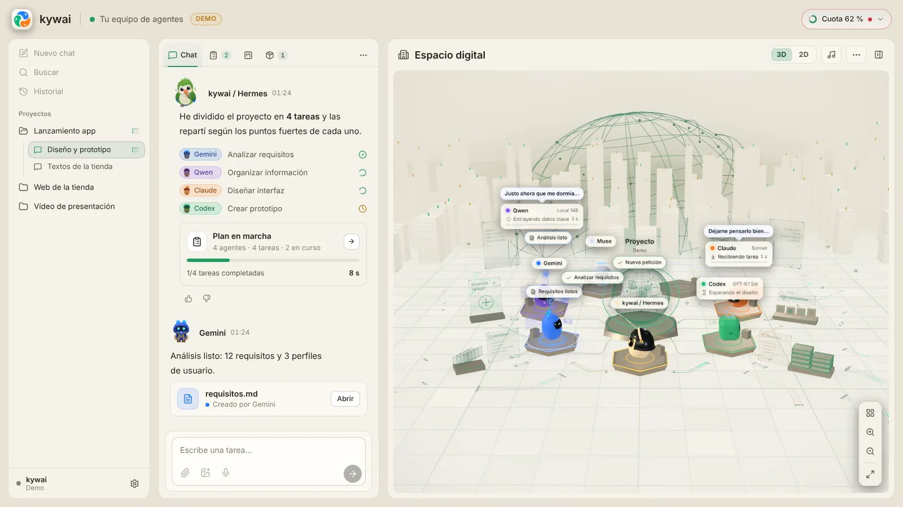
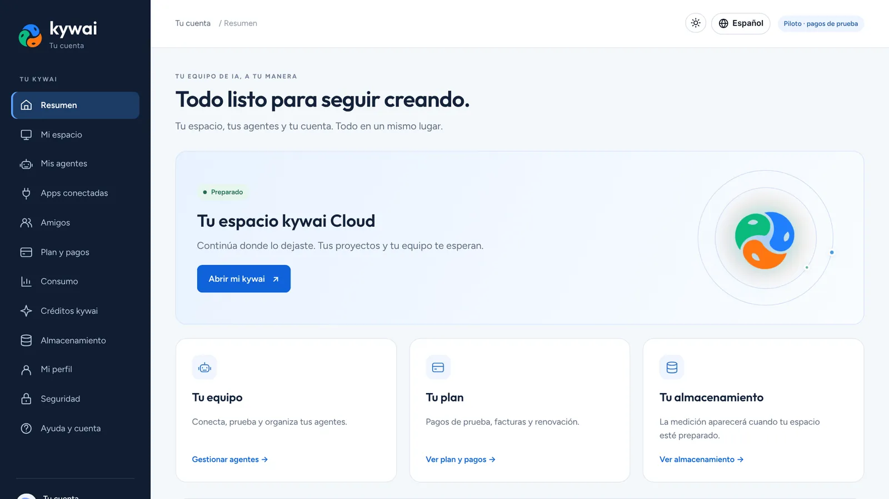
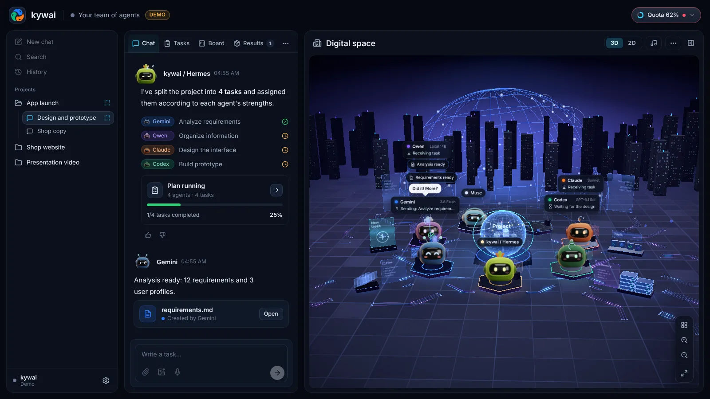

<p align="center"></p>

<h1 align="center">kywai 1.0</h1>

<p align="center"><b>Un equipo de agentes de IA que trabaja por ti.</b><br>Le dejas una tarea y vuelves a un resultado.</p>

<p align="center">
  <a href="https://github.com/Yiku21/kywai/releases/latest"></a>
  <a href="https://github.com/Yiku21/kywai/releases/latest"></a>
  <a href="https://kywai.app/es/agentes/"></a>
  <a href="https://kywai.app"></a>
</p>

kywai junta los agentes que ya usas (Claude Code, Codex, Gemini, modelos locales…) en un solo equipo. El coordinador, **kywai / Hermes**, reparte el trabajo según lo que hace mejor cada uno, y tú lo ves todo: el plan, las tareas, los archivos y a tus agentes trabajando.

## Así es por dentro

<table>
  <tr>
    <td width="50%"><br><b>Chat y coordinador.</b> Escribe una tarea y ves el plan en marcha.</td>
    <td width="50%"><br><b>Espacio 3D.</b> Quién tiene cada tarea, a quién espera y qué entrega.</td>
  </tr>
  <tr>
    <td><br><b>Espacio 2D.</b> El mismo equipo dibujado, ligero para cualquier ordenador.</td>
    <td><br><b>Tablero.</b> De «Por hacer» a «Hecho», y aparte lo que espera tu sí.</td>
  </tr>
  <tr>
    <td><br><b>Temas.</b> De claro a neón, en la app y en el mundo de tus agentes.</td>
    <td><br><b>kywai Cloud.</b> Tu kywai encendido 24 horas en el navegador.</td>
  </tr>
</table>

## Qué puedes hacer

| Quieres… | Con kywai |
|---|---|
| Repartir un proyecto entre varios agentes | Escribe la tarea: el coordinador hace el plan y lo reparte |
| Crear vídeos, voces, imágenes y clips | `/video`, `/editar`, `/recortes`; eliges si se genera con tu ChatGPT, modelos locales o la nube |
| Repetir un trabajo cada semana | Rutinas por horario, por evento o por carpeta |
| Hablar con tu equipo desde fuera | Slack, Teams y Órbita en el móvil |
| Usar tu suscripción, tu clave o un modelo local | 36 agentes compatibles y modelos locales instalados en un clic |
| Tenerlo encendido siempre | kywai Cloud, con Mi cuenta para agentes, consumo y créditos |

## Lo nuevo en la 1.0

- **Tu suscripción en Hermes:** el coordinador usa tu cuenta de ChatGPT o de Claude, con todos los modelos de tu plan.
- **Imágenes y vídeo a tu elección:** tu ChatGPT, modelos locales o la nube, y «Rehacer con…» otro.
- **Modelos locales en un clic:** kywai recomienda los que van bien en tu equipo y los deja listos.
- **Slack y Teams:** menciona a kywai en un canal y la respuesta llega allí con sus archivos.
- **«Tu día»** y **encargos en lote**.

Todas las notas: [versiones publicadas](https://github.com/Yiku21/kywai/releases).

## Instalar

Descarga el instalador en **[kywai.app](https://kywai.app/es/descargas/)** o en la [última versión](https://github.com/Yiku21/kywai/releases/latest), o usa una línea:

```bash
# macOS y Linux
curl -fsSL https://kywai.app/install.sh | bash
```

```powershell
# Windows (PowerShell)
irm https://kywai.app/install.ps1 | iex
```

Manual: [docs/MANUAL.md](docs/MANUAL.md) · Guías: [kywai.app/es/guias](https://kywai.app/es/guias/) · Cloud: [kywai.app/cloud](https://kywai.app/cloud/)

---

### English

**kywai 1.0: an AI agent team that works for you.** kywai brings the agents you already use into one coordinated team: the coordinator splits the work, and you watch the plan, the tasks, the files and your agents at work in 3D or 2D. Create videos, voices and images, run routines, talk to it from Slack, Teams or your Android phone, or keep it running 24/7 with kywai Cloud. Website, guides and downloads at **[kywai.app](https://kywai.app)**.

<p></p>

### Qué hay en este repositorio · What this repository holds

Es el escaparate público de kywai: la web [kywai.app](https://kywai.app), los instaladores de una línea, el manual y las versiones publicadas. El código de la app no está aquí.

This is kywai's public showcase: the [kywai.app](https://kywai.app) website, the one-line installers, the manual and the published releases. The app's source code is not here.

### Licencia · License

kywai es gratis para usar, pero no es de código abierto: [licencia de uso](LICENSE). Las versiones del 19 y 20 de noviembre de 2026 salieron con la FSL y las anteriores con MIT.

kywai is free to use but not open source: see the [license](LICENSE).
