<div align="center">


# kywai

<sub>Pronounced “kee-why”. Formerly <i>AI Cowork</i>.</sub>

### Any AI agent, from any provider, as many as you want, working as one team.

Ask once. A coordinator plans the work and gives each task to the agent that does it best: Claude, Codex, Gemini, DeepSeek, Qwen, Copilot, Cursor, a local model or any command-line agent you add. You watch every robot work in a live 3D world, and the results come back to you, already checked.

**English** · [Español](README.es.md) · [Português](README.pt-BR.md) · [Français](README.fr.md) · [简体中文](README.zh-CN.md) · 🌐 [kywai.app](https://kywai.app)

https://github.com/user-attachments/assets/624a3572-8c56-460d-be5a-40af6966df2d

[](https://kywai.app)


[](https://ko-fi.com/yilsander)

<br>

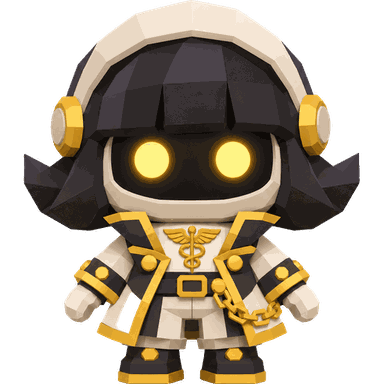
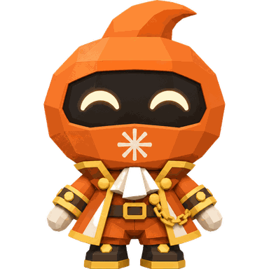
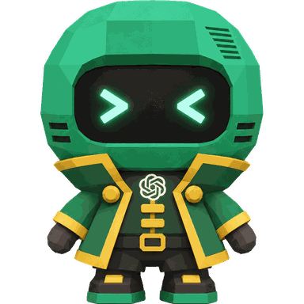
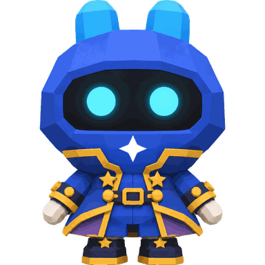
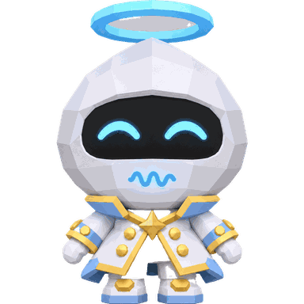
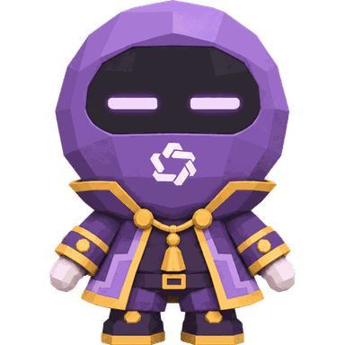
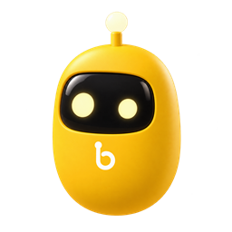

[What it is](#-what-it-is) · [Any agent](#-any-agent-any-provider) · [Why](#-why-kywai) · [How it works](#-how-it-works) · [Features](#-features) · [Anywhere](#-use-it-from-anywhere) · [Themes](#-themes) · [Install](#-install) · [Privacy](#-privacy-and-security) · [Support](#-support-the-project)

</div>

<br>

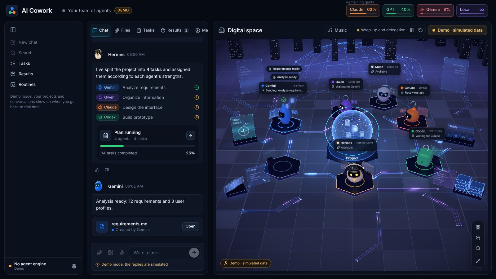

## ✨ What it is

kywai turns the AI agents and subscriptions you already have, from any provider, into **one team that works together**. Instead of jumping between apps and copying context around, you ask once:

1. **🧭 Hermes, the coordinator,** understands what you want and proposes a plan: which tasks there are, which agent does each one and why.
2. **✅ You approve it,** or tell it what to change in plain words.
3. **⚙️ The agents work,** in parallel when it pays off, in your project folder, each with its own program and your own login or API key.
4. **🔍 Another agent checks the result** before it reaches you, and the author fixes what it finds.
5. **📦 You get the deliverables** in the chat, grouped and ready to open, with a summary of what was done and what it cost.

The goal is simple: **leave a task and come back to a result, never to an error with nothing to show for it.**

## 🔌 Any agent, any provider

kywai is not tied to a fixed set of models. It is a platform where **you build your own team**:

- **Add as many agents as you want** from ⚙ → "Configure agents…" → "Add an agent". The catalog already knows how to launch 30+ of them, with the account or subscription each one uses: Claude Code, Codex CLI, Gemini CLI, Antigravity CLI, Muse Code, Aider, DeepSeek, Qwen Code, Kimi Code, MiniMax Code, Mistral Vibe, Grok Build, GitHub Copilot CLI, Cursor, Amp, Goose, OpenCode, Cline, Continue, OpenHands, Factory Droid, Auggie, Junie, Kiro, Rovo Dev, Qoder CLI, Crush, Open Interpreter, gptme, Letta Code, ForgeCode, OpenClaw and more.
- **Or connect any other program** with "Other program…": give its command, how it receives the task (stdin, a file or an argument) and its arguments, and it joins the team.
- **Subscriptions or API keys.** Agents run with the login you already have in their own program. The ones that use an API key (DeepSeek, Kiro, Junie, Factory Droid, Amp…) ask for it once; it is encrypted with the system keychain and only passed to that agent.
- **Local models too.** Any model you run in LM Studio or Ollama, free and without leaving your computer.
- **The local agent looks after itself.** It turns LM Studio on by itself when it needs it, and a "Reasoning (think)" switch on its card lets the model think before answering only when you want it to (off by default, so it answers much faster).
- **You choose who coordinates.** Hermes is the default, but any agent can plan and assign ("Make coordinator"). If it is unavailable, the next one takes over.
- **Every agent is a full team member,** with its own robot and station in the 3D world, its performance stats and the same plan, review and undo as the rest.

## 💡 Why kywai

<table>
<tr>
<td width="50%" valign="top">

**💳 The agents you already pay for**<br>
It drives each agent's own program with your session, so it runs on your plans' quota instead of extra API costs, and API keys or free local models work too. The header shows the **real remaining quota** of Claude and GPT.

</td>
<td width="50%" valign="top">

**🎯 Every task to the agent that does it best**<br>
The coordinator knows each agent's strengths, models, quota and track record. Easy work goes to an *intern* (the same agent with less effort), normal work to the main model and hard work to the strongest one.

</td>
</tr>
<tr>
<td valign="top">

**🏆 Quality first, by default**<br>
Each task has an acceptance criterion. An agent from a different family reviews every change, and for work that depends on taste (a website, a logo, a deck) two agents each make their own version and a third one picks the winner.

</td>
<td valign="top">

**🛟 Built to never leave you empty-handed**<br>
If an agent can't finish, another strong one takes over. Interrupted work resumes where it stopped, a stuck agent restarts with one button, and every change can be undone.

</td>
</tr>
<tr>
<td valign="top">

**👀 Fully transparent**<br>
Each agent tells you in short sentences what it is doing. A live step-by-step view shows every command with its output, every file read or edited (with the diff) and every search.

</td>
<td valign="top">

**🔒 Private by design**<br>
Everything runs on your computer. Remote access only travels through your own Tailscale network, voice dictation runs locally, and kywai never sees or stores passwords.

</td>
</tr>
</table>

## 🧠 How it works

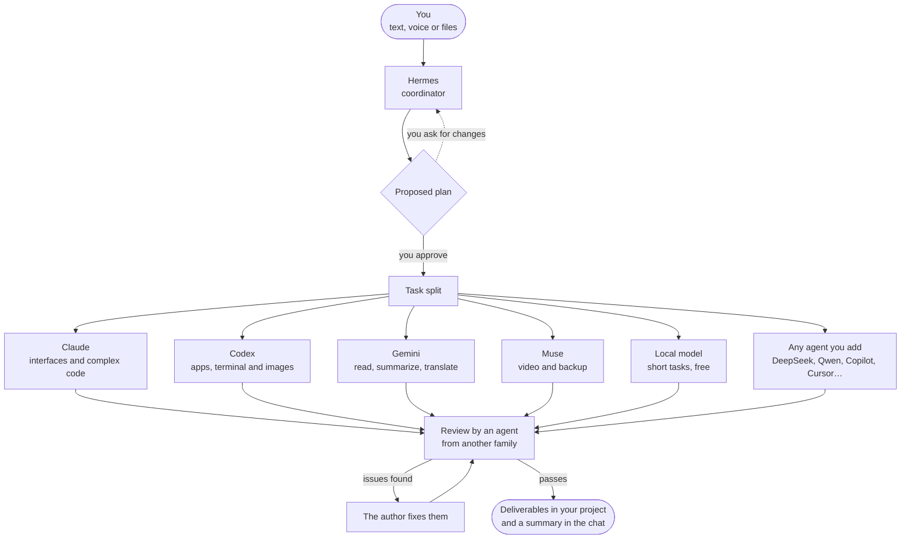

### The default team

This is the team you get out of the box. You can remove any of them and add as many others as you like.

| | Agent | Runs on | Best at |
|---|---|---|---|
|  | **Hermes** | Hermes Agent | Coordinating: understands the request, plans and assigns. It never runs tasks itself. If it is unavailable, Claude plans. |
|  | **Claude** | Claude Code (your Claude subscription) | Interfaces and design, writing, large or complex code. |
|  | **Codex** | Codex CLI (your ChatGPT account) | Apps and scripts end to end, terminal, servers and data. The one that generates images. |
|  | **Gemini** | Gemini CLI | Reading and summarizing huge amounts of material (1M-token context), translations and quick reports. |
|  | **Muse** | Muse Code (your Meta subscription) | Understanding video. Backup when others run out of quota. |
|  | **Local** | LM Studio or Ollama | Short, simple tasks for free, without leaving your computer. With LM Studio it can also read, create and edit files. |

Any agent you add from the catalog or with "Other program…" works exactly like these: the coordinator knows it, assigns it tasks and it appears in the 3D world. See [Any agent, any provider](#-any-agent-any-provider).

## 🚀 Features

### 🗺️ Planning and work

- **Plans you approve.** Nothing starts without your OK, and you can change the plan with one sentence ("let Codex do it", "skip the research"). Approve with a tap or just by answering "yes". If you prefer, turn approval off and let the team go straight to work.
- **Several requests at once.** New work goes to free agents without touching files another agent is editing.
- **Talk to one agent directly.** Write `@Claude …` (or `/directo Claude …`) and your text goes straight to that agent, with no plan, review or summary from Hermes. Typing `@` shows the list of agents, on desktop, in the browser and in Órbita.
- **Acceptance criteria per task**, plus a warning if an agent touches files that were not its own.
- **Two hands for taste-driven work.** Two agents from different families build the same thing separately (option A and option B), and a third one tests both, compares them against your request and tells you which one wins and why.
- **Peer review.** When a task changes files, an agent from another family checks it in read-only mode, runs the tests if it can and answers *passes* or *issues*. The author fixes them, and the result is checked again.
- **Resume and hand-off.** Interrupted tasks resume where they stopped. If an agent fails, another strong agent takes over the task, never a weaker one. Agents also resume their own session on follow-ups.
- **Full access switch.** Let agents install things and use the internet without asking, or limit them to editing the project folder.

### 📡 Following the work

- **Short live updates** from each agent while it works, with its tools folded into one expandable line, like the Claude app.
- **Live step-by-step view** of any task: reasoning, every command and its output, files read and edited with their changes, searches and the final answer. Kept for 30 days.
- **Progress you can see.** New screenshots and images appear as thumbnails in the chat, and documents as cards, while the task is still running.
- **"Needs you" bell** that gathers everything waiting for your decision (a plan, a question, a permission, a silent agent) with its buttons, plus notifications on your phone.
- **3D digital space** showing every state: working, waiting for another agent, delegating to an intern, out of quota or failing, with files traveling between robots.
- **Robots with character.** Their eyes show what each one is really doing (focused, thinking, tired, asleep, error, done), each has its own personality and speech bubbles in your language, and when you type in the chat they wake up and turn to look at you.

<p align="center">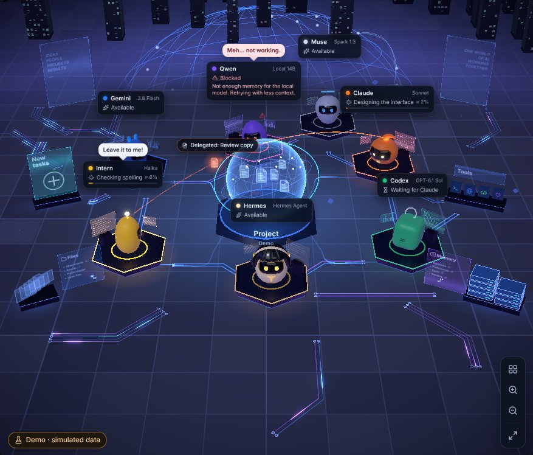</p>

### ↩️ Control and safety net

- **Changes per task, with Undo.** A snapshot is taken before and after every task, in a separate store, never in your project's `.git`. See "N files changed +a −b", review the diff and undo a single task. If tasks overlap, the result is kept as a separate copy.
- **Restart a failing agent** from its panel: it clears the block (quota, session, API error), checks its CLI again and picks up whatever was waiting for it.
- **Rate any result** 👍 / 👎. Ratings feed the coordinator, so it learns who really delivers.
- **"How each agent performs"** panel: tasks, review verdicts, ratings, time and cost per agent and difficulty.

### 🧩 Context and automation

- **Conversations like in Claude.** A sidebar with your projects, pinned ones and recent chats. "New chat" starts a fresh conversation without losing the previous one, and any of them can be resumed later with its tasks and each agent's session. Ctrl+K searches conversations, tasks, results and memory across all projects.
- **Project memory** with instructions, decisions, preferences and to-dos, each with its author and status. Every agent reads it on every task, even after you clear the chat.
- **One AGENTS.md for the whole team.** Each CLI reads only its own file; kywai passes the others along, so one `AGENTS.md` gives every agent the same rules.
- **Shared skills.** Reusable procedures in the `habilidades` folder, in the same `SKILL.md` format as Claude skills.
- **kywai MCP server.** Agents get tools to read and add to the project memory, see the team's status, load a skill and ask you a question, with a token per task.
- **Routines.** Requests that launch by themselves: at a set time, on chosen weekdays, every N hours, from a webhook (with GitHub signatures) or when files change in a folder. They go through the same plan, agents and review as anything you type.

### 📊 Quota and cost

- **Real quota** for Claude and GPT in the header, plus quota groups with budgets.
- **Usage per request:** time, tokens and how much quota it used, so you can see whether a team beats a single agent. Export to CSV.
- **Model and effort by difficulty,** models you can swap from each robot's panel, and `/model` to change Hermes's model.

### 🎨 Comfort

- **The chat comes first.** In smaller windows it takes more room, you can drag its edge to the width you like (double-click to go back to automatic), and in narrow windows the chat and the 3D world become two tabs.
- **Local voice dictation** with Whisper on your own computer. No external services, and the audio is deleted afterwards.
- **Eleven themes** that also restyle the 3D world. Some decorate it and dress up the robots.
- **Agent voices,** each with its own timbre, and text that types out at the pace of the voice, like in Animal Crossing.
- **Music player** with YouTube Music search, ad-free Audius and SomaFM radio stations, and a queue, and lights that follow the song's BPM without a microphone.
- **Setup assistant** that installs missing programs with their official installers and opens each official login.
- **Demo mode** to show the app without spending anything.

### ⌨️ Chat commands

| Command | What it does |
|---|---|
| `/model` | See and change Hermes's model |
| `/usage` | Check quotas right now |
| `/recuerda …` | Save something to the project memory (`decisión:`, `pendiente:`, `preferencia:`) |
| `/rutina …` | Create or manage a routine |
| `/new` | Start a new conversation, keeping a copy of the previous one |
| `@Agent …` | Send the text straight to one agent, without Hermes (also `/directo Agent …`) |

## 🌍 Use it from anywhere

The computer where kywai is installed (for example a Mac mini that is always on) does the work. You can take it with you in four ways:

| | 🖥️ **Desktop** | 💻 **Desktop client** | 🌐 **Browser** | 📱 **Órbita (Android)** |
|---|---|---|---|---|
| **What it is** | The full app for Windows, macOS and Linux | The app on another computer, connected to your main kywai | The same interface from any device on your Tailscale network | A native Android app made for the phone |
| **How you get in** | Open the app | Pair once with a 6-digit code | A link with an access code, once | Pair once with a 6-digit code |
| **What you can do** | Everything | Everything, plus browsing the server's files and **syncing folders** both ways | Chat, 3D world, files, results and plan approval | Chat, plans, tasks, files, memory, usage and a native 3D world |
| **Updates** | ⚙ → "Check for updates…" | Signed updates from your own server | Always the latest | From Settings, without reinstalling. New versions are published automatically |

<p align="center">
  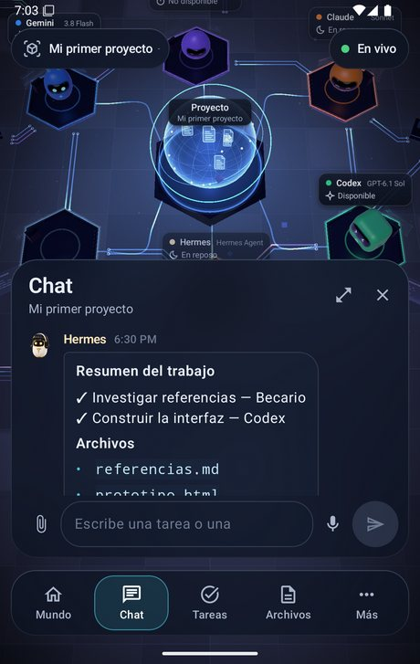
  &nbsp;
  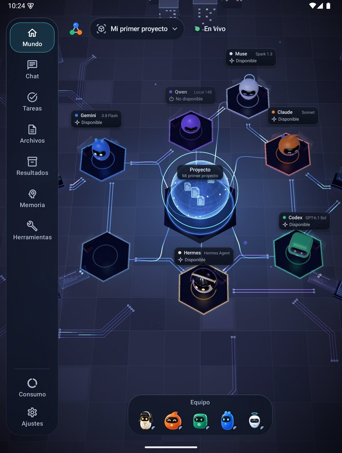
</p>

Órbita keeps the latest copy so you can use it **offline**, queues your messages until the connection comes back, and adapts to foldables and tablets. More in [android/README.md](android/README.md).

## 🎨 Themes

⚙ → "Themes…" changes the look of the app and its 3D world instantly.

<table>
  <tr>
    <td align="center">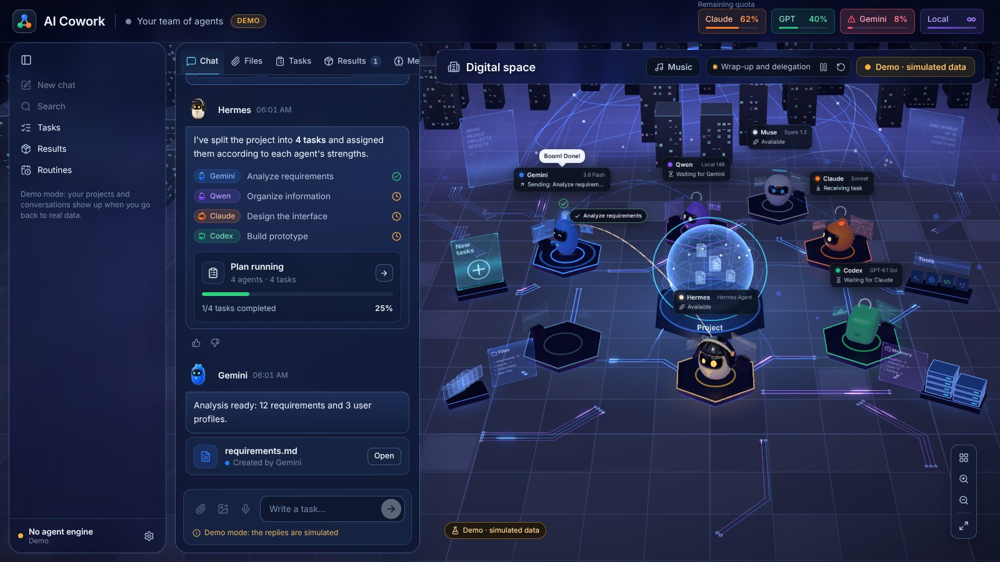<br><b>Órbita</b>: frosted glass</td>
    <td align="center">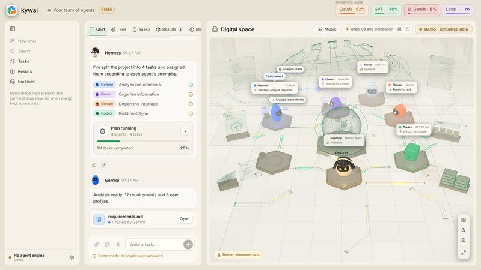<br><b>Marfil</b>: light and warm</td>
    <td align="center">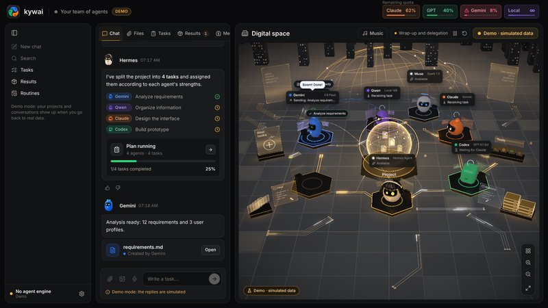<br><b>Grafito</b>: black and gold</td>
  </tr>
  <tr>
    <td align="center">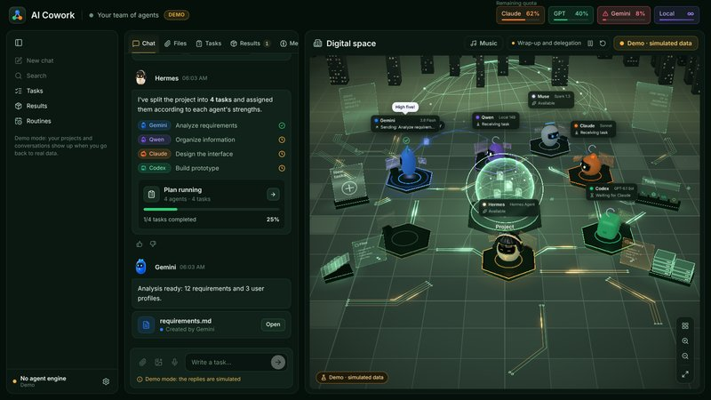<br><b>Bosque</b>: deep green and gold</td>
    <td align="center">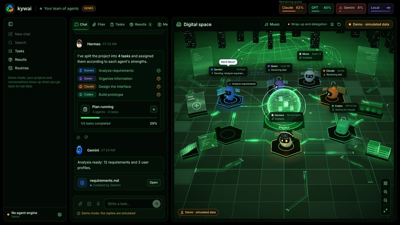<br><b>Matrix</b>: black and neon green</td>
    <td align="center">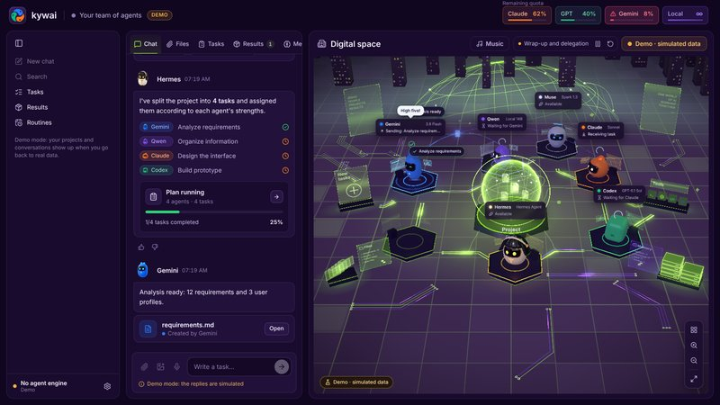<br><b>EVA-01</b>: purple and lime</td>
  </tr>
</table>

And four that decorate the world, reshape its core and, in the festive ones, dress up the robots:

<table>
  <tr>
    <td align="center">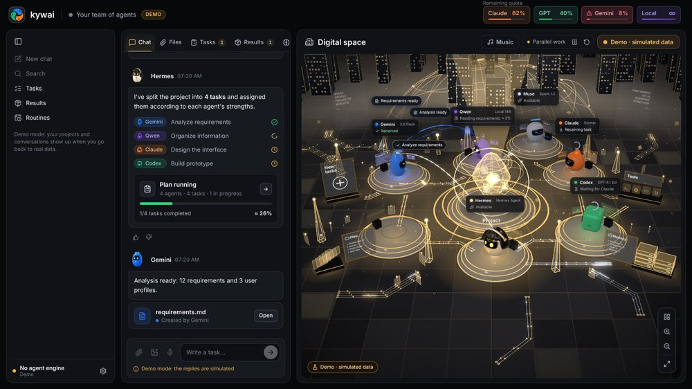<br><b>Relicario</b>: a cut-crystal core and glass-and-gold platforms</td>
    <td align="center">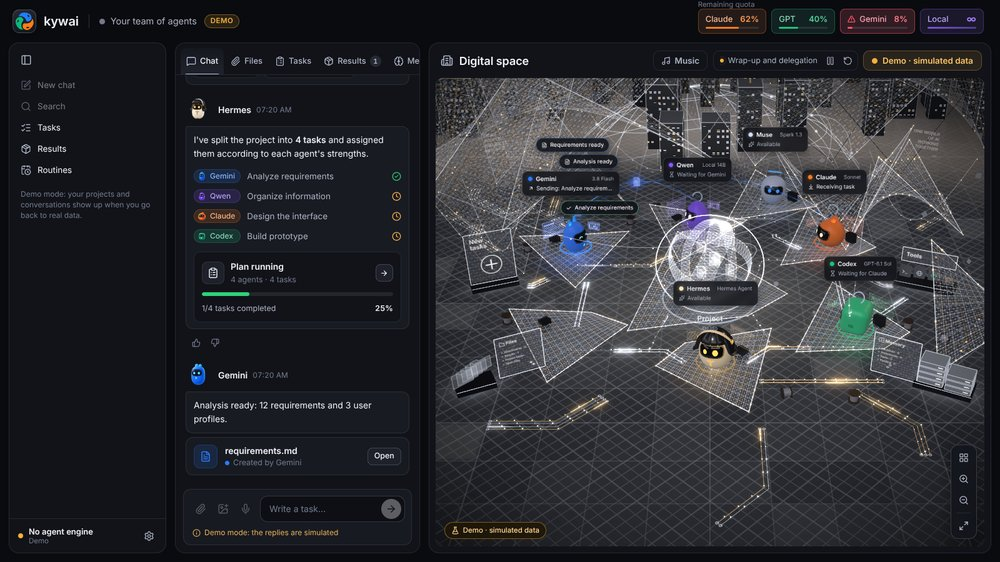<br><b>Telar</b>: silver-thread membranes with golden sparks</td>
  </tr>
  <tr>
    <td align="center">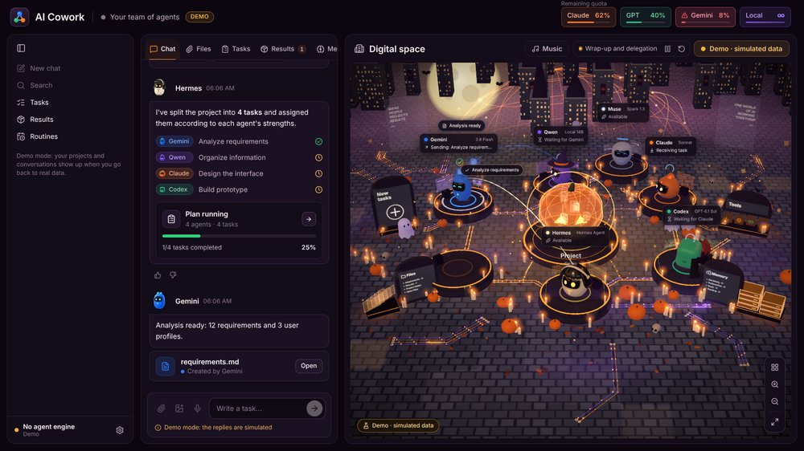<br><b>Halloween</b>: pumpkins, candles, moon, bats, a witch and a vampire</td>
    <td align="center">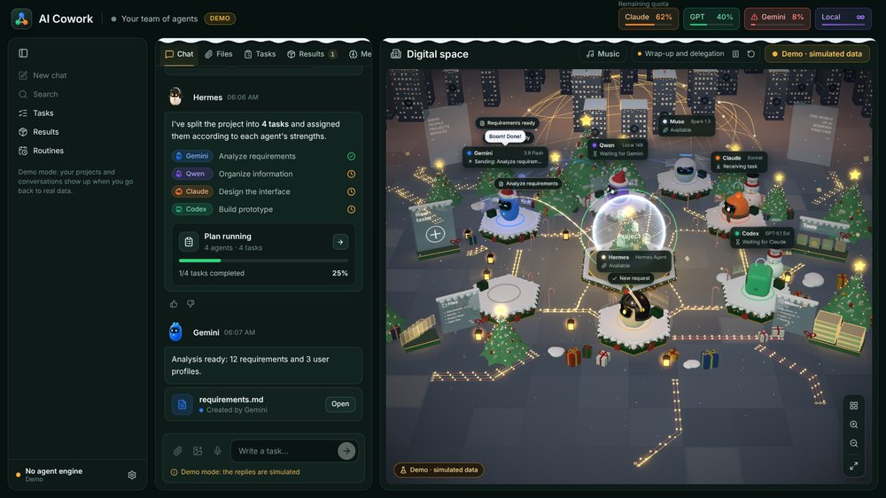<br><b>Navidad</b>: snow, trees, presents, a snow globe and Santa hats</td>
  </tr>
</table>

## 📥 Install

### Requirements

- **Windows 10/11, macOS** (Apple silicon or Intel) **or Linux** (x64 or ARM; Ubuntu, Debian, Fedora, Arch, openSUSE…).
- **Node.js** `^22.22.2 || ^24.15.0 || >=26.0.0`. The assistant installs it if it is missing.
- At least one agent: any from the catalog (Claude Code, Codex CLI, Gemini CLI, DeepSeek, Qwen Code, Copilot…), a local model or any command-line agent. **Hermes Agent** coordinates by default, but any agent can.
- Optional: **LM Studio** or **Ollama** for the local agent, **git** for Undo, and **Tailscale** to use it from other devices.

> **Language:** the app comes in English, Spanish, Portuguese, French and Chinese. It starts in your system's language and you can change it in ⚙ → Settings → "Idioma · Language". Portuguese, French and Chinese were machine-translated; corrections are welcome.

### Download (easiest)

Get the installer for your system from the **[latest release](https://github.com/Yiku21/kywai/releases/latest)**: `.exe` for Windows, `.dmg` for macOS (Apple silicon or Intel) and `.AppImage` for Linux. Once installed, the app checks for a newer version every time it opens and updates itself (on macOS it tells you and opens the download).

They are not code-signed yet: on Windows click "More info" → "Run anyway"; on macOS right-click the app → Open the first time (if it says it is damaged, run `xattr -cr "/Applications/AI Cowork.app"`); on Linux make the AppImage executable with `chmod +x`.

Or build it yourself:

### Windows

```bash
npm install
npm run dist:win
```

This creates `release/AI-Cowork-Setup-<version>.exe`. The installer lets you choose the folder and creates the shortcuts. Because it is not code-signed, Windows may warn you: "More info" → "Run anyway".

### macOS

```bash
npm run fuente
```

This creates `release/AI-Cowork-fuente.zip`. On the Mac, unzip it and run this inside the folder:

```bash
bash scripts/instalar-mac.sh
```

It builds the app for that Mac, copies it to `/Applications` (or wherever you choose) and opens it.

### Linux

With Node.js and git installed, clone the repository and run this inside the folder:

```bash
bash scripts/instalar-linux.sh
```

It builds the app for that computer, puts it in `~/.local/share/ai-cowork` without asking for admin rights, adds it to the applications menu and creates the `ai-cowork` command. You can also build an AppImage with `npm run dist:linux`. Details in the [manual](docs/MANUAL.md#linux-se-compila-en-el-propio-equipo) (in Spanish).

### First run

The **setup assistant** opens on first launch (also under ⚙ → "Configure agents…"):

1. Choose which agents to use.
2. It checks their programs and installs the missing ones with their official installers.
3. It opens each agent's official login. kywai never sees or stores passwords.
4. It sums up anything still pending.

To use it from your phone or laptop, open ⚙ → "Access from other devices…".

## 🔐 Privacy and security

- **On your computer.** Projects, memory, logs and usage live in your user data folder (`%APPDATA%\AI Cowork` on Windows, `~/Library/Application Support/AI Cowork` on macOS, `~/.config/AI Cowork` on Linux).
- **Closed remote access.** The server listens only on your Tailscale IP and `127.0.0.1`, never on the local network or the internet, and asks for a code on every request. Each paired device has its own key, which you can revoke on its own (it also expires after 90 days unused), or you can revoke all of them at once with a new code. Pairing codes expire after 10 minutes and allow only a few attempts.
- **Signed client updates.** Desktop clients only install updates signed with your own private key, which never leaves the computer that publishes them.
- **No passwords.** Each agent uses its official program's own login. API keys you add are encrypted with the system keychain.
- **Agents stay in their folder.** They are asked to work only inside the project folder. With "Full access" off, that folder is all they can edit.
- **Local voice.** Dictation uses Whisper on your own computer, and the audio is deleted afterwards.

## 🛠️ Development

```bash
npm install
npm run dev        # desktop app in development mode
npm run web        # just the interface in the browser (http://localhost:5199), in demo mode
npm run typecheck  # types
npx vitest run     # tests
```

**Stack:** Electron, React 19, TypeScript and Three.js (react-three-fiber) on desktop; Kotlin, Jetpack Compose and OpenGL ES in Órbita.

```
src/
  shared/      contract between the engine and the interface (types, defaults)
  main/        engine: window, CLIs, planning, tasks, quotas, projects, web and mobile server
  preload/     secure window.cowork bridge
  renderer/    interface: chat, panels and the 3D digital space
android/       Órbita, the Android app
docs/          manual, model guide and mobile API
```

## 📚 Documentation

The detailed documentation is in Spanish:

- **[Manual](docs/MANUAL.md)**: every feature in detail.
- **[Model guide](docs/GUIA-MODELOS.md)**: which model and effort each agent uses by difficulty, with sources.
- **[Órbita](android/README.md)**: the Android app, and how to build and publish it.
- **[Mobile API](docs/mobile-api/README.md)**: the contract between the server and Órbita.

## ☕ Support the project

kywai is free and open source. If it saves you time and you want to say thanks, you can **[buy me a coffee on Ko-fi](https://ko-fi.com/yilsander)**. You will also find it in the app: ⚙ → "Support kywai ☕" on desktop, and at the end of Settings in Órbita.

[](https://ko-fi.com/yilsander)

## 📄 License

[MIT](LICENSE). You can use, change and share kywai freely, as long as you keep the copyright notice.

<div align="center">
<br>
<sub>Built by a whole team of AI agents, coordinated by Hermes.</sub>
</div>
