<div align="center">


# kywai

<sub>Pronuncia-se “ki-wai”. Antes se chamava <i>AI Cowork</i>.</sub>

### Qualquer agente de IA, de qualquer provedor, quantos você quiser, trabalhando como uma só equipe.

Peça uma vez. Um coordenador planeja o trabalho e entrega cada tarefa ao agente que a faz melhor: Claude, Codex, Gemini, DeepSeek, Qwen, Copilot, Cursor, um modelo local ou qualquer agente de linha de comando que você adicionar. Você acompanha cada robô trabalhando em um mundo 3D ao vivo, e os resultados voltam para você, já revisados.

[English](README.md) · [Español](README.es.md) · **Português** · [Français](README.fr.md) · [简体中文](README.zh-CN.md) · 🌐 [kywai.app](https://kywai.app)

[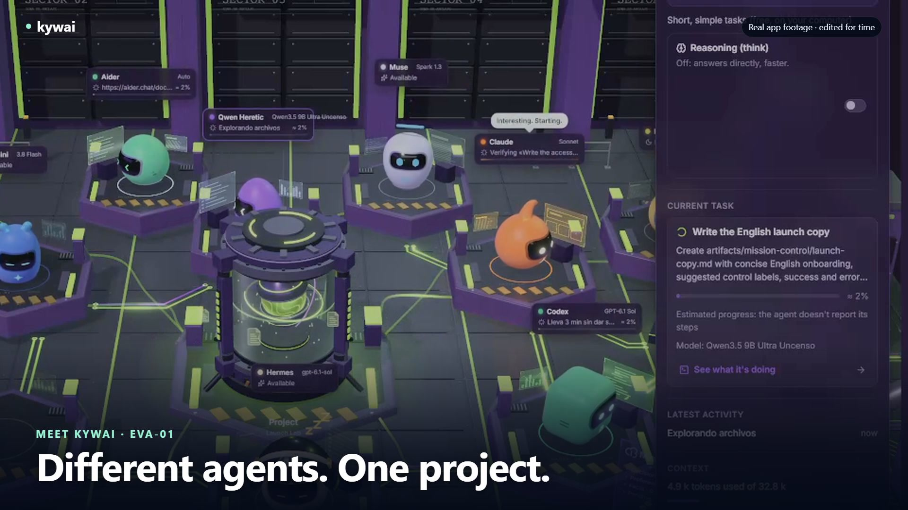](https://kywai.app/pt/#video)

**[▶ Veja kywai em ação — 30 segundos](https://kywai.app/pt/#video)** · [Baixar MP4](docs/video/kywai-promo-30s.mp4)
Gravação real do app, música original e textos em inglês.

[](https://kywai.app)


[](https://ko-fi.com/yilsander)

<br>

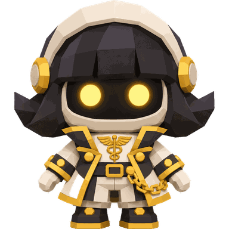
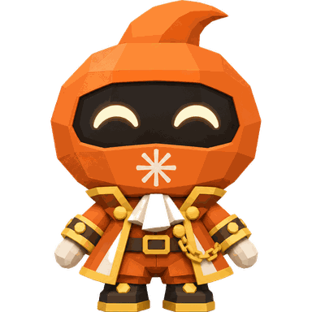
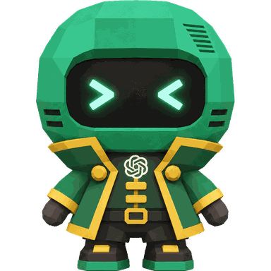
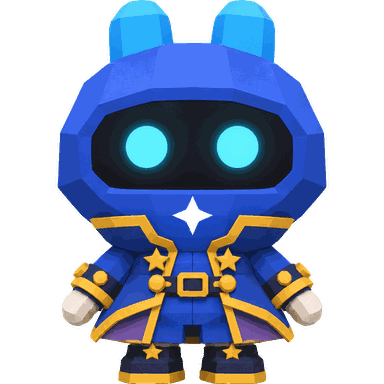
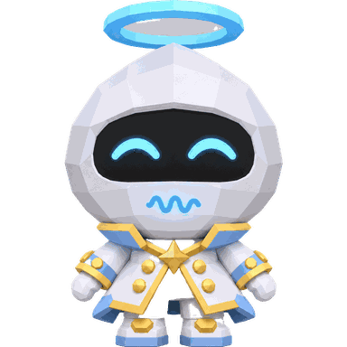
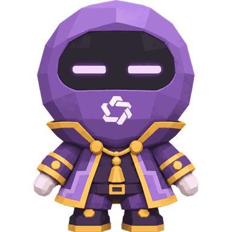
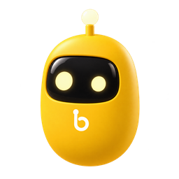

[O que é](#-o-que-é) · [Qualquer agente](#-qualquer-agente-qualquer-provedor) · [Por quê](#-por-que-o-kywai) · [Como funciona](#-como-funciona) · [Recursos](#-recursos) · [Extensões](#-extensões-mcp-skills-plugins-e-mods) · [De qualquer lugar](#-use-de-qualquer-lugar) · [Temas](#-temas) · [Instalação](#-instalação) · [Privacidade](#-privacidade-e-segurança) · [Apoiar](#-apoie-o-projeto)

</div>

<br>

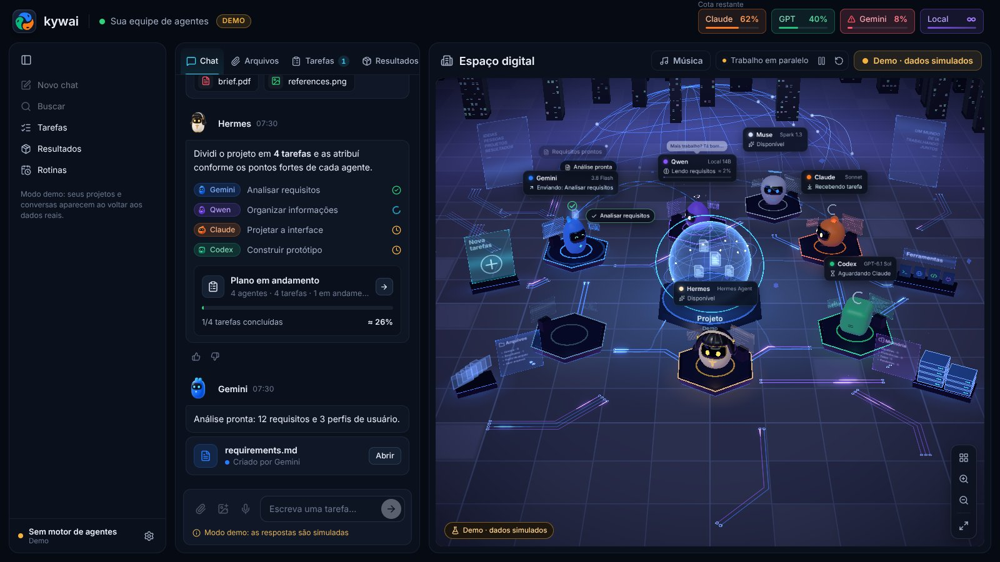

## ✨ O que é

O kywai transforma os agentes e as assinaturas de IA que você já tem, de qualquer provedor, em **uma única equipe que trabalha em conjunto**. Em vez de pular de um app para outro copiando contexto, você pede uma vez:

1. **🧭 Hermes, o coordenador,** entende o que você quer e propõe um plano: quais tarefas existem, qual agente fará cada uma e por quê.
2. **✅ Você aprova,** ou diz com suas próprias palavras o que mudar.
3. **⚙️ Os agentes trabalham,** em paralelo quando vale a pena, na pasta do seu projeto, cada um com seu próprio programa e o seu login ou chave de API.
4. **🔍 Outro agente revisa o resultado** antes que ele chegue até você, e o autor corrige o que for encontrado.
5. **📦 Você recebe as entregas** no chat, agrupadas e prontas para abrir, com um resumo do que foi feito e de quanto custou.

O objetivo é simples: **deixar uma tarefa e voltar para encontrar um resultado, nunca um erro sem nada para mostrar.**

## 🎬 O que você pode pedir

Alguns exemplos reais do que a equipe faz enquanto você cuida de outra coisa:

| Você escreve | O que acontece |
|---|---|
| “Faça uma landing page para minha padaria” | O Claude desenha e constrói, outro agente abre no navegador e confere capturas e testes, e você recebe os arquivos prontos para publicar. Acrescente “duas opções” e um terceiro escolhe a melhor. |
| “Descubra por que o login falha e corrija” | O Codex reproduz o erro, corrige e roda os testes; um revisor de outra família confirma. Se algo quebrar, Desfazer deixa seus arquivos exatamente como estavam. |
| “Resuma esses 300 PDFs e compare” | O Gemini lê muito material de uma vez e devolve um relatório com o essencial e uma tabela. Arraste os arquivos para o chat, até pelo celular. |
| “Crie a imagem de capa do meu post” | A imagem é gerada com a ferramenta de imagens do Codex (não desenhada com código) e aparece no chat como miniatura para abrir, baixar ou pedir mudanças. |
| “Toda manhã às 9, revise os PRs novos” | Uma rotina dispara todo dia no seu computador sempre ligado. Você lê o resultado no celular, e “Precisa de você” só toca se algo precisar da sua decisão. |
| “@Qwen escreva cinco títulos” | O que é rápido vai direto ao agente que você nomeia, sem plano nem revisão. Com um modelo local é grátis e nada sai do seu computador. |

## 🔌 Qualquer agente, qualquer provedor

O kywai não está preso a um conjunto fixo de modelos. É uma plataforma em que **você monta a sua própria equipe**:

- **Adicione quantos agentes quiser** em ⚙ → "Configurar agentes…" → "Adicionar um agente". O catálogo já sabe iniciar mais de 30 deles, com a conta ou assinatura que cada um usa: Claude Code, Codex CLI, Gemini CLI, Antigravity CLI, Muse Code, Aider, DeepSeek, Qwen Code, Kimi Code, MiniMax Code, Mistral Vibe, Grok Build, GitHub Copilot CLI, Cursor, Amp, Goose, OpenCode, Cline, Continue, OpenHands, Factory Droid, Auggie, Junie, Kiro, Rovo Dev, Qoder CLI, Crush, Open Interpreter, gptme, Letta Code, ForgeCode, OpenClaw e mais.
- **Encontre opções gratuitas.** O filtro «Só grátis» do catálogo destaca agentes com opções gratuitas, incluindo Kilo CLI com Kilo Auto Free. Cada ficha explica os requisitos e limites do provedor.
- **Ou conecte qualquer outro programa** com "Outro programa…": informe o comando, como ele recebe a tarefa (stdin, um arquivo ou um argumento) e seus argumentos, e ele entra para a equipe.
- **Assinaturas ou chaves de API.** Os agentes rodam com o login que você já tem no próprio programa deles. Os que usam chave de API (DeepSeek, Kiro, Junie, Factory Droid, Amp…) pedem a chave uma única vez; ela é criptografada com o chaveiro do sistema e repassada apenas a esse agente.
- **Modelos locais também.** Qualquer modelo que você rode no LM Studio ou no Ollama, de graça e sem sair do seu computador.
- **O agente local se vira sozinho.** Ele liga o LM Studio sozinho quando precisa, e a chave "Raciocínio (think)" no cartão dele deixa o modelo pensar antes de responder só quando você quiser (desligada por padrão, para responder bem mais rápido).
- **Você escolhe quem coordena.** O Hermes é o padrão, mas qualquer agente pode planejar e distribuir as tarefas ("Tornar coordenador"). Se ele estiver indisponível, o próximo assume.
- **Cada agente é um membro pleno da equipe,** com seu próprio robô e sua estação no mundo 3D, suas estatísticas de desempenho e o mesmo plano, revisão e desfazer que os demais.

## 💡 Por que o kywai

<table>
<tr>
<td width="50%" valign="top">

**💳 Os agentes que você já paga**<br>
Ele controla o próprio programa de cada agente com a sua sessão, então usa a cota dos seus planos em vez de custos extras de API, e chaves de API ou modelos locais gratuitos também funcionam. O cabeçalho mostra a **cota restante real** do Claude e do GPT.

</td>
<td width="50%" valign="top">

**🎯 Cada tarefa com o agente que a faz melhor**<br>
O coordenador conhece os pontos fortes, os modelos, a cota e o histórico de cada agente. Trabalho fácil vai para um *estagiário* (o mesmo agente com menos esforço), trabalho normal para o modelo principal e trabalho difícil para o mais forte.

</td>
</tr>
<tr>
<td valign="top">

**🏆 Qualidade em primeiro lugar, por padrão**<br>
Cada tarefa tem um critério de aceitação. Um agente de outra família revisa cada alteração, roda ele mesmo os testes e só um *aprovado* explícito a aceita. Em trabalhos que dependem de gosto (um site, um logotipo, uma apresentação) você pode pedir duas versões e um terceiro escolhe a vencedora.

</td>
<td valign="top">

**🛟 Feito para nunca deixar você de mãos vazias**<br>
Se um agente não consegue terminar, outro agente forte assume. O trabalho interrompido continua de onde parou, um agente travado reinicia com um botão e qualquer alteração pode ser desfeita.

</td>
</tr>
<tr>
<td valign="top">

**👀 Totalmente transparente**<br>
Cada agente conta em frases curtas o que está fazendo. Uma visão passo a passo ao vivo mostra cada comando com sua saída, cada arquivo lido ou editado (com o diff) e cada busca.

</td>
<td valign="top">

**🔒 Privado desde a concepção**<br>
Tudo roda no seu computador. O acesso remoto trafega apenas pela sua própria rede Tailscale, o ditado por voz roda localmente e o kywai nunca vê nem armazena senhas.

</td>
</tr>
</table>

## 🧠 Como funciona


### A equipe padrão

Esta é a equipe que vem de fábrica. Você pode remover qualquer um deles e adicionar quantos outros quiser.

| | Agente | Roda em | Melhor em |
|---|---|---|---|
|  | **Hermes** | Hermes Agent | Coordenar: entende o pedido, planeja e distribui. Nunca executa tarefas ele mesmo. Se estiver indisponível, o Claude planeja. |
|  | **Claude** | Claude Code (sua assinatura do Claude) | Interfaces e design, redação, código grande ou complexo. |
|  | **Codex** | Codex CLI (sua conta do ChatGPT) | Apps e scripts de ponta a ponta, terminal, servidores e dados. É quem gera imagens. |
|  | **Gemini** | Gemini CLI | Ler e resumir enormes quantidades de material (contexto de 1M de tokens), traduções e relatórios rápidos. |
|  | **Muse** | Muse Code (sua assinatura da Meta) | Entender vídeo. Reserva quando os outros ficam sem cota. |
|  | **Local** | LM Studio ou Ollama | Tarefas curtas e simples de graça, sem sair do seu computador. Com o LM Studio, também pode ler, criar e editar arquivos. |

Qualquer agente que você adicionar pelo catálogo ou com "Outro programa…" funciona exatamente como estes: o coordenador o conhece, atribui tarefas a ele e ele aparece no mundo 3D. Veja [Qualquer agente, qualquer provedor](#-qualquer-agente-qualquer-provedor).

## 🚀 Recursos

### 🗺️ Planejamento e trabalho

- **Planos que você aprova.** Nada começa sem o seu OK, e você pode mudar o plano com uma frase ("deixa o Codex fazer", "pula a pesquisa"). Aprove com um toque ou simplesmente respondendo "sim". Se preferir, desative a aprovação e deixe a equipe ir direto ao trabalho.
- **Vários pedidos ao mesmo tempo.** O trabalho novo vai para agentes livres sem mexer em arquivos que outro agente está editando.
- **Mais rápido, sem baixar o nível.** Um agente começa a próxima tarefa enquanto a anterior é revisada, o Hermes dispara ao mesmo tempo as tarefas independentes, testes e capturas rodam em paralelo e, entre revisores igualmente confiáveis, escolhe-se o claramente mais rápido. Agentes em má fase deixam de receber o que não for fácil.
- **Sem trabalho repetido.** O Hermes não repete uma tarefa que já está em andamento, e o chat avisa se um pedido novo parece com um em curso.
- **Fale direto com um agente.** Escreva `@Claude …` (ou `/directo Claude …`) e o seu texto vai direto para esse agente, sem plano, revisão nem resumo do Hermes. Ao digitar `@` aparece a lista de agentes, no desktop, no navegador e no Órbita.
- **Critérios de aceitação por tarefa**, além de um aviso se um agente mexer em arquivos que não eram dele.
- **Dividido como uma equipe de verdade.** Trabalhos grandes com partes separáveis (motor, interface, servidor…) são divididos em paralelo entre os melhores agentes, com um contrato comum escrito pelo coordenador (quais arquivos são de quem e como as partes se falam), e uma tarefa final “Integrar e testar” que roda os testes e confere o conjunto contra o pedido.
- **Imagens geradas, não desenhadas.** Peça uma ilustração, pôster, logotipo ou ícone e ele vai ao agente com ferramenta de imagens, que gera em vez de desenhar devagar com SVG ou scripts. Se quiser algo exato ou editável, diga e será feito com código.
- **Duas mãos para trabalhos de gosto, quando você pede.** Dois agentes de famílias diferentes constroem a mesma coisa separadamente (opção A e opção B), e um terceiro testa as duas, compara com o seu pedido e diz qual vence e por quê.
- **Revisão rigorosa e com testes de verdade.** Quando uma tarefa altera arquivos, um agente de outra família a revisa em modo somente leitura, roda ele mesmo os testes e responde *aprovado* ou *problemas*; só um *aprovado* explícito a aceita. Sem veredito, pede-se a outro revisor confiável. Cada tarefa tem até duas correções e um repasse para outro agente forte; se ainda falhar, aparece em "Precisa de você" como precisando da sua intervenção.
- **Retomada e repasse.** Tarefas interrompidas continuam de onde pararam. Se um agente falha, outro agente forte assume a tarefa, nunca um mais fraco. Os agentes também retomam a própria sessão nos acompanhamentos.
- **Chave de acesso total.** Deixe os agentes instalarem coisas e usarem a internet sem perguntar, ou limite-os a editar a pasta do projeto.

### 📡 Acompanhando o trabalho

- **Atualizações curtas ao vivo** de cada agente enquanto trabalha, com suas ferramentas recolhidas em uma única linha expansível, como no app do Claude.
- **Visão passo a passo ao vivo** de qualquer tarefa: raciocínio, cada comando e sua saída, arquivos lidos e editados com suas alterações, buscas e a resposta final. Guardada por 30 dias.
- **Progresso visível.** Novas capturas de tela e imagens aparecem como miniaturas no chat, e documentos como cartões, enquanto a tarefa ainda está rodando.
- **Respostas, não só ✓.** Quando um pedido termina, o coordenador lê os resultados reais e escreve o que foi feito e onde está, como testar, o que foi decidido e o que ficou de fora. Abaixo de cada plano você vê tempo, tokens e cota usada (“14 min · 339 k tokens · Claude 5 h +5 %”).
- **Cada tarefa no seu bloco.** No chat cada tarefa tem seu número, suas etapas reais (trabalhando, corrigindo, testes, revisão) e a revisão assinada pelo agente que a fez. Assim que você envia, uma linha mostra que o Hermes está preparando o plano, e se um agente fica em silêncio você vê "sem novidades há N min" em vez de uma barra de progresso inventada.
- **Pré-visualização de arquivos ao lado do chat.** Clique num anexo, numa entrega ou no nome de um arquivo e ele abre num painel lateral, como no Claude: documentos, código, imagens e PDF, com miniaturas das imagens anexadas. O Órbita tem o mesmo leitor com ‹ ›, visão de código, copiar e "Abrir com outro app".
- **Sino "Precisa de você"** só com o que realmente espera por você (um plano, uma pergunta, uma permissão, um agente em silêncio ou uma tarefa pausada com Retomar / Remover), com seus botões e notificações no celular. O que terminou vai para Resultados como "Recém-terminado".
- **Espaço digital 3D** que mostra cada estado: trabalhando, em revisão, esperando a revisão de outro agente, delegando a um estagiário, sem cota ou falhando, com arquivos viajando entre os robôs e uma faísca a cada passo real do agente.
- **Uma equipe que parece viva.** Os robôs livres brincam com um documento de brinquedo ou uma bola colorida, visitam os colegas e acordam um companheiro com um susto amigável. Reagem, sorriem e voltam ao posto quando o trabalho real precisa deles; reduzir efeitos desativa essas animações locais. Também dançam juntos, brincam de imitar, tocam as antenas e visitam o colega cansado para animá-lo. Com música tocando, os livres ficam acordados e dançam seguindo o pulso do player ou da música ambiente; a etiqueta mostra «Dançando».
- **Robôs com personalidade.** Os olhos mostram o que cada um está realmente fazendo (concentrado, pensando, cansado, dormindo, com erro, concluído), cada um tem sua personalidade e seus balões de fala no seu idioma, e quando você digita no chat eles acordam e se viram para olhar para você.

<p align="center">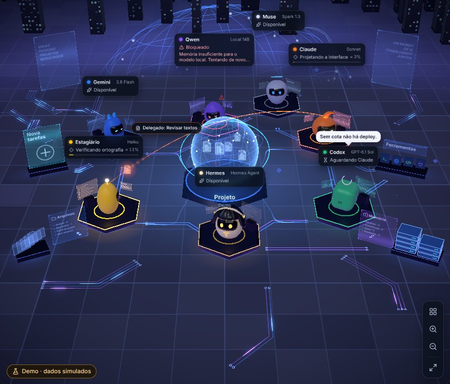</p>

### ↩️ Controle e rede de segurança

- **Alterações por tarefa, com Desfazer.** Um snapshot é feito antes e depois de cada tarefa, em um armazenamento separado, nunca no `.git` do seu projeto. Veja "N arquivos alterados +a −b", revise o diff e desfaça uma única tarefa. Se as tarefas se sobrepuserem, o resultado é mantido como uma cópia separada.
- **Reinicie um agente com falha** pelo painel dele: ele limpa o bloqueio (cota, sessão, erro de API), verifica sua CLI de novo e retoma o que estava esperando por ele.
- **Avalie qualquer resultado** 👍 / 👎. As avaliações alimentam o coordenador, que assim aprende quem realmente entrega.
- **Painel "Como cada agente se sai"**: tarefas, 👍, revisões aprovadas de primeira, correções, tempo e custo por agente, por dificuldade e por tipo de tarefa (visual, web, código, texto, pesquisa). O coordenador usa esse histórico ao distribuir, então aprende quem realmente entrega.

### 🧩 Contexto e automação

- **Traga o trabalho que você já tem.** Importe sessões locais do Claude Code, Codex e Hermes (incluindo Hermes Desktop), ou exportações JSON/ZIP do ChatGPT e Claude.ai, em ⚙ → Importar de outros apps. Preserve conversas, recupere projetos e documentos do Claude incluídos e continue com sua equipe. Os originais são preservados; as sessões locais são lidas no servidor. Os chats do Claude.ai vão para o próprio projeto, e importar de novo nunca duplica nada.
- **Conversas como no Claude.** Uma barra lateral com seus projetos, os fixados e os chats recentes. Ela se recolhe numa coluna de ícones, outro clique no projeto aberto o recolhe e o clique direito (toque longo no Órbita) permite fixar, renomear, bifurcar, mover ou excluir. "Novo chat" começa uma conversa nova sem perder a anterior, e qualquer uma pode ser retomada depois com suas tarefas e a sessão de cada agente. Ctrl+K busca em conversas, tarefas, resultados e memória de todos os projetos.
- **Busca e histórico.** Ctrl+K busca de uma vez em todas as conversas, tarefas, resultados e notas de memória, com frase exata (“…”) e filtros de data e autor, e abre o chat direto na mensagem encontrada, destacada. A janela Histórico agrupa todas as conversas de todos os projetos por Hoje, Ontem, últimos 7 e 30 dias e por mês. Também no Órbita.
- **Memória do projeto** com instruções, decisões, preferências e pendências, cada uma com seu autor e status. Todo agente a lê em cada tarefa, mesmo depois que você limpa o chat.
- **Um único AGENTS.md para toda a equipe.** Cada CLI lê apenas o próprio arquivo; o kywai repassa os outros, então um único `AGENTS.md` dá a todos os agentes as mesmas regras.
- **Rotinas.** Programe um pedido uma única vez, em horário fixo, em certos dias, a cada N horas, por webhook assinado do GitHub ou quando arquivos de uma pasta mudarem. Crie com /rutina, consulte o histórico e escolha se exige aprovação. Propostas do coordenador só são salvas após sua confirmação.
- **Modelos de tarefas.** Cartões acima do chat para revisar PRs, resumir pastas, encontrar falhas ou criar seus próprios pedidos. Preencha campos, use o comando /…, envie para a equipe ou direto a um agente e transforme os modelos compatíveis em rotinas.
- **Entregas para baixar.** Abra ou baixe cada arquivo pelo chat e Resultados, ou salve um conjunto em ZIP. Disponível no desktop, cliente, navegador e Órbita, inclusive para levar o resultado pelo celular.

### 🧰 Extensões: MCP, skills, plugins e mods

Em **⚙ → Configurações → Extensões**, amplie as ferramentas dos agentes e personalize o kywai:

- **Servidores MCP.** Pesquise no catálogo ou adicione um comando, JSON ou endereço. Escolha quais agentes podem usar cada servidor: o kywai verifica se ele responde e lista as ferramentas antes de ativá-lo. Instale uv ou Node.js pela própria ficha se estiverem faltando.
- **Skills compartilhadas.** Encontre habilidades no skills.sh ou instale a partir de um repositório ou pasta do GitHub. O `SKILL.md` fica junto dos scripts e referências, e toda a equipe pode consultar essas habilidades quando precisar.
- **Plugins.** Explore os catálogos de plugins da Anthropic ou adicione outro catálogo ou plugin do GitHub. O kywai converte skills, comandos e perfis de subagentes em habilidades compartilhadas e importa MCPs desativados para você escolher quais agentes podem usá-los.
- **Mods.** Instale extensões do kywai pelo GitHub ou por uma pasta local, com comandos /… no chat, hooks no início ou fim dos trabalhos e painéis próprios. Hooks exigem sua permissão; painéis rodam isolados no desktop, na web e no Órbita.

**Compatibilidade:** MCPs do usuário conectam-se a Claude, Codex, Gemini e Hermes; agentes incompatíveis aparecem desativados. Servidores remotos que exigem autorização precisam de um token: OAuth e SSE ainda não são aceitos. Plugins importam os componentes compatíveis; seus hooks e LSP não rodam como no Claude Code. O MCP interno do kywai é oferecido atualmente ao Claude em tarefas coordenadas.

Detalhes e exemplo de mod no [manual](docs/MANUAL.md#extensiones-tus-servidores-mcp-para-los-agentes) e em [Notas rápidas](docs/mods/notas-rapidas).

### 📊 Cota e custo

- **Cotas que acompanham sua equipe.** O cabeçalho se atualiza ao adicionar, remover, ativar ou desativar agentes. Mostra dados reais de Claude e GPT e distingue orçamentos ou estimativas de outros provedores e modelos locais.
- **Uso e custo.** Consulte tempo e tokens por pedido, custo por agente, planos de assinatura, API, gratuitos ou locais e compare o uso com o que paga. Configure preços e um alerta de orçamento mensal; exporte o consumo para CSV. Estimativas são identificadas.
- **Modelo e esforço por dificuldade,** modelos que você pode trocar no painel de cada robô e `/model` para mudar o modelo do Hermes.

### 🎨 Conforto

**Fundo do mar** traz cardumes, baleias, águas-vivas e uma cidade submersa ao redor de uma pérola luminosa. Relicario, Telar, Halloween e Natal agora têm cenários completos de santuário, ilhas de cristal, abadia gótica e vila nevada, preservando as preferências existentes.

**Refúgio Kywai** traz um observatório-estufa à beira-mar: cúpula de madeira e vidro, céu e água animados, oficinas individuais, árvore compartilhada e assento turquesa. Ative o modo noturno ao lado de Música; a preferência é lembrada por dispositivo.

- **O chat em primeiro lugar.** Em janelas menores ele ocupa mais espaço, você pode arrastar a borda até a largura que quiser (clique duplo volta ao automático) e em janelas estreitas o chat e o mundo 3D viram duas abas.
- **Um chat fácil de ler,** com respostas sem caixa, mais espaço entre parágrafos e um botão de copiar no canto de cada bloco de código ou de comandos. O Hermes e os agentes escrevem curto, com o resultado primeiro.
- **Ditado por voz local** com Whisper no seu próprio computador. Sem serviços externos, e o áudio é apagado em seguida.
- **Mapas, cores e decorações.** Sete mapas 3D, a Cidade digital em sete cores e quatro decorações. Siga o tema do servidor ou escolha um por dispositivo; o Órbita adapta a paleta, sem reproduzir os mapas do desktop.
- **Vozes dos agentes,** cada uma com seu próprio timbre, e texto que vai sendo digitado no ritmo da voz, como em Animal Crossing.
- **Player de música** com busca no YouTube Music, Audius e rádios da SomaFM sem anúncios, e fila de reprodução, e luzes que acompanham o BPM da música sem microfone.
- **Assistente de configuração** que instala os programas que faltam com seus instaladores oficiais e abre cada login oficial.
- **Modo demo** para mostrar o app sem gastar nada.
- **Leve para o seu computador.** A qualidade do 3D se ajusta sozinha à sua máquina sem travadas, descansa com a janela oculta e desacelera quando você está em outro app, e “Reduzir efeitos” tira o supérfluo. A equipe continua trabalhando com a janela fechada.

### ⌨️ Comandos do chat

| Comando | O que faz |
|---|---|
| `/model` | Ver e mudar o modelo do Hermes |
| `/usage` | Consultar as cotas na hora |
| `/recuerda …` | Salvar algo na memória do projeto (`decisión:`, `pendiente:`, `preferencia:`) |
| `/rutina …` | Criar ou gerenciar uma rotina |
| `/new` | Começar uma nova conversa, guardando uma cópia da anterior |
| `@Agente …` | Enviar o texto direto para um agente, sem passar pelo Hermes (também `/directo Agente …`) |

## 🌍 Use de qualquer lugar

O computador onde o kywai está instalado (por exemplo, um Mac mini sempre ligado) faz o trabalho. Você pode levá-lo com você de quatro formas:

| | 🖥️ **Desktop** | 💻 **Cliente desktop** | 🌐 **Navegador** | 📱 **Órbita (Android)** |
|---|---|---|---|---|
| **O que é** | O app completo para Windows, macOS e Linux | O app em outro computador, conectado ao seu kywai principal | A mesma interface a partir de qualquer dispositivo da sua rede Tailscale | Um app nativo para Android feito para o celular |
| **Como você entra** | Abra o app | Pareie uma vez com um código de 6 dígitos | Um link com código de acesso, uma única vez | Pareie uma vez com um código de 6 dígitos |
| **O que você pode fazer** | Tudo | Tudo, além de navegar pelos arquivos do servidor e **sincronizar pastas** nos dois sentidos | Chat, mundo 3D, arquivos, resultados e aprovação de planos | Chat, planos, tarefas, arquivos, memória, uso e um mundo 3D nativo |
| **Atualizações** | ⚙ → "Verificar atualizações…" | Atualizações assinadas a partir do seu próprio servidor | Sempre a versão mais recente | Pelas Configurações, sem reinstalar. As novas versões são publicadas automaticamente |

<p align="center">
  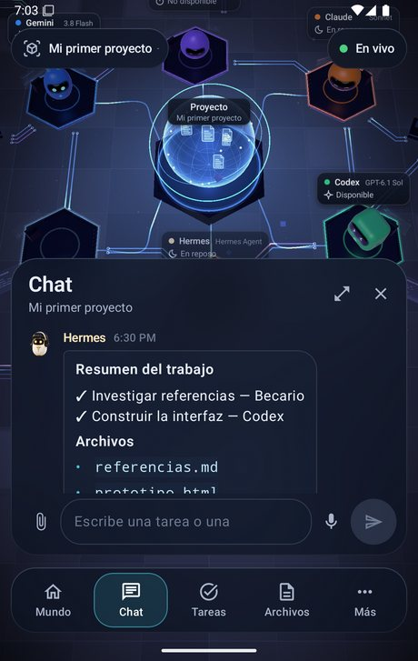
  &nbsp;
  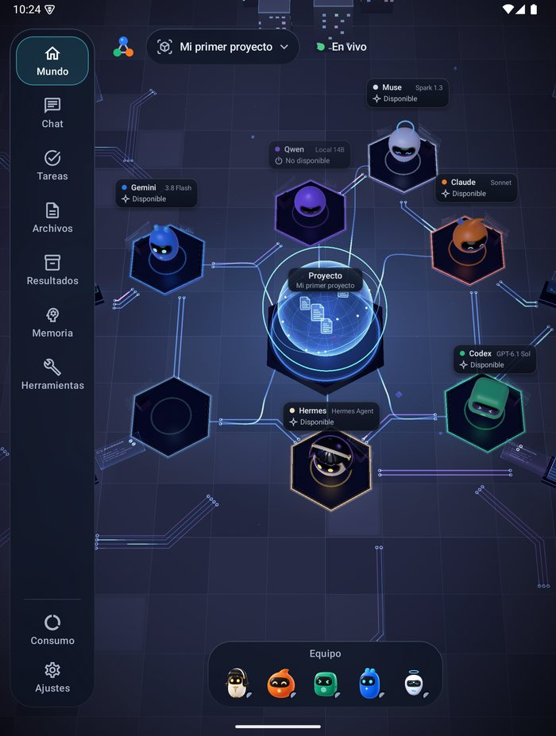
</p>

O Órbita guarda a cópia mais recente para que você possa usá-lo **offline**, coloca suas mensagens na fila até a conexão voltar e se adapta a dobráveis e tablets. Mais em [android/README.md](android/README.md).

O Órbita é pareado uma vez com um código de 6 dígitos e continua pareado mesmo quando o kywai reinicia ou atualiza. Ele se atualiza sozinho a partir do seu computador, avisa o que precisa de você também em segundo plano e tem o mesmo histórico, busca, resultados e uso do desktop.

No chat, o Órbita tem **ditado ao vivo** (um toque no microfone; segure para gravar uma nota de voz que o seu computador transcreve com o Whisper), um **botão de câmera** para tirar uma foto ou escolher da galeria, e os mesmos menus de toque longo que o clique direito do desktop.

Um computador era cliente e você quer que ele seja o servidor? Toque em **"Usar este computador como servidor"** na tela de conexão ou em ⚙ → Configurações → Conexão.

## 🎨 Temas

A galeria de **Configurações → Temas** reúne sete mapas (Clásico, Órbita, Marfil, Grafito, Bosque, Matrix e EVA-01), a Cidade digital em sete cores e quatro decorações. Siga o tema do servidor ou escolha um por dispositivo. O Órbita adapta a paleta, não os cenários do desktop. As imagens mostram algumas cores e decorações:

<table>
  <tr>
    <td align="center">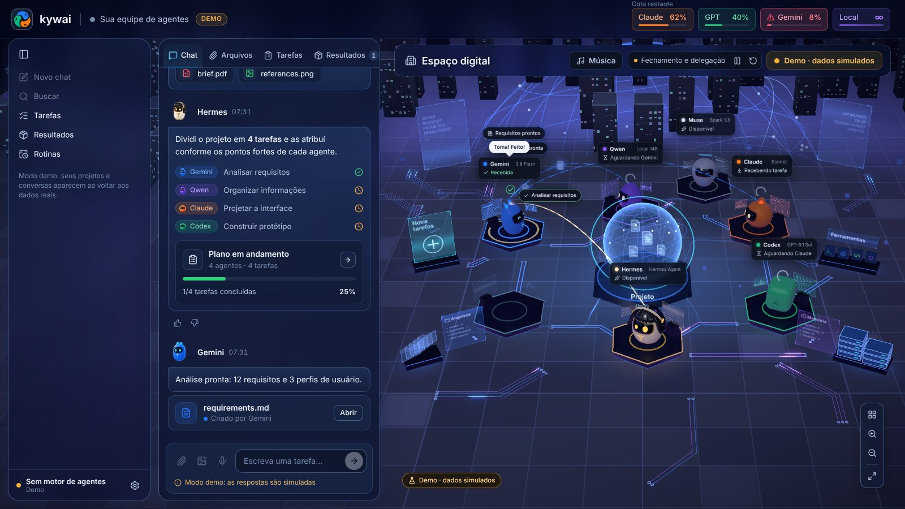<br><b>Frost Glass</b>: vidro fosco</td>
    <td align="center">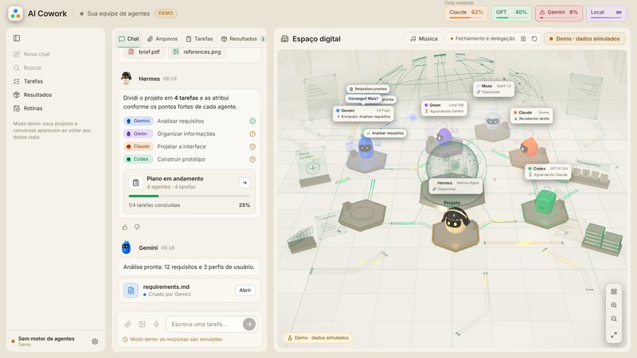<br><b>Pérola</b>: claro e acolhedor</td>
    <td align="center">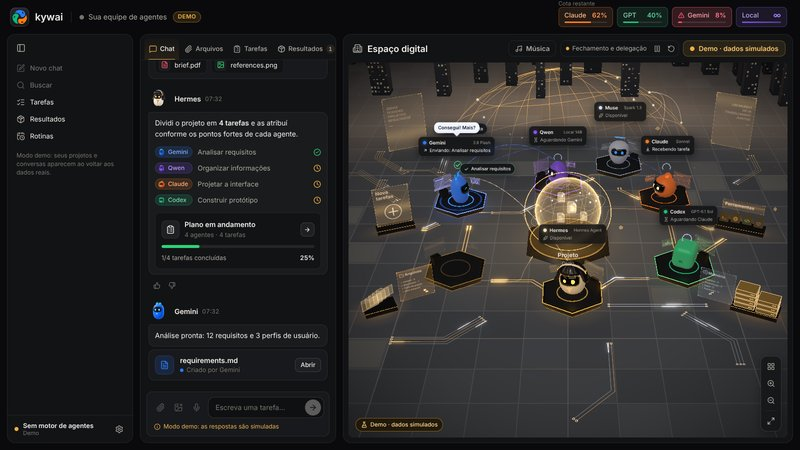<br><b>Ônix</b>: preto e dourado</td>
  </tr>
  <tr>
    <td align="center">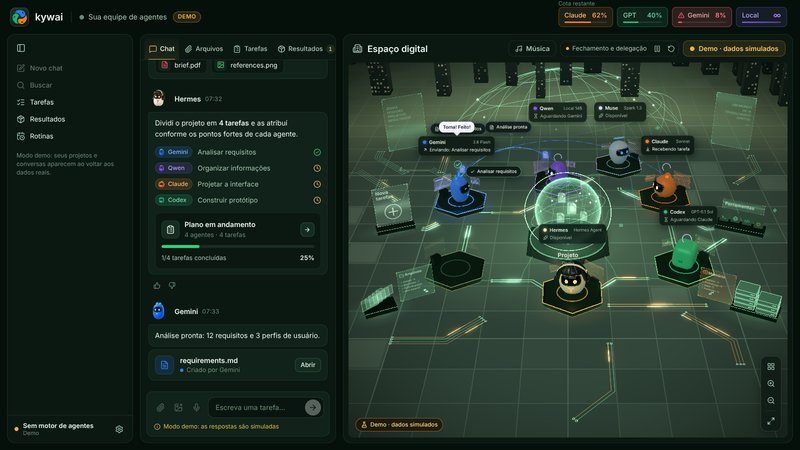<br><b>Esmeralda</b>: verde profundo e dourado</td>
    <td align="center">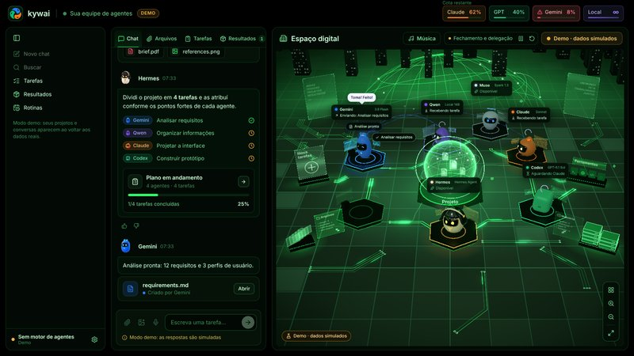<br><b>Néon</b>: preto e verde neon</td>
    <td align="center">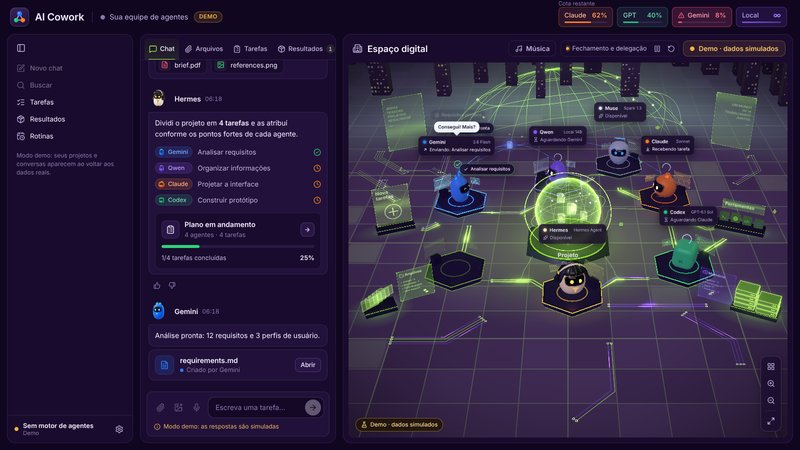<br><b>Ultravioleta</b>: roxo e verde-limão</td>
  </tr>
</table>

E quatro que decoram o mundo, remodelam o seu núcleo e, nos festivos, vestem os robôs:

<table>
  <tr>
    <td align="center">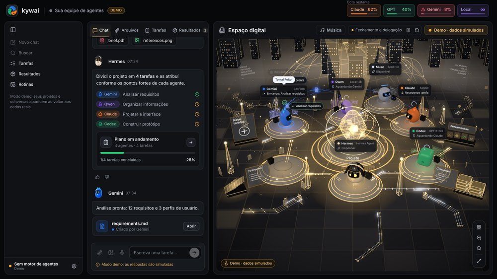<br><b>Relicario</b>: um núcleo de cristal lapidado e plataformas de vidro e ouro</td>
    <td align="center">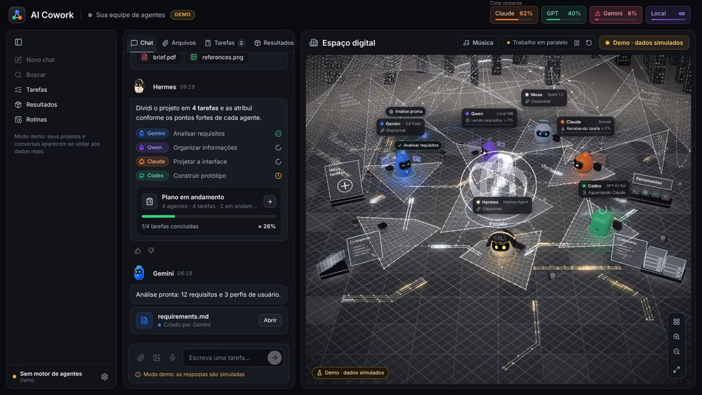<br><b>Telar</b>: membranas de fio de prata com faíscas douradas</td>
  </tr>
  <tr>
    <td align="center">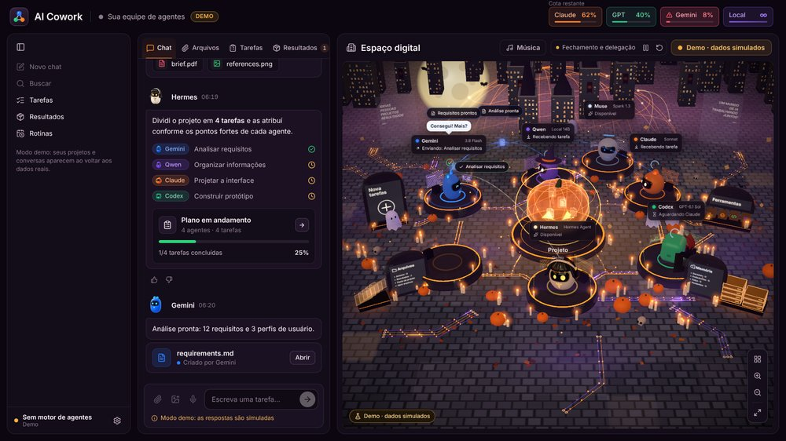<br><b>Halloween</b>: abóboras, velas, lua, morcegos, uma bruxa e um vampiro</td>
    <td align="center">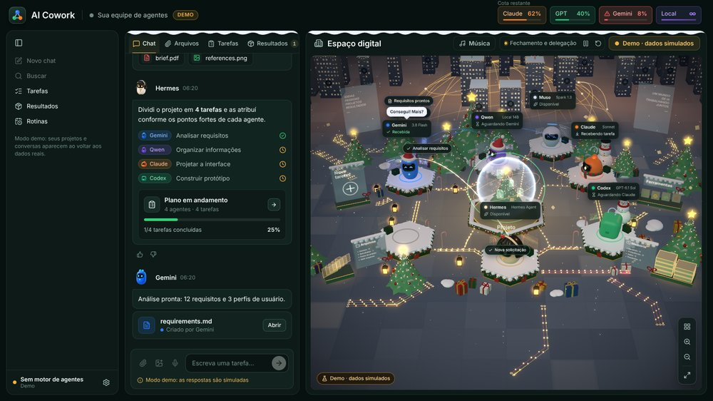<br><b>Navidad</b>: neve, árvores, presentes, um globo de neve e gorros de Papai Noel</td>
  </tr>
</table>

## 📥 Instalação

### Requisitos

- **Windows 10/11, macOS** (Apple silicon ou Intel) **ou Linux** (x64 ou ARM; Ubuntu, Debian, Fedora, Arch, openSUSE…).
- **Node.js** `^22.22.2 || ^24.15.0 || >=26.0.0`. O assistente o instala se estiver faltando.
- Pelo menos um agente: qualquer um do catálogo (Claude Code, Codex CLI, Gemini CLI, DeepSeek, Qwen Code, Copilot…), um modelo local ou qualquer agente de linha de comando. O **Hermes Agent** coordena por padrão, mas qualquer agente pode fazer isso.
- Opcional: **LM Studio** ou **Ollama** para o agente local, **git** para o Desfazer e **Tailscale** para usar a partir de outros dispositivos.

> **Idioma:** o app está em inglês, espanhol, português, francês e chinês. Ele abre no idioma do sistema e você pode mudar em ⚙ → Configurações → "Idioma · Language". O português, o francês e o chinês foram traduzidos automaticamente; correções são bem-vindas.

### Baixar (o mais fácil)

Baixe o instalador do seu sistema na **[versão mais recente](https://github.com/Yiku21/kywai/releases/latest)**: `.exe` para Windows, `.dmg` para macOS (Apple silicon ou Intel) e `.AppImage` para Linux. Android: baixe `kywai-orbita.apk` da mesma versão. Depois de instalado, o app procura uma versão nova toda vez que abre e se atualiza sozinho (no macOS ele avisa e abre o download).

Ainda não são assinados: no Windows clique em "Mais informações" → "Executar assim mesmo"; no macOS, na primeira vez, clique com o botão direito no app → Abrir (se disser que está danificado, rode `xattr -cr "/Applications/kywai.app"`); no Linux torne o AppImage executável com `chmod +x`.

Ou compile você mesmo:

### Windows

```bash
npm install
npm run dist:win
```

Isso gera `release/kywai-Setup-<version>.exe`. O instalador permite escolher a pasta e cria os atalhos. Como ele não tem assinatura de código, o Windows pode exibir um aviso: "Mais informações" → "Executar assim mesmo".

### macOS

```bash
npm run fuente
```

Isso gera `release/kywai-fuente.zip`. No Mac, descompacte o arquivo e execute isto dentro da pasta:

```bash
bash scripts/instalar-mac.sh
```

Ele compila o app para esse Mac, copia-o para `/Applications` (ou para onde você escolher) e o abre.

### Linux

Com Node.js e git instalados, clone o repositório e execute isto dentro da pasta:

```bash
bash scripts/instalar-linux.sh
```

Ele compila o app para esse computador, instala-o em `~/.local/share/ai-cowork` sem pedir permissões de administrador, adiciona-o ao menu de aplicativos e cria o comando `ai-cowork`. Também dá para gerar uma AppImage com `npm run dist:linux`. Detalhes no [manual](docs/MANUAL.md#linux-se-compila-en-el-propio-equipo) (em espanhol).

### Primeira execução

O **assistente de configuração** abre na primeira inicialização (também em ⚙ → "Configurar agentes…"):

1. Escolha quais agentes usar.
2. Ele verifica os programas deles e instala os que faltam com seus instaladores oficiais.
3. Ele abre o login oficial de cada agente. O kywai nunca vê nem armazena senhas.
4. Ele resume o que ainda estiver pendente.

Para usá-lo a partir do celular ou do notebook, abra ⚙ → "Acesso a partir de outros dispositivos…".

## 🔐 Privacidade e segurança

- **No seu computador.** Projetos, memória, logs e uso ficam na sua pasta de dados de usuário (`%APPDATA%\AI Cowork` no Windows, `~/Library/Application Support/AI Cowork` no macOS, `~/.config/AI Cowork` no Linux).
- **Acesso remoto fechado.** O servidor escuta apenas no seu IP do Tailscale e em `127.0.0.1`, nunca na rede local nem na internet, e pede um código em cada requisição. Cada dispositivo pareado tem sua própria chave, que você pode revogar individualmente (ela também expira após 90 dias sem uso), ou você pode revogar todas de uma vez com um novo código. Os códigos de pareamento expiram após 10 minutos e permitem apenas algumas tentativas.
- **Atualizações assinadas do cliente.** Os clientes desktop só instalam atualizações assinadas com a sua própria chave privada, que nunca sai do computador que as publica.
- **Sem senhas.** Cada agente usa o login do seu próprio programa oficial. As chaves de API que você adiciona são criptografadas com o chaveiro do sistema.
- **Os agentes ficam na sua pasta.** Eles são instruídos a trabalhar apenas dentro da pasta do projeto. Com o "Acesso total" desativado, essa pasta é tudo o que eles podem editar.
- **Voz local.** O ditado usa Whisper no seu próprio computador, e o áudio é apagado em seguida.

## 🛠️ Desenvolvimento

```bash
npm install
npm run dev        # app desktop em modo de desenvolvimento
npm run web        # apenas a interface no navegador (http://localhost:5199), em modo demo
npm run typecheck  # tipos
npx vitest run     # testes
```

**Stack:** Electron, React 19, TypeScript e Three.js (react-three-fiber) no desktop; Kotlin, Jetpack Compose e OpenGL ES no Órbita.

```
src/
  shared/      contrato entre o motor e a interface (tipos, valores padrão)
  main/        motor: janela, CLIs, planejamento, tarefas, cotas, projetos, servidor web e móvel
  preload/     ponte segura window.cowork
  renderer/    interface: chat, painéis e o espaço digital 3D
android/       Órbita, o app para Android
docs/          manual, guia de modelos e API móvel
```

## 📚 Documentação

A documentação detalhada está em espanhol:

- **[Manual](docs/MANUAL.md)**: todos os recursos em detalhe.
- **[Guia de modelos](docs/GUIA-MODELOS.md)**: qual modelo e qual esforço cada agente usa conforme a dificuldade, com fontes.
- **[Órbita](android/README.md)**: o app para Android, e como compilá-lo e publicá-lo.
- **[API móvel](docs/mobile-api/README.md)**: o contrato entre o servidor e o Órbita.

## ☕ Apoie o projeto

O kywai é gratuito e de código aberto. Se ele economiza o seu tempo e você quiser agradecer, pode **[me pagar um café no Ko-fi](https://ko-fi.com/yilsander)**. Também está no app: ⚙ → "Apoiar o kywai ☕" no desktop, e no fim das Configurações no Órbita.

[](https://ko-fi.com/yilsander)

## 📄 Licença

[MIT](LICENSE). Você pode usar, alterar e compartilhar o kywai livremente, desde que mantenha o aviso de copyright.

<div align="center">
<br>
<sub>Construído por uma equipe inteira de agentes de IA, coordenada pelo Hermes.</sub>
</div>
