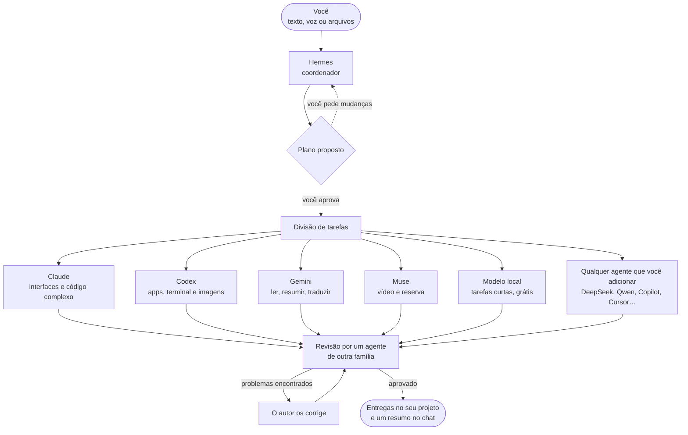

<div align="center">


# AI Cowork

### Qualquer agente de IA, de qualquer provedor, quantos você quiser, trabalhando como uma só equipe.

Peça uma vez. Um coordenador planeja o trabalho e entrega cada tarefa ao agente que a faz melhor: Claude, Codex, Gemini, DeepSeek, Qwen, Copilot, Cursor, um modelo local ou qualquer agente de linha de comando que você adicionar. Você acompanha cada robô trabalhando em um mundo 3D ao vivo, e os resultados voltam para você, já revisados.

[English](README.md) · [Español](README.es.md) · **Português** · [Français](README.fr.md) · [简体中文](README.zh-CN.md)

https://github.com/user-attachments/assets/d9df3fa8-9d52-4fb6-93e9-2f37d54fb362


[](https://ko-fi.com/yilsander)

<br>


[O que é](#-o-que-é) · [Qualquer agente](#-qualquer-agente-qualquer-provedor) · [Por quê](#-por-que-o-ai-cowork) · [Como funciona](#-como-funciona) · [Recursos](#-recursos) · [De qualquer lugar](#-use-de-qualquer-lugar) · [Temas](#-temas) · [Instalação](#-instalação) · [Privacidade](#-privacidade-e-segurança)

</div>

<br>


## ✨ O que é

O AI Cowork transforma os agentes e as assinaturas de IA que você já tem, de qualquer provedor, em **uma única equipe que trabalha em conjunto**. Em vez de pular de um app para outro copiando contexto, você pede uma vez:

1. **🧭 Hermes, o coordenador,** entende o que você quer e propõe um plano: quais tarefas existem, qual agente fará cada uma e por quê.
2. **✅ Você aprova,** ou diz com suas próprias palavras o que mudar.
3. **⚙️ Os agentes trabalham,** em paralelo quando vale a pena, na pasta do seu projeto, cada um com seu próprio programa e o seu login ou chave de API.
4. **🔍 Outro agente revisa o resultado** antes que ele chegue até você, e o autor corrige o que for encontrado.
5. **📦 Você recebe as entregas** no chat, agrupadas e prontas para abrir, com um resumo do que foi feito e de quanto custou.

O objetivo é simples: **deixar uma tarefa e voltar para encontrar um resultado, nunca um erro sem nada para mostrar.**

## 🔌 Qualquer agente, qualquer provedor

O AI Cowork não está preso a um conjunto fixo de modelos. É uma plataforma em que **você monta a sua própria equipe**:

- **Adicione quantos agentes quiser** em ⋮ → "Configurar agentes…" → "Adicionar um agente". O catálogo já sabe iniciar mais de 30 deles, com a conta ou assinatura que cada um usa: Claude Code, Codex CLI, Gemini CLI, Antigravity CLI, Muse Code, Aider, DeepSeek, Qwen Code, Kimi Code, MiniMax Code, Mistral Vibe, Grok Build, GitHub Copilot CLI, Cursor, Amp, Goose, OpenCode, Cline, Continue, OpenHands, Factory Droid, Auggie, Junie, Kiro, Rovo Dev, Qoder CLI, Crush, Open Interpreter, gptme, Letta Code, ForgeCode, OpenClaw e mais.
- **Ou conecte qualquer outro programa** com "Outro programa…": informe o comando, como ele recebe a tarefa (stdin, um arquivo ou um argumento) e seus argumentos, e ele entra para a equipe.
- **Assinaturas ou chaves de API.** Os agentes rodam com o login que você já tem no próprio programa deles. Os que usam chave de API (DeepSeek, Kiro, Junie, Factory Droid, Amp…) pedem a chave uma única vez; ela é criptografada com o chaveiro do sistema e repassada apenas a esse agente.
- **Modelos locais também.** Qualquer modelo que você rode no LM Studio ou no Ollama, de graça e sem sair do seu computador.
- **Você escolhe quem coordena.** O Hermes é o padrão, mas qualquer agente pode planejar e distribuir as tarefas ("Tornar coordenador"). Se ele estiver indisponível, o próximo assume.
- **Cada agente é um membro pleno da equipe,** com seu próprio robô e sua estação no mundo 3D, suas estatísticas de desempenho e o mesmo plano, revisão e desfazer que os demais.

## 💡 Por que o AI Cowork

<table>
<tr>
<td width="50%" valign="top">

**💳 Os agentes que você já paga**<br>
Ele controla o próprio programa de cada agente com a sua sessão, então usa a cota dos seus planos em vez de custos extras de API, e chaves de API ou modelos locais gratuitos também funcionam. O cabeçalho mostra a **cota restante real** do Claude e do GPT.

</td>
<td width="50%" valign="top">

**🎯 Cada tarefa com o agente que a faz melhor**<br>
O coordenador conhece os pontos fortes, os modelos, a cota e o histórico de cada agente. Trabalho fácil vai para um *estagiário* (o mesmo agente com menos esforço), trabalho normal para o modelo principal e trabalho difícil para o mais forte.

</td>
</tr>
<tr>
<td valign="top">

**🏆 Qualidade em primeiro lugar, por padrão**<br>
Cada tarefa tem um critério de aceitação. Um agente de outra família revisa cada alteração e, em trabalhos que dependem de gosto (um site, um logotipo, uma apresentação), dois agentes fazem cada um a sua versão e um terceiro escolhe a vencedora.

</td>
<td valign="top">

**🛟 Feito para nunca deixar você de mãos vazias**<br>
Se um agente não consegue terminar, outro agente forte assume. O trabalho interrompido continua de onde parou, um agente travado reinicia com um botão e qualquer alteração pode ser desfeita.

</td>
</tr>
<tr>
<td valign="top">

**👀 Totalmente transparente**<br>
Cada agente conta em frases curtas o que está fazendo. Uma visão passo a passo ao vivo mostra cada comando com sua saída, cada arquivo lido ou editado (com o diff) e cada busca.

</td>
<td valign="top">

**🔒 Privado desde a concepção**<br>
Tudo roda no seu computador. O acesso remoto trafega apenas pela sua própria rede Tailscale, o ditado por voz roda localmente e o AI Cowork nunca vê nem armazena senhas.

</td>
</tr>
</table>

## 🧠 Como funciona



### A equipe padrão

Esta é a equipe que vem de fábrica. Você pode remover qualquer um deles e adicionar quantos outros quiser.

| | Agente | Roda em | Melhor em |
|---|---|---|---|
|  | **Hermes** | Hermes Agent | Coordenar: entende o pedido, planeja e distribui. Nunca executa tarefas ele mesmo. Se estiver indisponível, o Claude planeja. |
|  | **Claude** | Claude Code (sua assinatura do Claude) | Interfaces e design, redação, código grande ou complexo. |
|  | **Codex** | Codex CLI (sua conta do ChatGPT) | Apps e scripts de ponta a ponta, terminal, servidores e dados. É quem gera imagens. |
|  | **Gemini** | Gemini CLI | Ler e resumir enormes quantidades de material (contexto de 1M de tokens), traduções e relatórios rápidos. |
|  | **Muse** | Muse Code (sua assinatura da Meta) | Entender vídeo. Reserva quando os outros ficam sem cota. |
|  | **Local** | LM Studio ou Ollama | Tarefas curtas e simples de graça, sem sair do seu computador. Com o LM Studio, também pode ler, criar e editar arquivos. |

Qualquer agente que você adicionar pelo catálogo ou com "Outro programa…" funciona exatamente como estes: o coordenador o conhece, atribui tarefas a ele e ele aparece no mundo 3D. Veja [Qualquer agente, qualquer provedor](#-qualquer-agente-qualquer-provedor).

## 🚀 Recursos

### 🗺️ Planejamento e trabalho

- **Planos que você aprova.** Nada começa sem o seu OK, e você pode mudar o plano com uma frase ("deixa o Codex fazer", "pula a pesquisa"). Aprove com um toque ou simplesmente respondendo "sim". Se preferir, desative a aprovação e deixe a equipe ir direto ao trabalho.
- **Vários pedidos ao mesmo tempo.** O trabalho novo vai para agentes livres sem mexer em arquivos que outro agente está editando.
- **Critérios de aceitação por tarefa**, além de um aviso se um agente mexer em arquivos que não eram dele.
- **Duas mãos para trabalhos de gosto.** Dois agentes de famílias diferentes constroem a mesma coisa separadamente (opção A e opção B), e um terceiro testa as duas, compara com o seu pedido e diz qual vence e por quê.
- **Revisão por pares.** Quando uma tarefa altera arquivos, um agente de outra família a revisa em modo somente leitura, roda os testes se puder e responde *aprovado* ou *problemas*. O autor corrige, e o resultado é revisado de novo.
- **Retomada e repasse.** Tarefas interrompidas continuam de onde pararam. Se um agente falha, outro agente forte assume a tarefa, nunca um mais fraco. Os agentes também retomam a própria sessão nos acompanhamentos.
- **Chave de acesso total.** Deixe os agentes instalarem coisas e usarem a internet sem perguntar, ou limite-os a editar a pasta do projeto.

### 📡 Acompanhando o trabalho

- **Atualizações curtas ao vivo** de cada agente enquanto trabalha, com suas ferramentas recolhidas em uma única linha expansível, como no app do Claude.
- **Visão passo a passo ao vivo** de qualquer tarefa: raciocínio, cada comando e sua saída, arquivos lidos e editados com suas alterações, buscas e a resposta final. Guardada por 30 dias.
- **Progresso visível.** Novas capturas de tela e imagens aparecem como miniaturas no chat, e documentos como cartões, enquanto a tarefa ainda está rodando.
- **Sino "Precisa de você"** que reúne tudo o que está esperando uma decisão sua (um plano, uma pergunta, uma permissão, um agente em silêncio) com seus botões, além de notificações no seu celular.
- **Espaço digital 3D** que mostra cada estado: trabalhando, esperando outro agente, delegando a um estagiário, sem cota ou falhando, com arquivos viajando entre os robôs.

### ↩️ Controle e rede de segurança

- **Alterações por tarefa, com Desfazer.** Um snapshot é feito antes e depois de cada tarefa, em um armazenamento separado, nunca no `.git` do seu projeto. Veja "N arquivos alterados +a −b", revise o diff e desfaça uma única tarefa. Se as tarefas se sobrepuserem, o resultado é mantido como uma cópia separada.
- **Reinicie um agente com falha** pelo painel dele: ele limpa o bloqueio (cota, sessão, erro de API), verifica sua CLI de novo e retoma o que estava esperando por ele.
- **Avalie qualquer resultado** 👍 / 👎. As avaliações alimentam o coordenador, que assim aprende quem realmente entrega.
- **Painel "Como cada agente se sai"**: tarefas, veredictos de revisão, avaliações, tempo e custo por agente e por dificuldade.

### 🧩 Contexto e automação

- **Memória do projeto** com instruções, decisões, preferências e pendências, cada uma com seu autor e status. Todo agente a lê em cada tarefa, mesmo depois que você limpa o chat.
- **Um único AGENTS.md para toda a equipe.** Cada CLI lê apenas o próprio arquivo; o AI Cowork repassa os outros, então um único `AGENTS.md` dá a todos os agentes as mesmas regras.
- **Habilidades compartilhadas.** Procedimentos reutilizáveis na pasta `habilidades`, no mesmo formato `SKILL.md` das skills do Claude.
- **Servidor MCP do AI Cowork.** Os agentes ganham ferramentas para ler e acrescentar itens à memória do projeto, ver o status da equipe, carregar uma habilidade e fazer uma pergunta a você, com um token por tarefa.
- **Rotinas.** Pedidos que disparam sozinhos: em um horário definido, em dias da semana escolhidos, a cada N horas, a partir de um webhook (com assinaturas do GitHub) ou quando arquivos mudam em uma pasta. Eles passam pelo mesmo plano, pelos mesmos agentes e pela mesma revisão que qualquer coisa que você digita.

### 📊 Cota e custo

- **Cota real** do Claude e do GPT no cabeçalho, além de grupos de cota com orçamentos.
- **Uso por pedido:** tempo, tokens e quanto de cota foi gasto, para você ver se uma equipe supera um único agente. Exportação para CSV.
- **Modelo e esforço por dificuldade,** modelos que você pode trocar no painel de cada robô e `/model` para mudar o modelo do Hermes.

### 🎨 Conforto

- **Ditado por voz local** com Whisper no seu próprio computador. Sem serviços externos, e o áudio é apagado em seguida.
- **Onze temas** que também mudam o visual do mundo 3D. Alguns o decoram e vestem os robôs.
- **Vozes dos agentes,** cada uma com seu próprio timbre, e texto que vai sendo digitado no ritmo da voz, como em Animal Crossing.
- **Player de música** com busca no YouTube Music e fila de reprodução, e luzes que acompanham o BPM da música sem microfone.
- **Assistente de configuração** que instala os programas que faltam com seus instaladores oficiais e abre cada login oficial.
- **Modo demo** para mostrar o app sem gastar nada.

### ⌨️ Comandos do chat

| Comando | O que faz |
|---|---|
| `/model` | Ver e mudar o modelo do Hermes |
| `/usage` | Consultar as cotas na hora |
| `/recuerda …` | Salvar algo na memória do projeto (`decisión:`, `pendiente:`, `preferencia:`) |
| `/rutina …` | Criar ou gerenciar uma rotina |
| `/new` | Começar uma nova conversa, guardando uma cópia da anterior |

## 🌍 Use de qualquer lugar

O computador onde o AI Cowork está instalado (por exemplo, um Mac mini sempre ligado) faz o trabalho. Você pode levá-lo com você de quatro formas:

| | 🖥️ **Desktop** | 💻 **Cliente desktop** | 🌐 **Navegador** | 📱 **Órbita (Android)** |
|---|---|---|---|---|
| **O que é** | O app completo para Windows, macOS e Linux | O app em outro computador, conectado ao seu AI Cowork principal | A mesma interface a partir de qualquer dispositivo da sua rede Tailscale | Um app nativo para Android feito para o celular |
| **Como você entra** | Abra o app | Pareie uma vez com um código de 6 dígitos | Um link com código de acesso, uma única vez | Pareie uma vez com um código de 6 dígitos |
| **O que você pode fazer** | Tudo | Tudo, além de navegar pelos arquivos do servidor e **sincronizar pastas** nos dois sentidos | Chat, mundo 3D, arquivos, resultados e aprovação de planos | Chat, planos, tarefas, arquivos, memória, uso e um mundo 3D nativo |
| **Atualizações** | ⋮ → "Verificar atualizações…" | Atualizações assinadas a partir do seu próprio servidor | Sempre a versão mais recente | Pelas Configurações, sem reinstalar |

<p align="center">
  
  &nbsp;
  
</p>

O Órbita guarda a cópia mais recente para que você possa usá-lo **offline**, coloca suas mensagens na fila até a conexão voltar e se adapta a dobráveis e tablets. Mais em [android/README.md](android/README.md).

## 🎨 Temas

⋮ → "Temas…" muda na hora o visual do app e do seu mundo 3D.

<table>
  <tr>
    <td align="center"><br><b>Órbita</b>: vidro fosco</td>
    <td align="center"><br><b>Marfil</b>: claro e acolhedor</td>
    <td align="center"><br><b>Grafito</b>: preto e dourado</td>
  </tr>
  <tr>
    <td align="center"><br><b>Bosque</b>: verde profundo e dourado</td>
    <td align="center"><br><b>Matrix</b>: preto e verde neon</td>
    <td align="center"><br><b>EVA-01</b>: roxo e verde-limão</td>
  </tr>
</table>

E quatro que decoram o mundo, remodelam o seu núcleo e, nos festivos, vestem os robôs:

<table>
  <tr>
    <td align="center"><br><b>Relicario</b>: um núcleo de cristal lapidado e plataformas de vidro e ouro</td>
    <td align="center"><br><b>Telar</b>: membranas de fio de prata com faíscas douradas</td>
  </tr>
  <tr>
    <td align="center"><br><b>Halloween</b>: abóboras, velas, lua, morcegos, uma bruxa e um vampiro</td>
    <td align="center"><br><b>Navidad</b>: neve, árvores, presentes, um globo de neve e gorros de Papai Noel</td>
  </tr>
</table>

## 📥 Instalação

### Requisitos

- **Windows 10/11, macOS** (Apple silicon ou Intel) **ou Linux** (x64 ou ARM; Ubuntu, Debian, Fedora, Arch, openSUSE…).
- **Node.js** `^22.22.2 || ^24.15.0 || >=26.0.0`. O assistente o instala se estiver faltando.
- Pelo menos um agente: qualquer um do catálogo (Claude Code, Codex CLI, Gemini CLI, DeepSeek, Qwen Code, Copilot…), um modelo local ou qualquer agente de linha de comando. O **Hermes Agent** coordena por padrão, mas qualquer agente pode fazer isso.
- Opcional: **LM Studio** ou **Ollama** para o agente local, **git** para o Desfazer e **Tailscale** para usar a partir de outros dispositivos.

> **Idioma:** o app está em inglês, espanhol, português, francês e chinês. Ele abre no idioma do sistema e você pode mudar em ⋮ → Configurações → "Idioma · Language". O português, o francês e o chinês foram traduzidos automaticamente; correções são bem-vindas.

### Baixar (o mais fácil)

Baixe o instalador do seu sistema na **[versão mais recente](https://github.com/Yiku21/Ai-cowork/releases/latest)**: `.exe` para Windows, `.dmg` para macOS (Apple silicon ou Intel) e `.AppImage` para Linux. Depois de instalado, o app procura uma versão nova toda vez que abre e se atualiza sozinho (no macOS ele avisa e abre o download).

Ainda não são assinados: no Windows clique em "Mais informações" → "Executar assim mesmo"; no macOS, na primeira vez, clique com o botão direito no app → Abrir (se disser que está danificado, rode `xattr -cr "/Applications/AI Cowork.app"`); no Linux torne o AppImage executável com `chmod +x`.

Ou compile você mesmo:

### Windows

```bash
npm install
npm run dist:win
```

Isso gera `release/AI-Cowork-Setup-<version>.exe`. O instalador permite escolher a pasta e cria os atalhos. Como ele não tem assinatura de código, o Windows pode exibir um aviso: "Mais informações" → "Executar assim mesmo".

### macOS

```bash
npm run fuente
```

Isso gera `release/AI-Cowork-fuente.zip`. No Mac, descompacte o arquivo e execute isto dentro da pasta:

```bash
bash scripts/instalar-mac.sh
```

Ele compila o app para esse Mac, copia-o para `/Applications` (ou para onde você escolher) e o abre.

### Linux

Com Node.js e git instalados, clone o repositório e execute isto dentro da pasta:

```bash
bash scripts/instalar-linux.sh
```

Ele compila o app para esse computador, instala-o em `~/.local/share/ai-cowork` sem pedir permissões de administrador, adiciona-o ao menu de aplicativos e cria o comando `ai-cowork`. Também dá para gerar uma AppImage com `npm run dist:linux`. Detalhes no [manual](docs/MANUAL.md#linux-se-compila-en-el-propio-equipo) (em espanhol).

### Primeira execução

O **assistente de configuração** abre na primeira inicialização (também em ⋮ → "Configurar agentes…"):

1. Escolha quais agentes usar.
2. Ele verifica os programas deles e instala os que faltam com seus instaladores oficiais.
3. Ele abre o login oficial de cada agente. O AI Cowork nunca vê nem armazena senhas.
4. Ele resume o que ainda estiver pendente.

Para usá-lo a partir do celular ou do notebook, abra ⋮ → "Acesso a partir de outros dispositivos…".

## 🔐 Privacidade e segurança

- **No seu computador.** Projetos, memória, logs e uso ficam na sua pasta de dados de usuário (`%APPDATA%\AI Cowork` no Windows, `~/Library/Application Support/AI Cowork` no macOS, `~/.config/AI Cowork` no Linux).
- **Acesso remoto fechado.** O servidor escuta apenas no seu IP do Tailscale e em `127.0.0.1`, nunca na rede local nem na internet, e pede um código em cada requisição. Cada dispositivo pareado tem sua própria chave, que você pode revogar individualmente (ela também expira após 90 dias sem uso), ou você pode revogar todas de uma vez com um novo código. Os códigos de pareamento expiram após 10 minutos e permitem apenas algumas tentativas.
- **Atualizações assinadas do cliente.** Os clientes desktop só instalam atualizações assinadas com a sua própria chave privada, que nunca sai do computador que as publica.
- **Sem senhas.** Cada agente usa o login do seu próprio programa oficial. As chaves de API que você adiciona são criptografadas com o chaveiro do sistema.
- **Os agentes ficam na sua pasta.** Eles são instruídos a trabalhar apenas dentro da pasta do projeto. Com o "Acesso total" desativado, essa pasta é tudo o que eles podem editar.
- **Voz local.** O ditado usa Whisper no seu próprio computador, e o áudio é apagado em seguida.

## 🛠️ Desenvolvimento

```bash
npm install
npm run dev        # app desktop em modo de desenvolvimento
npm run web        # apenas a interface no navegador (http://localhost:5199), em modo demo
npm run typecheck  # tipos
npx vitest run     # testes
```

**Stack:** Electron, React 19, TypeScript e Three.js (react-three-fiber) no desktop; Kotlin, Jetpack Compose e OpenGL ES no Órbita.

```
src/
  shared/      contrato entre o motor e a interface (tipos, valores padrão)
  main/        motor: janela, CLIs, planejamento, tarefas, cotas, projetos, servidor web e móvel
  preload/     ponte segura window.cowork
  renderer/    interface: chat, painéis e o espaço digital 3D
android/       Órbita, o app para Android
docs/          manual, guia de modelos e API móvel
```

## 📚 Documentação

A documentação detalhada está em espanhol:

- **[Manual](docs/MANUAL.md)**: todos os recursos em detalhe.
- **[Guia de modelos](docs/GUIA-MODELOS.md)**: qual modelo e qual esforço cada agente usa conforme a dificuldade, com fontes.
- **[Órbita](android/README.md)**: o app para Android, e como compilá-lo e publicá-lo.
- **[API móvel](docs/mobile-api/README.md)**: o contrato entre o servidor e o Órbita.

<div align="center">
<br>
<sub>Construído por uma equipe inteira de agentes de IA, coordenada pelo Hermes.</sub>
</div>
