<div align="center">

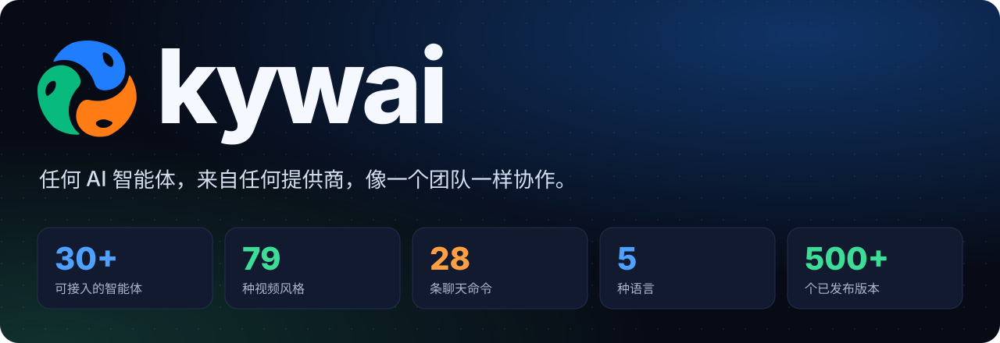

<sub>读作 “ki-wai”。原名 <i>AI Cowork</i>。</sub>

只需说一次。协调者会规划工作，把每项任务交给最擅长的智能体：Claude、Codex、Gemini、DeepSeek、Qwen、Copilot、Cursor、本地模型，或你添加的任何命令行智能体。你可以在实时 3D 世界里看着每个机器人干活，最后，结果会回到你手中，而且已经过检查。

[English](README.md) · [Español](README.es.md) · [Português](README.pt-BR.md) · [Français](README.fr.md) · **简体中文** · 🌐 [kywai.app](https://kywai.app)

[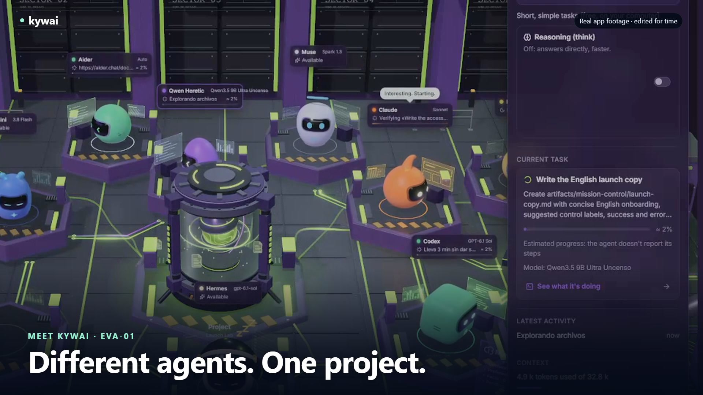](https://kywai.app/zh/#video)

**[▶ 观看 kywai 实际运行 — 30 秒](https://kywai.app/zh/#video)** · [下载 MP4](docs/video/kywai-promo-30s.mp4)
应用真实录屏、原创音乐和英文画面文字。

[](https://kywai.app)

**[⚡ 一条命令即可安装](#-安装)**


[](https://ko-fi.com/yilsander)

<br>


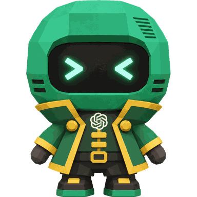
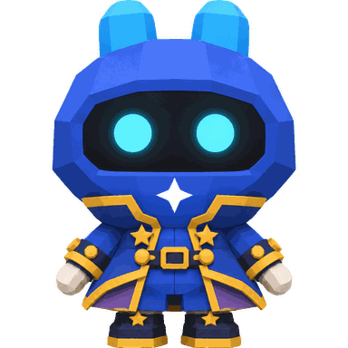

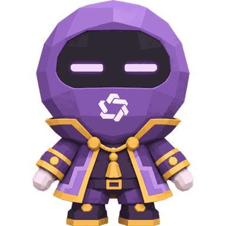
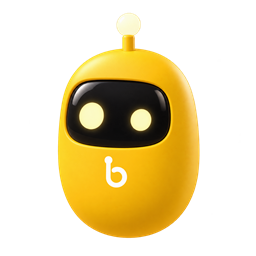

[简介](#-简介) · [最新动态](#-最新动态) · [任意智能体](#-支持任意提供商的任意智能体) · [为什么](#-为什么选择-kywai) · [工作原理](#-工作原理) · [功能](#-功能) · [扩展](#-扩展mcpskillsplugins-和-mods) · [随时随地](#-随时随地使用) · [主题](#-主题) · [安装](#-安装) · [隐私](#-隐私与安全) · [支持](#-支持这个项目) · [更新日志](CHANGELOG.md)

</div>

<br>

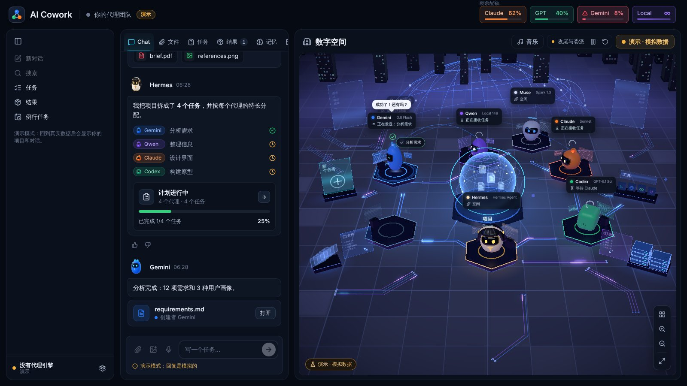

## ✨ 简介

kywai 把你已有的 AI 智能体和订阅（无论来自哪家提供商）变成**一支协同工作的团队**。你不必在各个应用之间来回切换、到处复制上下文，只需说一次：

1. **🧭 协调者 Hermes** 理解你的需求并提出计划：有哪些任务、每项任务由哪个智能体负责，以及原因。
2. **✅ 你来批准**，或者直接用大白话告诉它要改什么。
3. **⚙️ 智能体开始工作**，值得时会并行进行，就在你的项目文件夹里，每个都使用自己的程序，以及你本人的登录或 API 密钥。
4. **🔍 另一个智能体检查结果**，然后才交到你手上，发现的问题由原作者修复。
5. **📦 你在聊天中收到交付成果**，分好组、随时可打开，并附有完成内容和花费的摘要。

目标很简单：**交代一项任务，回来时看到的是成果，而不是一个毫无产出的报错。**

## 🆕 最新动态

kywai 最近新增的内容（完整列表按日期和版本列在 **[更新日志](CHANGELOG.md)** 中，西班牙语）：

- **🌐 给智能体用的浏览器。** 在 kywai 内置的浏览器里登录你的账号，Claude、Codex、Gemini 或 Hermes 就能替你阅读和浏览这些页面，而且永远看不到你的密码。点击或输入总会先征得你的同意。
- **📋 任务看板。** 把任务放进“待办”，团队会自己一个接一个地领走。
- **🧑‍⚖️ `/consejo` 和 `/radar`。** 把同一个问题同时交给多个智能体，汇总出最佳答案；以及你所在领域正在升温的话题，附带标题和可直接制作的视频。
- **🤖 角色。** 智能体变成了会动的 3D 角色，有四种外观可选：角色、经典、Kywai 静居和像素。
- **💬 同时开两个聊天，** 多个对话并行工作，同一个智能体还能开副本（“Claude 2”），一次做更多事。
- **❓ 带选项的提问。** 智能体拿不准时，会用按钮向你提问，标出推荐选项，并留一个输入框给你自己回答。
- **🎬 更强的视频工作室：** 79 种风格、在 3D 演播室里由机器人出演的“对话教程”、带情绪的配音，以及 `/editar`、`/recortes`、`/demo`、`/miniatura`、`/doblar` 和 `/sprite`。
- **🌙 夜间模式**：所有主题都有真实的夜间灯光，或选“自动”跟随时间；另有适合工作的 **办公室** 主题。
- **⚡ 更轻量。** 3D 最多每秒 30 帧，没有动静时降到 10 帧。

## 🎬 你可以让它做什么

几个真实示例：你忙别的事时，团队在做这些。

| 你写下 | 接下来会发生 |
|---|---|
| “给我的面包店做一个落地页” | Claude 设计并搭建，另一个智能体在浏览器中打开它，检查截图和测试，你拿到可直接发布的文件。加上“两个方案”，第三个智能体会选出更好的。 |
| “查出登录为什么失败并修好” | Codex 复现问题、修复并运行测试；另一家族的审查者确认。如果弄坏了什么，“撤销”会把文件完全恢复原样。 |
| “总结这 300 个 PDF 并比较” | Gemini 一次读完大量资料，返回一份带重点和表格的报告。把文件拖进聊天即可，手机上也行。 |
| “给我的文章做一张封面图” | 图片用 Codex 的图像工具生成（而不是用代码画），以缩略图出现在聊天中，可打开、下载或要求修改。 |
| “每天早上 9 点审查新的 PR” | 例行任务每天在你常开的电脑上自动启动。你在手机上看结果，只有需要你决定时“需要你处理”才会提醒。 |
| “给 TikTok 做一个讲恒星如何诞生的竖版视频” | 智能体写好脚本，其余交给 kywai：配音、图片、音乐、音效和剪辑。你只会收到在聊天里播放的 MP4，`/tiktok` 或 `/instagram` 可以发布它。 |
| “把我在 GoHighLevel 里的工作流程步骤整理成 PDF” | 你只需在 kywai 的浏览器里登录一次账号。智能体会逐个页面浏览、截图，然后交给你 PDF，全程看不到你的密码。 |
| “/consejo 这个应用该用什么数据库？” | 问题会同时发给多个智能体，各自独立回答，再由一个智能体汇总出最佳答案，并告诉你它们哪里一致、哪里不同。 |
| 睡前在看板上放五个任务 | 团队会一个接一个地完成，每个都经过审查，第二天早上它们都在“完成”里。 |
| “@Qwen 给我写五个标题” | 简单的事直接交给你点名的智能体，不做计划也不审查。用本地模型免费，数据不离开你的电脑。 |

## 🔌 支持任意提供商的任意智能体

kywai 并不绑定于一组固定的模型。它是一个让你**组建自己团队**的平台：

- **想加多少智能体就加多少**：在 ⚙ →“配置智能体…”→“添加智能体”中操作。目录已经知道如何启动 30 多个智能体，以及每个智能体使用的账号或订阅：Claude Code、Codex CLI、Gemini CLI、Antigravity CLI、Muse Code、Aider、DeepSeek、Qwen Code、Kimi Code、MiniMax Code、Mistral Vibe、Grok Build、GitHub Copilot CLI、Cursor、Amp、Goose、OpenCode、Cline、Continue、OpenHands、Factory Droid、Auggie、Junie、Kiro、Rovo Dev、Qoder CLI、Crush、Open Interpreter、gptme、Letta Code、ForgeCode、OpenClaw 等等。
- **寻找免费选项。** 目录的“仅免费”筛选显示提供免费选项的智能体，包括使用 Kilo Auto Free 的 Kilo CLI。各条目会说明提供商的要求和限制。 Aider 默认使用 OpenRouter 上免费的 Nemotron 3 Ultra 模型。
- **也可以接入任何其他程序**：选择“其他程序…”，填写它的命令、接收任务的方式（stdin、文件或参数）以及参数，它就会加入团队。
- **订阅或 API 密钥皆可。** 智能体使用你在其自身程序中已有的登录运行。需要 API 密钥的智能体（DeepSeek、Kiro、Junie、Factory Droid、Amp…）只会询问一次；密钥通过系统钥匙串加密，并且只会传给对应的智能体。
- **本地模型同样支持。** 你在 LM Studio 或 Ollama 中运行的任何模型都可以使用，免费且数据不离开你的电脑。
- **本地智能体会自己照顾自己。** 需要时它会自动启动 LM Studio；它卡片上的“推理（think）”开关让模型只在你需要时先思考再回答（默认关闭，回答快得多）。 除了 LM Studio 和 Ollama，它还支持用于大型混合专家模型的 **Colibri**，“本地”指示器为每个引擎都提供了**安装**按钮。
- **由谁来协调由你决定。** 默认由 Hermes 协调，但任何智能体都可以负责规划和分配（“设为协调者”）。如果它不可用，下一个会接手。
- **每个智能体都是正式的团队成员**，在 3D 世界里拥有自己的机器人和工位、自己的表现统计，并和其他成员一样经过计划、审查和撤销流程。

## 💡 为什么选择 kywai

<table>
<tr>
<td width="50%" valign="top">

**💳 用你已经付费的智能体**<br>
它通过你自己的会话驱动每个智能体自身的程序，因此消耗的是你套餐里的额度，而不会产生额外的 API 费用；API 密钥或免费的本地模型同样可用。顶栏会显示 Claude 和 GPT 的**真实剩余额度**。

</td>
<td width="50%" valign="top">

**🎯 每项任务都交给最擅长的智能体**<br>
协调者了解每个智能体的长处、模型、额度和过往表现。简单的工作交给*实习生*（同一个智能体，投入更少的精力），常规工作交给主力模型，困难的工作交给最强的模型。

</td>
</tr>
<tr>
<td valign="top">

**🏆 默认质量优先**<br>
每项任务都有验收标准。每一处改动都由另一个家族的智能体审查，它会亲自运行测试，只有明确的*通过*才算合格。对于看重品味的工作（网站、Logo、演示文稿），你可以要求做两个版本，再由第三个智能体选出胜者。

</td>
<td valign="top">

**🛟 绝不让你两手空空**<br>
如果某个智能体无法完成，另一个强力智能体会接手。中断的工作会从停下的地方继续，卡住的智能体一键即可重启，每一处改动都可以撤销。

</td>
</tr>
<tr>
<td valign="top">

**👀 完全透明**<br>
每个智能体都会用简短的话告诉你它正在做什么。实时的逐步视图会展示每条命令及其输出、每个被读取或编辑的文件（附带 diff）以及每次搜索。

</td>
<td valign="top">

**🔒 从设计上保护隐私**<br>
一切都在你的电脑上运行。远程访问只经过你自己的 Tailscale 网络，语音听写在本地运行，kywai 从不查看或存储密码。

</td>
</tr>
</table>

## 🧠 工作原理


### 默认团队

这是开箱即用的团队。你可以移除其中任何一个，也可以随意添加更多智能体。

| | 智能体 | 运行于 | 擅长 |
|---|---|---|---|
|  | **Hermes** | Hermes Agent | 协调：理解请求、制定计划并分配任务。它自己从不执行任务。如果它不可用，则由 Claude 来规划。 |
|  | **Claude** | Claude Code（你的 Claude 订阅） | 界面与设计、写作、大型或复杂的代码。 |
|  | **Codex** | Codex CLI（你的 ChatGPT 账号） | 端到端的应用和脚本、终端、服务器和数据。负责生成图像。 |
|  | **Gemini** | Gemini CLI | 阅读和总结海量资料（100 万 token 上下文）、翻译和快速报告。 |
|  | **Muse** | Muse Code（你的 Meta 订阅） | 理解视频。其他智能体额度用完时作为备援。 |
|  | **本地** | LM Studio 或 Ollama | 免费处理简短、简单的任务，数据不离开你的电脑。配合 LM Studio 时，还能读取、创建和编辑文件。 |

你从目录中或通过“其他程序…”添加的任何智能体，都和它们完全一样：协调者了解它、给它分配任务，它也会出现在 3D 世界里。参见[支持任意提供商的任意智能体](#-支持任意提供商的任意智能体)。

## 🚀 功能

### 🗺️ 规划与工作

- **由你批准的计划。** 没有你的同意，什么都不会开始；你只需一句话就能修改计划（“让 Codex 来做”“跳过调研”）。点一下即可批准，或者直接回复“是”。如果你愿意，也可以关闭批准环节，让团队直接开工。
- **同时处理多个请求。** 新工作会分配给空闲的智能体，并且不会碰到其他智能体正在编辑的文件。
- **更快，但标准不降。** 上一个任务在审查时，智能体就开始做下一个；Hermes 会同时启动互不依赖的任务，测试和截图并行进行；在同样可靠的审查者中会选明显更快的那个。近期表现不佳的智能体只会接到简单任务。
- **不做重复的工作。** Hermes 不会重复已在进行的任务；如果新请求与进行中的某个相似，聊天里会提醒你。
- **直接和某个智能体对话。** 在消息任意位置（开头、中间或结尾）写上 `@Claude`，文字就会原样发给该智能体，不经过 Hermes 的计划、审查或总结。输入 `@` 会列出所有智能体及其模型，输入 `/` 会列出所有命令及其作用；桌面、浏览器和 Órbita 都支持。
- **每项任务都有验收标准**，如果某个智能体动了不属于它的文件，还会发出警告。
- **像真正的团队一样分工。** 可拆分的大任务（引擎、界面、服务器……）会并行分给最合适的智能体，并附上协调者写的共同约定（哪些文件归谁、各部分如何通信），最后还有一个“整合并测试”任务，运行测试并对照你的需求检查整体。
- **图片是生成的，不是画出来的。** 需要插图、海报、Logo 或图标时，会交给有图像工具的智能体直接生成，而不是慢慢用 SVG 或脚本去画。如果你要精确或可编辑的内容，说一声就会用代码来做。
- **看重品味的工作，按你的要求两人分头做。** 两个来自不同家族的智能体分别构建同一样东西（方案 A 和方案 B），再由第三个智能体测试两者、对照你的需求进行比较，并告诉你哪个胜出以及原因。
- **严格且有真实测试的评审。** 当任务修改了文件时，另一个家族的智能体会以只读模式检查，亲自运行测试，并给出*通过*或*有问题*的结论；只有明确的*通过*才算合格。没有结论时会请另一个可靠的审查者。每项任务最多修复两次、交给另一个强力智能体接手一次；仍然失败的话，会出现在“需要你处理”中，标为需要你介入。
- **续做与接手。** 中断的任务会从停下的地方继续。如果某个智能体失败，会由另一个强力智能体接手，绝不会换成更弱的。智能体在后续追问时也会恢复自己的会话。
- **智能体权限，由你决定。** 完全访问（无需询问即可安装和上网）、仅限项目文件夹，或**“先问我”**：智能体会像 Claude Code 一样在聊天中询问，提供**拒绝 / 允许一次 / 本次会话内允许**，而不是卡住。
- **受阻不等于出错。** 如果智能体因为缺少某样东西（密钥、决定、文件）而停下，你会收到它已完成的部分，并在“需要你处理”中决定：接受、回复它，或交给另一个智能体。
- **任务看板。** 每个项目一个看板，分为“待办”“进行中”“等你处理”和“完成”。把任务放进“待办”，团队会自己一个接一个地领走；看板为空时会显示可点击的示例。
- **同一个智能体，更多人手。** 在 ⚙ → 设置 → 智能体 中设置每个智能体能同时处理几个任务：kywai 会开出副本（“Claude 2”“Claude 3”），各自用自己的会话并行工作。
- **带选项的提问。** 智能体需要你做决定时，会用按钮提问，标出推荐选项，支持多选，并留一个输入框给你写自己的答案。
- **回复智能体。** 每条回答下方都有“回复”按钮，可以引用原消息，让它复查或继续。
- **智能体议会（`/consejo`）。** 同一个问题同时问多个智能体，由一个智能体汇总最佳答案，并说明它们哪里一致、哪里不同。
- **话题雷达（`/radar`）。** 你所在领域此刻在 YouTube 和网络上升温的话题，带评分、五个标题、三个切入角度和现成的 `/video`。
- **kywai 浏览器。** 应用内置的真正浏览器，有独立会话，你可以在里面登录自己的账号（CRM、网站后台、GoHighLevel……）。智能体无需询问即可阅读、截图和浏览；点击、输入或按键则总要先征得你的同意，而且它们从不读取密码、验证码或银行卡信息。你可以实时观看并点“停止”，在客户端或网页上也可以。
- **简单问题，快速回答。** 简单的事 Hermes 自己回答，不做计划也不分派；只需查看项目的问题会立即得到答复。会修改文件的工作仍然保留完整的计划和审查。

### 📡 跟进工作

- **简短的实时动态**：每个智能体工作时都会汇报进展，所用工具折叠成一行可展开的条目，就像 Claude 应用那样。
- **任意任务的实时逐步视图**：推理过程、每条命令及其输出、读取和编辑过的文件及其改动、搜索以及最终回答。保留 30 天。
- **看得见的进度。** 任务还在运行时，新的截图和图像就会以缩略图出现在聊天中，文档则以卡片形式呈现。
- **给你答复，而不只是 ✓。** 请求完成后，协调者会阅读真实结果，写明做了什么、放在哪里、怎么试用、做了哪些决定以及还缺什么。每个计划下方都显示耗时、tokens 和用掉的额度（“14 分钟 · 339 k tokens · Claude 5 小时 +5 %”）。
- **每项任务一个独立区块。** 在聊天中，每项任务都有编号、真实阶段（工作中、修复中、测试、审查）以及审查者的署名。一发送就会出现一行提示 Hermes 正在制定计划；如果某个智能体没有动静，你会看到“N 分钟内无新进展”，而不是虚假的进度条。
- **在聊天旁预览文件。** 点击附件、交付文件或文件名，它会像 Claude 一样在侧边面板中打开：文档、代码、图片和 PDF，并显示附带图片的缩略图。Órbita 也有同样的查看器，支持 ‹ ›、代码视图、复制和“用其他应用打开”。
- **不会错过的提醒。** 有事等你处理时，小铃铛会带着专属提示音闪动，协调者也会在 3D 空间里呼叫你；点一下就直接打开需要你的那件事。
- **“需要你处理”铃铛** 只放真正在等你的事项（计划、问题、权限请求、沉默的智能体，或带有“继续 / 移除”按钮的已暂停任务），并会向你的手机推送通知。已完成的工作会以“刚完成”出现在“结果”中。
- **3D 数字空间**：展示每一种状态，包括工作中、审查中、等待其他智能体审查、委派给实习生、额度用尽或出错，还能看到文件在机器人之间传递，智能体每走一步真实操作都会冒出一点火花。 智能体围绕“项目”排成正多边形（三个是三角形，四个是正方形……），多出来的实习生排在原实习生身后。
- **充满活力的团队。** 空闲机器人会传接玩具文档或彩球、互相串门，还会友善地吓醒睡着的同伴。它们会惊讶、微笑，并在实际工作需要时立即返回岗位；减少特效会关闭这些本地动画。它们还会一起跳舞、玩模仿游戏、碰天线打招呼，并探望疲惫的同伴为它加油。音乐播放时，空闲机器人会保持清醒，跟随播放器或环境音乐的节拍跳舞，标签显示“跳舞中”。
- **随你喜欢的角色外观。** 在 ⚙ → 设置 → 智能体 → “智能体外观” 中统一选择：**角色**（每个智能体的 3D 动画形象）、**经典**（原来的机器人）、**Kywai 静居** 或 **像素**。聊天图标也会随之改变。
- **有性格的机器人。** 它们的眼睛会显示每个机器人真正在做什么（专注、思考、疲惫、睡着、出错、完成），每个都有自己的性格和用你的语言说话的对话气泡；你在聊天框打字时，它们会醒来并转身看向你。

<p align="center">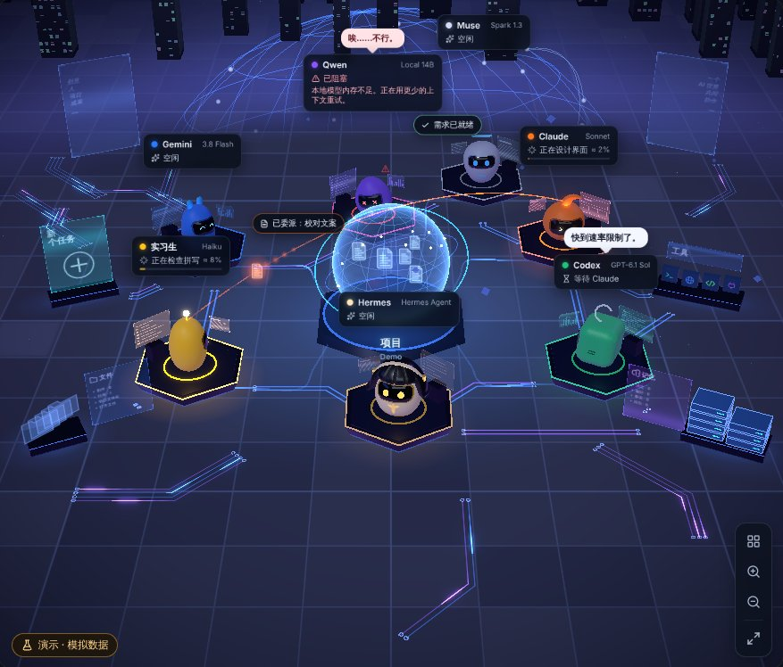</p>

### ↩️ 控制与安全网

- **按任务记录改动，可撤销。** 每项任务前后都会拍摄快照，存放在独立的存储中，绝不放进你项目的 `.git`。你可以看到“N 个文件已更改 +a −b”，审查 diff，并单独撤销某一项任务。如果任务之间有重叠，结果会另存为一个副本。
- **重启出错的智能体**：在它的面板中操作即可。它会清除阻塞（额度、会话、API 错误），重新检查其 CLI，并接手所有在等待它的工作。
- **为任意结果打分** 👍 / 👎。评分会反馈给协调者，让它了解谁真正靠得住。
- **“各智能体表现”面板**：按智能体、按难度和按任务类型（视觉、网页、代码、文本、研究）统计任务数、👍、一次通过审查、修复次数、耗时和成本。协调者分配工作时会参考这些记录，所以它会记住谁真正靠谱。

### 🧩 上下文与自动化

- **带上你已有的工作。** 从 ⚙ → 从其他应用导入中，导入本地 Claude Code、Codex、Hermes 会话（包括 Hermes Desktop），或 ChatGPT、Claude.ai 的 JSON/ZIP 导出文件。保留对话，恢复导出文件中包含的 Claude 项目和文档，并与团队继续工作。原始数据会保留；本地会话从服务器读取。 Claude.ai 的聊天会归入各自的项目，重新导入也不会产生重复。
- **像 Claude 一样的对话。** 侧边栏列出你的项目、置顶项目和最近的聊天。它可以收起成一列图标，再次点击已打开的项目即可折叠；右键（在 Órbita 中长按）可置顶、重命名、分叉、移动或删除。“新聊天”会开始一段新对话，而不会丢失之前的对话；任何一段都可以稍后恢复，连同它的任务和每个智能体的会话。Ctrl+K 可在所有项目的对话、任务、结果和记忆中搜索。
- **搜索与历史。** Ctrl+K 一次搜索所有对话、任务、结果和记忆，支持精确短语（“…”）以及按日期和作者筛选，并直接打开到匹配的那条消息并高亮。“历史”窗口把所有项目的所有对话按今天、昨天、最近 7 天和 30 天以及按月分组。Órbita 里也有。
- **同时进行多个对话。** 即使团队正在工作，也可以切换聊天或开始新的聊天：每个对话各自继续。把聊天拖到窗口右侧即可 **并排显示两个聊天**，或用鼠标中键在独立窗口中打开。
- **随你调整的侧边栏。** 拖动聊天和项目来排序或放进 **收藏**，拖动边缘调整侧边栏宽度，还能筛选项目；每个项目显示最近的三个聊天和“查看其余 X 个”。
- **每条消息都有菜单。** 右键（Órbita 中长按）即可复制、回复、从这里分支对话，或在新分支中编辑你的消息。铅笔图标可编辑你的消息。
- **文件一找就到。** 在“文件”和“结果”中可按类型筛选（照片、视频、音频、文档、代码和其他），照片和视频显示缩略图，文件夹按请求折叠。
- **项目记忆**：包含指令、决定、偏好和待办事项，每条都标明作者和状态。每个智能体在每项任务中都会读取它，即使你清空了聊天也不例外。
- **一个学会，全队都会。** 智能体摸索出某件事的做法后，会把它存为“学到的技能”中的临时技能，团队其他成员在任务中都会收到。每个任务都会留下一段“完成于……”的总结，留给下一个任务。
- **全队共用一个 AGENTS.md。** 每个 CLI 只读取自己的文件；kywai 会把其他文件一并传递过去，因此一个 `AGENTS.md` 就能让所有智能体遵循同样的规则。
- **例行任务。** 可设置仅运行一次、固定时间、指定星期、每隔 N 小时、通过带签名的 GitHub webhook 或文件夹变化触发。使用 /rutina 创建，查看历史并决定是否需要批准。协调者的建议只有在你确认后才会保存。
- **任务模板。** 聊天框上方的卡片用于审查 PR、总结文件夹、查找问题或创建自己的请求。填写字段、使用 /… 命令、发送给团队或直接发送给智能体，并将符合条件的模板转换为例行任务。
- **可下载的交付文件。** 在聊天和“结果”中打开或下载单个文件，或将一组文件保存为 ZIP。支持桌面、桌面客户端、浏览器和 Órbita，也能从手机带走结果。 “结果”标签页会把它们分到**每个任务一个文件夹**，主要文件（视频、网页、文档）放在最前，工作文件折叠起来。

### 🧰 扩展：MCP、skills、plugins 和 mods

打开 **⚙ → 设置 → 扩展**，为智能体添加工具并自定义 kywai：

- **MCP 服务器.** 从目录搜索，或添加命令、JSON 配置或地址。选择哪些智能体可以使用各服务器：kywai 会先检查连接并列出工具，再启用服务器。缺少 uv 或 Node.js 时，可以从卡片安装。 Firecrawl、Perplexity 和 PostHog 也在推荐服务器之列。
- **共享 skills.** 在 skills.sh 搜索技能，或从 GitHub 仓库或文件夹安装。`SKILL.md` 与脚本、参考资料一同保留，整个团队都可以在需要时查阅这些技能。 开始任务前，Hermes 会推荐 skills.sh 上可能有用的技能，并附带**安装**按钮（它从不自行安装）；**`/aprende`** 能把一个视频或链接变成全队可用的新技能。每个项目还有**“精简代码（Ponytail）”**开关，让智能体少写代码。
- **Plugins.** 浏览 Anthropic 的插件目录，或添加其他 GitHub 目录或插件。kywai 将技能、命令和子智能体配置转换为共享技能，并以关闭状态导入 MCP，由你选择向哪些智能体启用。
- **Mods.** 从 GitHub 或本地文件夹安装 kywai 扩展，添加聊天 /… 命令、工作开始或结束时的 hooks，以及自定义面板。Hooks 需要你的授权；面板在桌面、网页和 Órbita 中隔离运行。

**兼容性：** 用户 MCP 支持 Claude、Codex、Gemini 和 Hermes；不兼容的智能体会显示为不可选。需要授权的远程服务器必须使用令牌，目前不支持 OAuth 和 SSE。插件只导入兼容组件，不会像 Claude Code 那样执行插件 hooks 和 LSP。kywai 内部 MCP 目前提供给协调任务中的 Claude。

详情及 mod 示例见[手册](docs/MANUAL.md#extensiones-tus-servidores-mcp-para-los-agentes)和[快速笔记](docs/mods/notas-rapidas)。

### 🎥 视频工作室

输入 **`/video`** 和主题（或点击任意回复下方的**“用这条做个视频”**），你只会收到**做好的 MP4**，直接在聊天中播放。不用批准计划，也没有零散文件。一切都在你的电脑上完成。

- **四步选好：** 类型（动态文字、带主持人的卡通、混合、在 3D 演播室里由机器人出演的“对话教程”或“搞笑小品”）、角色（无、kywai 机器人或你自己的、可重复使用）、风格和配音，每项都有预览。然后写下主题。说“竖版”或“给 TikTok”即可生成适合 TikTok、Reels 或 Shorts 的竖版视频。
- **79 种影片风格**，每种都有示例（水彩、像素 RPG、30 年代卡通、浮世绘、剪纸、应用广告、kywai 自己的十种风格等），另有 **9 种 AI 图像风格**，可以先用你自己的场景试看再选择。附上一个短视频或你的图片，它会照着它们的风格来做。
- **配音、音乐和真实音效。** 可先试听的自然配音（Kokoro、Edge、Gemini、Voicebox、每句都带情绪的 Chatterbox，想对比的话还有 ElevenLabs v3），支持双人对话，所选配音决定视频语言。原创音乐在说话时自动变小，还有自由授权的真实音效（呼啸、弹出、撞击）。
- **会动的画面。** 用你电脑上的 **ComfyUI** 生成图片（Gemini 作备用），生动的 3D 场景，用 **Manim** 制作公式和图表动画，并在前两秒抓住注意力。
- **剪辑和再利用你的素材。** **`/editar`** 清理你的录像（口头禅、停顿、重复镜头）并加上字幕；**`/recortes`** 把长视频的精彩片段剪成竖版短片；**`/doblar`** 把最新视频配成另一种语言；**`/miniatura`** 制作三张封面；**`/demo`** 把网站或代码仓库做成广告，需要的话还能让机器人当主持人；**`/sprite`** 为你的游戏绘制像素风角色。
- **系列与批量。** **`/serie`** 用同样的角色制作多集，每集以给观众的 A/B 问题收尾；“`/serie` 下一集，B 胜出”即可继续。“给我做 3 个关于…的视频”会从不同角度一次做好几个。
- **由你决定何时发布。** **`/instagram`** 和 **`/tiktok`** 会写好文案，发布到你连接的账号，可存为草稿或直接发布，但总要你点一下，并配上吸睛的封面。**`/ig-plan`**、**`/ig-viral`**、**`/ig-reel`** 等命令用真实数据打理账号，**`/turno-noche`** 会在夜里寻找你所在领域的爆款短视频，早上给你留一条新的试发短视频。
- **自动安装。** 工作室（HyperFrames、配音、音效库）会在 kywai 首次启动时在后台自动安装。

### 📊 额度与成本

- **随团队更新的额度。** 添加、移除、启用或停用智能体时，顶部栏会更新。显示 Claude 和 GPT 的真实额度，并区分其他提供商的预算或估算以及本地模型。
- **用量与成本。** 查看每次请求的时间与 token、各智能体成本、订阅、API、免费或本地方案，并比较用量与支出。可设置价格和月度预算提醒，导出 CSV；估算数据会明确标注。
- **按难度选择模型和投入程度**，可以在每个机器人的面板中更换模型，用 `/model` 更换 Hermes 的模型。

### 🎨 舒适体验

**海底世界**在发光珍珠周围带来鱼群、鲸鱼、水母和水下城市。Relicario、Telar、万圣节及圣诞节现拥有完整的圣殿、水晶岛、哥特修道院和雪村场景，并保留原有主题选择。

**Kywai 静居**带来面朝大海的温室天文台：木质玻璃穹顶、动态天空与海水、独立工作坊、共享树木和青绿色座椅。在音乐按钮旁切换夜间模式，偏好会按设备保存。

- **更新后的新功能介绍。** 每次更新后，都会弹出窗口告诉你改了什么（桌面、网页、客户端和 Órbita 都有）。
- **声音分开控制。** “背景音乐”“音效与提醒”和“智能体语音”各有独立开关。
- **聊天优先。** 窗口较小时聊天区会占更多空间；你可以拖动它的边缘调整到想要的宽度（双击恢复自动）；窗口很窄时，聊天和 3D 世界会变成两个标签页。
- **字号随你调。** Ctrl + 鼠标滚轮可放大或缩小聊天文字，聊天区会占满可用宽度。智能体随手写出的 JSON 会显示在独立卡片中，附带复制按钮。
- **易读的聊天，** 回复不再套框，段落之间更宽松，每个代码或命令块的角落都有复制按钮。Hermes 和智能体会写得简短，先给结果。
- **本地语音听写**：在你自己的电脑上使用 Whisper。不依赖任何外部服务，音频用完即删。
- **地图、配色与装饰。** 七款 3D 地图、七种配色的数字城市和四款装饰场景。可跟随服务器主题或为每台设备单独设置；Órbita 使用对应配色，不复现桌面地图。 主题选择器为每个世界显示一张真实截图，每行四个。
- **智能体语音**，每个都有自己的音色，文字会随着语音的节奏逐字显示，就像《集合啦！动物森友会》里那样。
- **音乐播放器**：支持 YouTube Music 搜索、Audius、Spotifast 和无广告的 SomaFM 电台（还能登录 YouTube 账号使用 Premium），以及播放队列，灯光会跟随歌曲的 BPM 变化，无需麦克风。
- **设置助手**：用官方安装程序安装缺失的程序，并打开每个官方登录页面。
- **演示模式**：无需任何花费即可展示应用。
- **对电脑很友好。** 3D 最多每秒 30 帧，没有动静时降到 10 帧；你可以彻底关闭 3D，也可以在设置中显示性能监视器。画质会根据你的电脑自动调整、不卡顿；窗口隐藏时暂停，切到其他应用时放慢；“减少特效”可关闭额外效果。关掉窗口后团队照常工作。

### ⌨️ 聊天命令

| 命令 | 作用 |
|---|---|
| `/model` | 查看并更换 Hermes 的模型 |
| `/usage` | 立即查看额度 |
| `/recuerda …` | 将内容保存到项目记忆（`decisión:`、`pendiente:`、`preferencia:`） |
| `/rutina …` | 创建或管理例行任务 |
| `/new` | 开始新对话，并保留上一段对话的副本 |
| `@智能体 …` | 把文字原样直接发给某个智能体，不经过 Hermes（也可用 `/directo 智能体 …`） |
| `/video …` | 制作视频（打开四步选择器） |
| `/serie …` | 用同样角色制作分集视频系列 |
| `/aprende …` | 把视频或链接变成技能 |
| `/editar` · `/recortes` | 清理你的录像，或从长视频中剪出竖版短片 |
| `/demo` · `/miniatura` · `/doblar` | 网站广告、三张封面，或把最新视频配成另一种语言 |
| `/sprite …` | 为你的游戏制作像素风角色，支持 4 或 8 个方向的动画 |
| `/radar …` | 你所在领域正在升温的话题，附标题和对应的 `/video` |
| `/consejo …` | 同一个问题问多个智能体，汇总出最佳答案 |
| `/instagram` · `/tiktok` | 准备并发布最新的视频 |
| `/ig-plan` · `/ig-viral` · `/ig-reel` · `/turno-noche` | 打理 Instagram：每周计划、什么内容有效、脚本，以及每晚一条新短视频 |

在聊天框输入 `/` 即可看到所有命令（包括你的模板和 mods）及其作用。

## 🌍 随时随地使用

安装了 kywai 的电脑（例如一台始终开机的 Mac mini）负责干活。你可以通过四种方式随身使用它：

| | 🖥️ **桌面版** | 💻 **桌面客户端** | 🌐 **浏览器** | 📱 **Órbita（Android）** |
|---|---|---|---|---|
| **是什么** | 适用于 Windows、macOS 和 Linux 的完整应用 | 在另一台电脑上运行的应用，连接到你的主 kywai | 在你 Tailscale 网络中的任何设备上使用同样的界面 | 专为手机打造的原生 Android 应用 |
| **如何进入** | 打开应用 | 用 6 位数代码配对一次 | 一个带访问码的链接，只需一次 | 用 6 位数代码配对一次 |
| **能做什么** | 全部功能 | 全部功能，外加浏览服务器上的文件和双向**同步文件夹** | 聊天、3D 世界、文件、结果和批准计划 | 聊天、计划、任务、文件、记忆、用量和原生 3D 世界 |
| **更新方式** | ⚙ →“检查更新…” | 来自你自己服务器的签名更新 | 始终是最新版本 | 在“设置”中更新，无需重新安装；新版本会自动发布 |

<p align="center">
  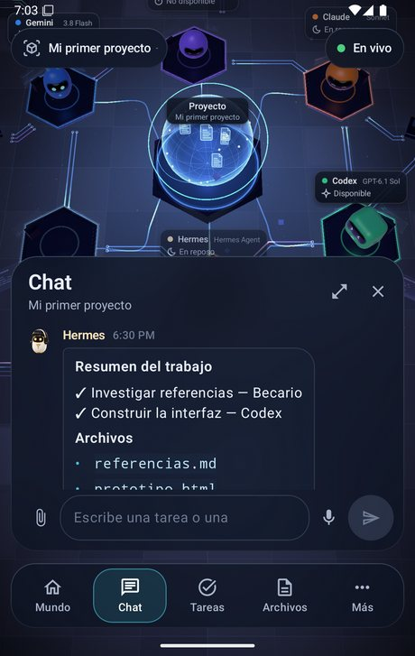
  &nbsp;
  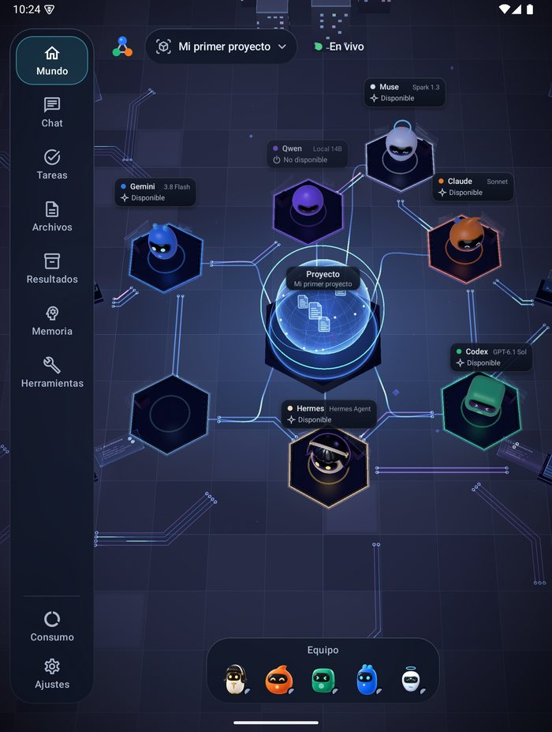
</p>

Órbita 会保留最新的副本，让你可以**离线**使用；在连接恢复之前，它会把你的消息排队，并且能适配折叠屏和平板。更多内容请见 [android/README.md](android/README.md)。

Órbita 只需用 6 位数代码配对一次，即使 kywai 重启或更新也保持配对。它会从你的电脑自动更新，即使在后台也会提醒需要你处理的事项，并拥有与桌面版相同的历史、搜索、结果和用量。

在聊天中，Órbita 支持**实时听写**（轻点麦克风；长按则录制语音备忘，由你的电脑用 Whisper 转成文字），还有**相机按钮**可拍照或从相册选择，长按菜单与桌面版的右键菜单一致。

某台电脑原来是客户端，想让它成为服务器？在连接界面或 ⚙ → 设置 → 连接 中点击**“将这台电脑用作服务器”**。

## 🎨 主题

**设置 → 主题** 中包含七款地图（Clásico、Órbita、Marfil、Grafito、Bosque、Matrix 和 EVA-01）、七种配色的数字城市、Kywai 静居、海底世界、**办公室**（简洁，适合工作）和四款装饰场景。所有主题都有带真实灯光（火把、路灯、生物荧光……）的 **夜间模式**，或选择随时间自动切换的 **自动**。可以跟随服务器主题或为每台设备单独选择。Órbita 使用对应配色，不复现桌面场景。以下图片展示部分配色和装饰：

<table>
  <tr>
    <td align="center">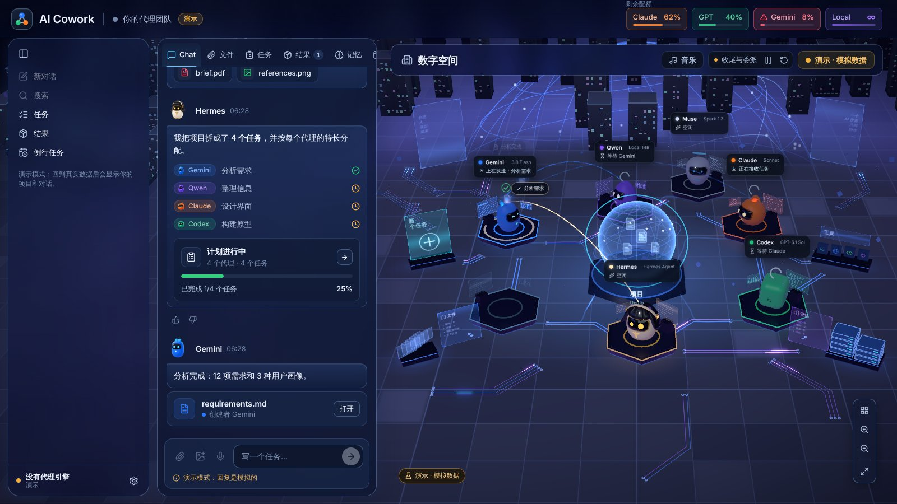<br><b>Frost Glass</b>：磨砂玻璃</td>
    <td align="center">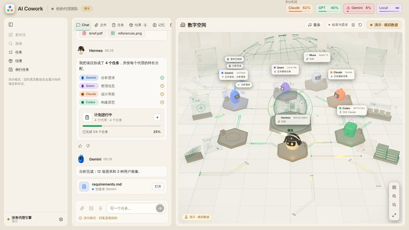<br><b>珍珠</b>：明亮温暖</td>
    <td align="center">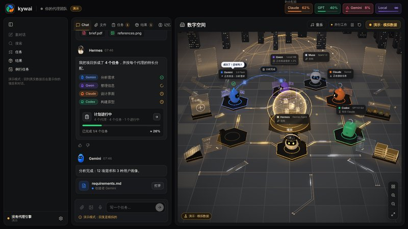<br><b>缟玛瑙</b>：黑与金</td>
  </tr>
  <tr>
    <td align="center">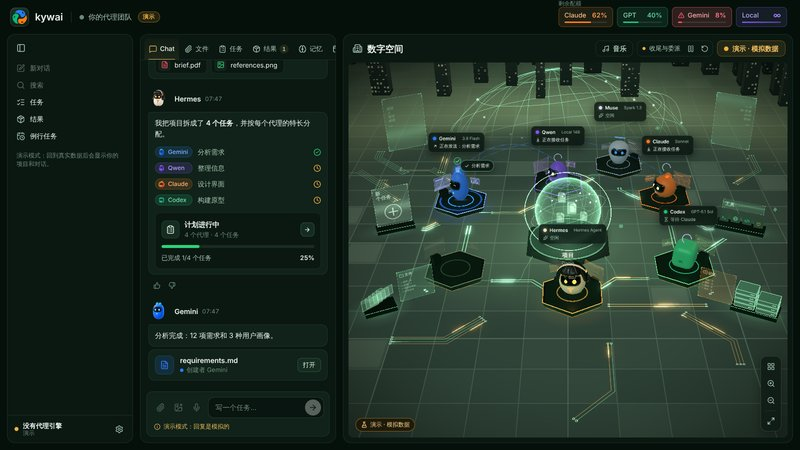<br><b>翡翠</b>：深绿与金</td>
    <td align="center">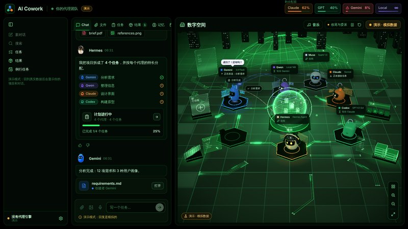<br><b>霓虹</b>：黑与霓虹绿</td>
    <td align="center">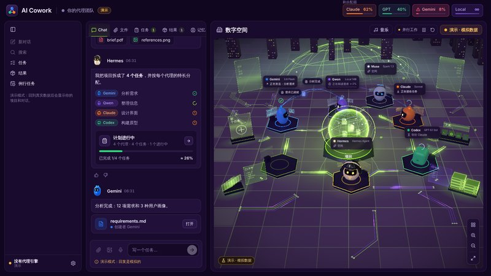<br><b>紫外</b>：紫与青柠绿</td>
  </tr>
</table>

另有四款主题会装饰世界、重塑其核心，节日主题还会给机器人换装：

<table>
  <tr>
    <td align="center">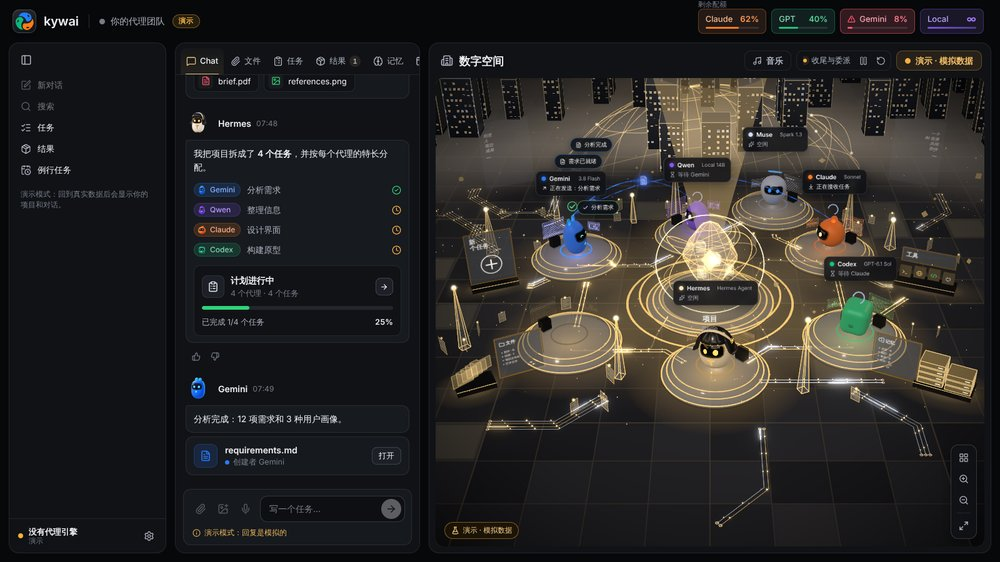<br><b>Relicario</b>：切割水晶核心与玻璃镶金平台</td>
    <td align="center">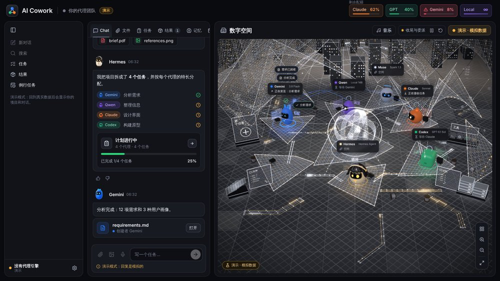<br><b>Telar</b>：银丝薄膜与金色火花</td>
  </tr>
  <tr>
    <td align="center">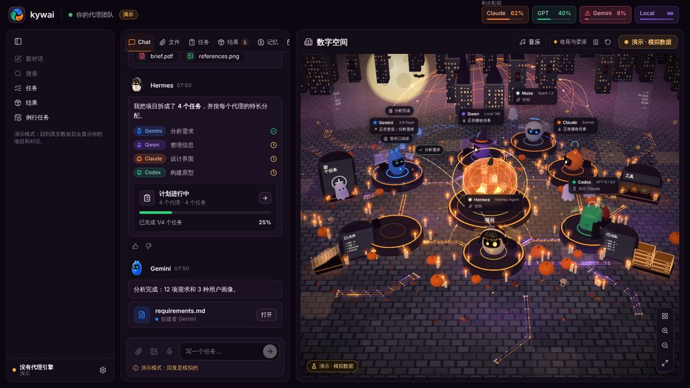<br><b>Halloween</b>：南瓜、蜡烛、月亮、蝙蝠、女巫和吸血鬼</td>
    <td align="center">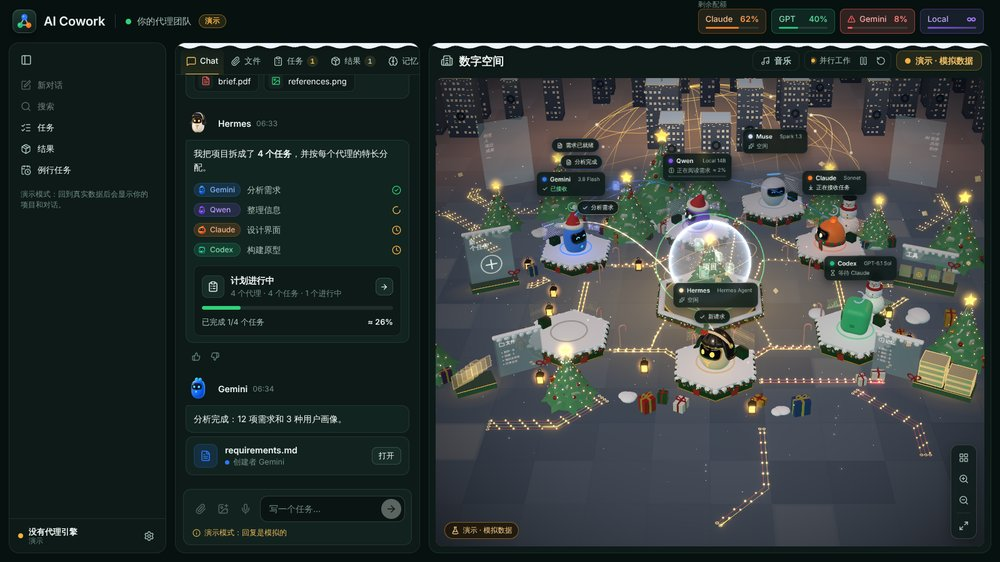<br><b>Navidad</b>：雪花、圣诞树、礼物、雪花水晶球和圣诞帽</td>
  </tr>
</table>

## 📥 安装

### ⚡ 一条命令安装

在终端里粘贴一行命令。它会一步步引导你（“第 1 步，共 3 步……完成”），从 Releases 下载适合你电脑的最新版本，安装并打开。想重装或更新时再运行一次即可：你的项目和设置都会保留。

**Windows 10/11**：打开 **PowerShell** 并粘贴：

```powershell
irm https://kywai.app/install.ps1 | iex
```

**macOS 和 Linux**：打开**终端**并粘贴：

```bash
curl -fsSL https://kywai.app/install.sh | bash
```

- **Windows：** 只为当前用户安装（无需管理员权限），并在桌面和开始菜单创建快捷方式。
- **macOS：** 自动选择 Apple 芯片或 Intel 版本（无需 Homebrew：缺少的东西由向导安装），把 `kywai.app` 放进“应用程序”，并解除“应用已损坏”的拦截，无需右键 → 打开。
- **Linux**（x64 或 ARM）：把 AppImage 放在 `~/.local/share/kywai`，加入应用菜单并创建 `kywai` 命令。只有在需要安装 libfuse2 时才会要求输入密码。

想先看看脚本？在这里：[install.sh](https://github.com/Yiku21/kywai/blob/master/scripts/instalar-kywai.sh) 和 [install.ps1](https://github.com/Yiku21/kywai/blob/master/scripts/instalar-kywai.ps1)。

### 系统要求

- **Windows 10/11、macOS**（Apple 芯片或 Intel）**或 Linux**（x64 或 ARM；Ubuntu、Debian、Fedora、Arch、openSUSE 等）。
- **Node.js** `^22.22.2 || ^24.15.0 || >=26.0.0`。如果缺少，设置助手会自动安装。
- 至少一个智能体：目录中的任意智能体（Claude Code、Codex CLI、Gemini CLI、DeepSeek、Qwen Code、Copilot…）、本地模型或任何命令行智能体。默认由 **Hermes Agent** 负责协调，但任何智能体都可以担任。
- 可选：用于本地智能体的 **LM Studio** 或 **Ollama**，用于撤销功能的 **git**，以及用于在其他设备上使用的 **Tailscale**。

> **语言：** 应用支持英语、西班牙语、葡萄牙语、法语和中文。默认使用系统语言，可在 ⚙ → 设置 →“Idioma · Language”中更改。葡萄牙语、法语和中文为机器翻译，欢迎指正。

### 下载（最简单）

从 **[最新版本](https://github.com/Yiku21/kywai/releases/latest)** 下载适合你系统的安装包：Windows 用 `.exe`，macOS（Apple 芯片或 Intel）用 `.dmg`，Linux 用 `.AppImage`。Android：从同一版本下载 `kywai-orbita.apk`。安装后，应用每次打开都会检查新版本并自动更新（macOS 也一样：它会自己下载、校验并替换应用）。有更新待安装时 ⚙ 齿轮会亮黄色，更新后会弹出**“新功能”**窗口说明变化。

目前还没有代码签名：在 Windows 上点击“更多信息”→“仍要运行”；在 macOS 上第一次打开时右键点击应用 → 打开（如果提示已损坏，在终端运行 `xattr -cr "/Applications/kywai.app"`）；在 Linux 上用 `chmod +x` 让 AppImage 可执行。

或者自己编译：

### Windows

```bash
npm install
npm run dist:win
```

这会生成 `release/kywai-Setup-<version>.exe`。安装程序允许你选择安装文件夹，并会创建快捷方式。由于没有代码签名，Windows 可能会发出警告：点击“更多信息”→“仍要运行”。

### macOS

```bash
npm run fuente
```

这会生成 `release/kywai-fuente.zip`。在 Mac 上解压后，在该文件夹内运行：

```bash
bash scripts/instalar-mac.sh
```

它会为这台 Mac 构建应用，将其复制到 `/Applications`（或你选择的任意位置）并打开。

### Linux

安装好 Node.js 和 git 后，克隆仓库，并在该文件夹内运行：

```bash
bash scripts/instalar-linux.sh
```

它会为这台电脑构建应用，无需管理员权限即可安装到 `~/.local/share/ai-cowork`，将其加入应用程序菜单，并创建 `ai-cowork` 命令。也可以用 `npm run dist:linux` 生成 AppImage。详情见[手册](docs/MANUAL.md#linux-se-compila-en-el-propio-equipo)（西班牙语）。

### 首次运行

首次启动时会打开**设置助手**（也可以在 ⚙ →“配置智能体…”中找到）：

1. 选择要使用哪些智能体。
2. 它会检查这些智能体的程序，并用官方安装程序安装缺失的部分。
3. 它会打开每个智能体的官方登录页面，并为每个智能体讲解步骤。kywai 从不查看或存储密码。之后如果缺了哪个，Hermes 会在聊天中放一张“连接智能体”卡片。
4. 它会汇总所有尚未完成的事项。

要在手机或笔记本电脑上使用，请打开 ⚙ →“从其他设备访问…”。

## 🔐 隐私与安全

- **数据在你的电脑上。** 项目、记忆、日志和用量都保存在你的用户数据文件夹中（Windows 上为 `%APPDATA%\AI Cowork`，macOS 上为 `~/Library/Application Support/AI Cowork`，Linux 上为 `~/.config/AI Cowork`）。
- **封闭的远程访问。** 服务器只监听你的 Tailscale IP 和 `127.0.0.1`，绝不监听局域网或互联网，并且每个请求都要求提供代码。每台配对设备都有自己的密钥，你可以单独吊销（闲置 90 天后也会自动过期），也可以通过生成新代码一次性全部吊销。配对码 10 分钟后过期，并且只允许尝试少数几次。
- **签名的客户端更新。** 桌面客户端只会安装用你自己的私钥签名的更新，而私钥从不离开发布更新的那台电脑。
- **无需密码。** 每个智能体都使用其官方程序自身的登录方式。你添加的 API 密钥会通过系统钥匙串加密。
- **智能体只待在自己的文件夹里。** 它们被要求只在项目文件夹内工作。关闭“完全访问”后，它们只能编辑该文件夹。
- **本地语音。** 听写在你自己的电脑上使用 Whisper，音频用完即删。

## 🛠️ 开发

```bash
npm install
npm run dev        # 以开发模式运行桌面应用
npm run web        # 仅在浏览器中运行界面（http://localhost:5199），处于演示模式
npm run typecheck  # 类型检查
npx vitest run     # 测试
```

**技术栈：** 桌面端使用 Electron、React 19、TypeScript 和 Three.js（react-three-fiber）；Órbita 使用 Kotlin、Jetpack Compose 和 OpenGL ES。

```
src/
  shared/      引擎与界面之间的契约（类型、默认值）
  main/        引擎：窗口、CLI、规划、任务、额度、项目、Web 与移动端服务器
  preload/     安全的 window.cowork 桥接
  renderer/    界面：聊天、面板和 3D 数字空间
android/       Órbita，Android 应用
docs/          使用手册、模型指南和移动端 API
```

## 📚 文档

详细文档为西班牙语：

- **[使用手册](docs/MANUAL.md)**：详细介绍每项功能。
- **[更新日志](CHANGELOG.md)**：从第一天起的所有改进，按日期和版本排列。
- **[模型指南](docs/GUIA-MODELOS.md)**：每个智能体在不同难度下使用的模型和投入程度，并附有来源。
- **[Órbita](android/README.md)**：Android 应用，以及如何构建和发布它。
- **[移动端 API](docs/mobile-api/README.md)**：服务器与 Órbita 之间的契约。

## ☕ 支持这个项目

kywai 免费且开源。如果它帮你节省了时间，想表示感谢，可以 **[在 Ko-fi 上请我喝杯咖啡](https://ko-fi.com/yilsander)**。应用里也有入口：桌面端 ⚙ →“支持 kywai ☕”，Órbita 在“设置”的最底部。

[](https://ko-fi.com/yilsander)

## 📄 许可证

[MIT](LICENSE)。你可以自由使用、修改和分享 kywai，只需保留版权声明。

<div align="center">
<br>
<sub>由一整支 AI 智能体团队打造，由 Hermes 协调。</sub>
</div>
