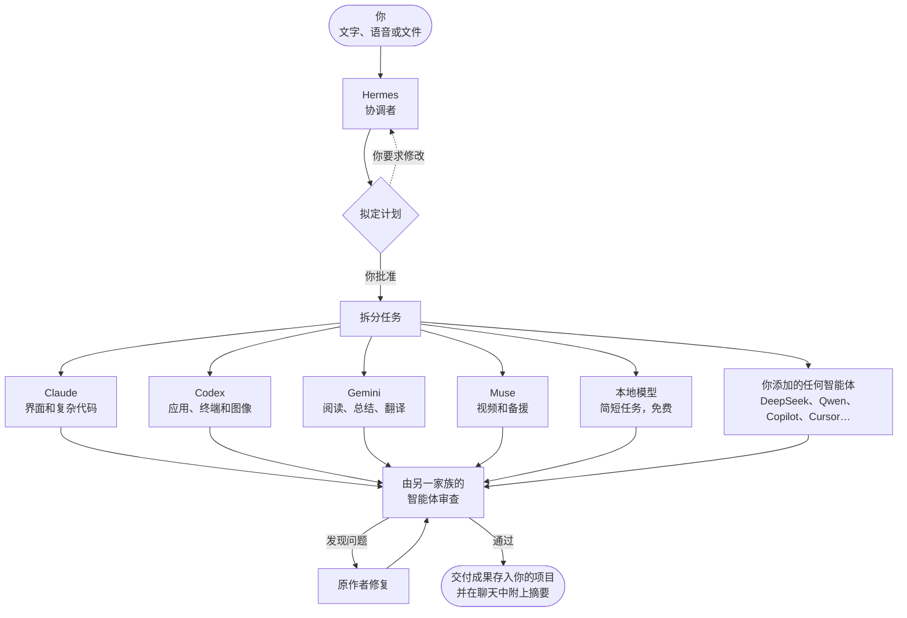

<div align="center">


# AI Cowork

### 任意提供商的任意 AI 智能体，想要多少就加多少，作为一支团队协同工作。

只需说一次。协调者会规划工作，把每项任务交给最擅长的智能体：Claude、Codex、Gemini、DeepSeek、Qwen、Copilot、Cursor、本地模型，或你添加的任何命令行智能体。你可以在实时 3D 世界里看着每个机器人干活，最后，结果会回到你手中，而且已经过检查。

[English](README.md) · [Español](README.es.md) · [Português](README.pt-BR.md) · [Français](README.fr.md) · **简体中文**

https://github.com/user-attachments/assets/d9df3fa8-9d52-4fb6-93e9-2f37d54fb362


[](https://ko-fi.com/yilsander)

<br>


[简介](#-简介) · [任意智能体](#-支持任意提供商的任意智能体) · [为什么](#-为什么选择-ai-cowork) · [工作原理](#-工作原理) · [功能](#-功能) · [随时随地](#-随时随地使用) · [主题](#-主题) · [安装](#-安装) · [隐私](#-隐私与安全)

</div>

<br>


## ✨ 简介

AI Cowork 把你已有的 AI 智能体和订阅（无论来自哪家提供商）变成**一支协同工作的团队**。你不必在各个应用之间来回切换、到处复制上下文，只需说一次：

1. **🧭 协调者 Hermes** 理解你的需求并提出计划：有哪些任务、每项任务由哪个智能体负责，以及原因。
2. **✅ 你来批准**，或者直接用大白话告诉它要改什么。
3. **⚙️ 智能体开始工作**，值得时会并行进行，就在你的项目文件夹里，每个都使用自己的程序，以及你本人的登录或 API 密钥。
4. **🔍 另一个智能体检查结果**，然后才交到你手上，发现的问题由原作者修复。
5. **📦 你在聊天中收到交付成果**，分好组、随时可打开，并附有完成内容和花费的摘要。

目标很简单：**交代一项任务，回来时看到的是成果，而不是一个毫无产出的报错。**

## 🔌 支持任意提供商的任意智能体

AI Cowork 并不绑定于一组固定的模型。它是一个让你**组建自己团队**的平台：

- **想加多少智能体就加多少**：在 ⋮ →“配置智能体…”→“添加智能体”中操作。目录已经知道如何启动 30 多个智能体，以及每个智能体使用的账号或订阅：Claude Code、Codex CLI、Gemini CLI、Antigravity CLI、Muse Code、Aider、DeepSeek、Qwen Code、Kimi Code、MiniMax Code、Mistral Vibe、Grok Build、GitHub Copilot CLI、Cursor、Amp、Goose、OpenCode、Cline、Continue、OpenHands、Factory Droid、Auggie、Junie、Kiro、Rovo Dev、Qoder CLI、Crush、Open Interpreter、gptme、Letta Code、ForgeCode、OpenClaw 等等。
- **也可以接入任何其他程序**：选择“其他程序…”，填写它的命令、接收任务的方式（stdin、文件或参数）以及参数，它就会加入团队。
- **订阅或 API 密钥皆可。** 智能体使用你在其自身程序中已有的登录运行。需要 API 密钥的智能体（DeepSeek、Kiro、Junie、Factory Droid、Amp…）只会询问一次；密钥通过系统钥匙串加密，并且只会传给对应的智能体。
- **本地模型同样支持。** 你在 LM Studio 或 Ollama 中运行的任何模型都可以使用，免费且数据不离开你的电脑。
- **由谁来协调由你决定。** 默认由 Hermes 协调，但任何智能体都可以负责规划和分配（“设为协调者”）。如果它不可用，下一个会接手。
- **每个智能体都是正式的团队成员**，在 3D 世界里拥有自己的机器人和工位、自己的表现统计，并和其他成员一样经过计划、审查和撤销流程。

## 💡 为什么选择 AI Cowork

<table>
<tr>
<td width="50%" valign="top">

**💳 用你已经付费的智能体**<br>
它通过你自己的会话驱动每个智能体自身的程序，因此消耗的是你套餐里的额度，而不会产生额外的 API 费用；API 密钥或免费的本地模型同样可用。顶栏会显示 Claude 和 GPT 的**真实剩余额度**。

</td>
<td width="50%" valign="top">

**🎯 每项任务都交给最擅长的智能体**<br>
协调者了解每个智能体的长处、模型、额度和过往表现。简单的工作交给*实习生*（同一个智能体，投入更少的精力），常规工作交给主力模型，困难的工作交给最强的模型。

</td>
</tr>
<tr>
<td valign="top">

**🏆 默认质量优先**<br>
每项任务都有验收标准。每一处改动都由另一个家族的智能体审查；对于看重品味的工作（网站、Logo、演示文稿），两个智能体各自做出一个版本，再由第三个智能体选出胜者。

</td>
<td valign="top">

**🛟 绝不让你两手空空**<br>
如果某个智能体无法完成，另一个强力智能体会接手。中断的工作会从停下的地方继续，卡住的智能体一键即可重启，每一处改动都可以撤销。

</td>
</tr>
<tr>
<td valign="top">

**👀 完全透明**<br>
每个智能体都会用简短的话告诉你它正在做什么。实时的逐步视图会展示每条命令及其输出、每个被读取或编辑的文件（附带 diff）以及每次搜索。

</td>
<td valign="top">

**🔒 从设计上保护隐私**<br>
一切都在你的电脑上运行。远程访问只经过你自己的 Tailscale 网络，语音听写在本地运行，AI Cowork 从不查看或存储密码。

</td>
</tr>
</table>

## 🧠 工作原理



### 默认团队

这是开箱即用的团队。你可以移除其中任何一个，也可以随意添加更多智能体。

| | 智能体 | 运行于 | 擅长 |
|---|---|---|---|
|  | **Hermes** | Hermes Agent | 协调：理解请求、制定计划并分配任务。它自己从不执行任务。如果它不可用，则由 Claude 来规划。 |
|  | **Claude** | Claude Code（你的 Claude 订阅） | 界面与设计、写作、大型或复杂的代码。 |
|  | **Codex** | Codex CLI（你的 ChatGPT 账号） | 端到端的应用和脚本、终端、服务器和数据。负责生成图像。 |
|  | **Gemini** | Gemini CLI | 阅读和总结海量资料（100 万 token 上下文）、翻译和快速报告。 |
|  | **Muse** | Muse Code（你的 Meta 订阅） | 理解视频。其他智能体额度用完时作为备援。 |
|  | **本地** | LM Studio 或 Ollama | 免费处理简短、简单的任务，数据不离开你的电脑。配合 LM Studio 时，还能读取、创建和编辑文件。 |

你从目录中或通过“其他程序…”添加的任何智能体，都和它们完全一样：协调者了解它、给它分配任务，它也会出现在 3D 世界里。参见[支持任意提供商的任意智能体](#-支持任意提供商的任意智能体)。

## 🚀 功能

### 🗺️ 规划与工作

- **由你批准的计划。** 没有你的同意，什么都不会开始；你只需一句话就能修改计划（“让 Codex 来做”“跳过调研”）。点一下即可批准，或者直接回复“是”。如果你愿意，也可以关闭批准环节，让团队直接开工。
- **同时处理多个请求。** 新工作会分配给空闲的智能体，并且不会碰到其他智能体正在编辑的文件。
- **每项任务都有验收标准**，如果某个智能体动了不属于它的文件，还会发出警告。
- **看重品味的工作由两人分头做。** 两个来自不同家族的智能体分别构建同一样东西（方案 A 和方案 B），再由第三个智能体测试两者、对照你的需求进行比较，并告诉你哪个胜出以及原因。
- **同行评审。** 当任务修改了文件时，另一个家族的智能体会以只读模式检查，能跑测试就跑测试，并给出*通过*或*有问题*的结论。原作者修复问题后，结果会再次接受检查。
- **续做与接手。** 中断的任务会从停下的地方继续。如果某个智能体失败，会由另一个强力智能体接手，绝不会换成更弱的。智能体在后续追问时也会恢复自己的会话。
- **完全访问开关。** 允许智能体无需询问就安装软件和使用互联网，或者限制它们只能编辑项目文件夹。

### 📡 跟进工作

- **简短的实时动态**：每个智能体工作时都会汇报进展，所用工具折叠成一行可展开的条目，就像 Claude 应用那样。
- **任意任务的实时逐步视图**：推理过程、每条命令及其输出、读取和编辑过的文件及其改动、搜索以及最终回答。保留 30 天。
- **看得见的进度。** 任务还在运行时，新的截图和图像就会以缩略图出现在聊天中，文档则以卡片形式呈现。
- **“需要你处理”铃铛**：汇集所有等待你决定的事项（计划、问题、权限请求、沉默的智能体）及其按钮，并会向你的手机推送通知。
- **3D 数字空间**：展示每一种状态，包括工作中、等待其他智能体、委派给实习生、额度用尽或出错，还能看到文件在机器人之间传递。

### ↩️ 控制与安全网

- **按任务记录改动，可撤销。** 每项任务前后都会拍摄快照，存放在独立的存储中，绝不放进你项目的 `.git`。你可以看到“N 个文件已更改 +a −b”，审查 diff，并单独撤销某一项任务。如果任务之间有重叠，结果会另存为一个副本。
- **重启出错的智能体**：在它的面板中操作即可。它会清除阻塞（额度、会话、API 错误），重新检查其 CLI，并接手所有在等待它的工作。
- **为任意结果打分** 👍 / 👎。评分会反馈给协调者，让它了解谁真正靠得住。
- **“各智能体表现”面板**：按智能体和难度展示任务数、评审结论、评分、耗时和成本。

### 🧩 上下文与自动化

- **项目记忆**：包含指令、决定、偏好和待办事项，每条都标明作者和状态。每个智能体在每项任务中都会读取它，即使你清空了聊天也不例外。
- **全队共用一个 AGENTS.md。** 每个 CLI 只读取自己的文件；AI Cowork 会把其他文件一并传递过去，因此一个 `AGENTS.md` 就能让所有智能体遵循同样的规则。
- **共享技能。** 可复用的流程存放在 `habilidades` 文件夹中，采用与 Claude 技能相同的 `SKILL.md` 格式。
- **AI Cowork MCP 服务器。** 智能体可以获得一些工具，用来读取和补充项目记忆、查看团队状态、加载技能以及向你提问，每项任务都有独立的令牌。
- **例行任务。** 能自动启动的请求：在设定的时间、选定的星期几、每隔 N 小时、通过 webhook（支持 GitHub 签名）或在某个文件夹中的文件发生变化时触发。它们和你手动输入的请求一样，经过相同的计划、智能体和审查流程。

### 📊 额度与成本

- 顶栏显示 Claude 和 GPT 的**真实额度**，并支持带预算的额度分组。
- **每次请求的用量：** 耗时、token 数以及消耗的额度，方便你判断团队协作是否胜过单个智能体。可导出为 CSV。
- **按难度选择模型和投入程度**，可以在每个机器人的面板中更换模型，用 `/model` 更换 Hermes 的模型。

### 🎨 舒适体验

- **本地语音听写**：在你自己的电脑上使用 Whisper。不依赖任何外部服务，音频用完即删。
- **十一款主题**，同时改变 3D 世界的风格。其中一些还会装饰世界、给机器人换装。
- **智能体语音**，每个都有自己的音色，文字会随着语音的节奏逐字显示，就像《集合啦！动物森友会》里那样。
- **音乐播放器**：支持 YouTube Music 搜索和播放队列，灯光会跟随歌曲的 BPM 变化，无需麦克风。
- **设置助手**：用官方安装程序安装缺失的程序，并打开每个官方登录页面。
- **演示模式**：无需任何花费即可展示应用。

### ⌨️ 聊天命令

| 命令 | 作用 |
|---|---|
| `/model` | 查看并更换 Hermes 的模型 |
| `/usage` | 立即查看额度 |
| `/recuerda …` | 将内容保存到项目记忆（`decisión:`、`pendiente:`、`preferencia:`） |
| `/rutina …` | 创建或管理例行任务 |
| `/new` | 开始新对话，并保留上一段对话的副本 |

## 🌍 随时随地使用

安装了 AI Cowork 的电脑（例如一台始终开机的 Mac mini）负责干活。你可以通过四种方式随身使用它：

| | 🖥️ **桌面版** | 💻 **桌面客户端** | 🌐 **浏览器** | 📱 **Órbita（Android）** |
|---|---|---|---|---|
| **是什么** | 适用于 Windows、macOS 和 Linux 的完整应用 | 在另一台电脑上运行的应用，连接到你的主 AI Cowork | 在你 Tailscale 网络中的任何设备上使用同样的界面 | 专为手机打造的原生 Android 应用 |
| **如何进入** | 打开应用 | 用 6 位数代码配对一次 | 一个带访问码的链接，只需一次 | 用 6 位数代码配对一次 |
| **能做什么** | 全部功能 | 全部功能，外加浏览服务器上的文件和双向**同步文件夹** | 聊天、3D 世界、文件、结果和批准计划 | 聊天、计划、任务、文件、记忆、用量和原生 3D 世界 |
| **更新方式** | ⋮ →“检查更新…” | 来自你自己服务器的签名更新 | 始终是最新版本 | 在“设置”中更新，无需重新安装 |

<p align="center">
  
  &nbsp;
  
</p>

Órbita 会保留最新的副本，让你可以**离线**使用；在连接恢复之前，它会把你的消息排队，并且能适配折叠屏和平板。更多内容请见 [android/README.md](android/README.md)。

## 🎨 主题

⋮ →“主题…”可以立即改变应用及其 3D 世界的外观。

<table>
  <tr>
    <td align="center"><br><b>Órbita</b>：磨砂玻璃</td>
    <td align="center"><br><b>Marfil</b>：明亮温暖</td>
    <td align="center"><br><b>Grafito</b>：黑与金</td>
  </tr>
  <tr>
    <td align="center"><br><b>Bosque</b>：深绿与金</td>
    <td align="center"><br><b>Matrix</b>：黑与霓虹绿</td>
    <td align="center"><br><b>EVA-01</b>：紫与青柠绿</td>
  </tr>
</table>

另有四款主题会装饰世界、重塑其核心，节日主题还会给机器人换装：

<table>
  <tr>
    <td align="center"><br><b>Relicario</b>：切割水晶核心与玻璃镶金平台</td>
    <td align="center"><br><b>Telar</b>：银丝薄膜与金色火花</td>
  </tr>
  <tr>
    <td align="center"><br><b>Halloween</b>：南瓜、蜡烛、月亮、蝙蝠、女巫和吸血鬼</td>
    <td align="center"><br><b>Navidad</b>：雪花、圣诞树、礼物、雪花水晶球和圣诞帽</td>
  </tr>
</table>

## 📥 安装

### 系统要求

- **Windows 10/11、macOS**（Apple 芯片或 Intel）**或 Linux**（x64 或 ARM；Ubuntu、Debian、Fedora、Arch、openSUSE 等）。
- **Node.js** `^22.22.2 || ^24.15.0 || >=26.0.0`。如果缺少，设置助手会自动安装。
- 至少一个智能体：目录中的任意智能体（Claude Code、Codex CLI、Gemini CLI、DeepSeek、Qwen Code、Copilot…）、本地模型或任何命令行智能体。默认由 **Hermes Agent** 负责协调，但任何智能体都可以担任。
- 可选：用于本地智能体的 **LM Studio** 或 **Ollama**，用于撤销功能的 **git**，以及用于在其他设备上使用的 **Tailscale**。

> **语言：** 应用支持英语、西班牙语、葡萄牙语、法语和中文。默认使用系统语言，可在 ⋮ → 设置 →“Idioma · Language”中更改。葡萄牙语、法语和中文为机器翻译，欢迎指正。

### 下载（最简单）

从 **[最新版本](https://github.com/Yiku21/Ai-cowork/releases/latest)** 下载适合你系统的安装包：Windows 用 `.exe`，macOS（Apple 芯片或 Intel）用 `.dmg`，Linux 用 `.AppImage`。安装后，应用每次打开都会检查新版本并自动更新（在 macOS 上会提示你并打开下载页面）。

目前还没有代码签名：在 Windows 上点击“更多信息”→“仍要运行”；在 macOS 上第一次打开时右键点击应用 → 打开（如果提示已损坏，在终端运行 `xattr -cr "/Applications/AI Cowork.app"`）；在 Linux 上用 `chmod +x` 让 AppImage 可执行。

或者自己编译：

### Windows

```bash
npm install
npm run dist:win
```

这会生成 `release/AI-Cowork-Setup-<version>.exe`。安装程序允许你选择安装文件夹，并会创建快捷方式。由于没有代码签名，Windows 可能会发出警告：点击“更多信息”→“仍要运行”。

### macOS

```bash
npm run fuente
```

这会生成 `release/AI-Cowork-fuente.zip`。在 Mac 上解压后，在该文件夹内运行：

```bash
bash scripts/instalar-mac.sh
```

它会为这台 Mac 构建应用，将其复制到 `/Applications`（或你选择的任意位置）并打开。

### Linux

安装好 Node.js 和 git 后，克隆仓库，并在该文件夹内运行：

```bash
bash scripts/instalar-linux.sh
```

它会为这台电脑构建应用，无需管理员权限即可安装到 `~/.local/share/ai-cowork`，将其加入应用程序菜单，并创建 `ai-cowork` 命令。也可以用 `npm run dist:linux` 生成 AppImage。详情见[手册](docs/MANUAL.md#linux-se-compila-en-el-propio-equipo)（西班牙语）。

### 首次运行

首次启动时会打开**设置助手**（也可以在 ⋮ →“配置智能体…”中找到）：

1. 选择要使用哪些智能体。
2. 它会检查这些智能体的程序，并用官方安装程序安装缺失的部分。
3. 它会打开每个智能体的官方登录页面。AI Cowork 从不查看或存储密码。
4. 它会汇总所有尚未完成的事项。

要在手机或笔记本电脑上使用，请打开 ⋮ →“从其他设备访问…”。

## 🔐 隐私与安全

- **数据在你的电脑上。** 项目、记忆、日志和用量都保存在你的用户数据文件夹中（Windows 上为 `%APPDATA%\AI Cowork`，macOS 上为 `~/Library/Application Support/AI Cowork`，Linux 上为 `~/.config/AI Cowork`）。
- **封闭的远程访问。** 服务器只监听你的 Tailscale IP 和 `127.0.0.1`，绝不监听局域网或互联网，并且每个请求都要求提供代码。每台配对设备都有自己的密钥，你可以单独吊销（闲置 90 天后也会自动过期），也可以通过生成新代码一次性全部吊销。配对码 10 分钟后过期，并且只允许尝试少数几次。
- **签名的客户端更新。** 桌面客户端只会安装用你自己的私钥签名的更新，而私钥从不离开发布更新的那台电脑。
- **无需密码。** 每个智能体都使用其官方程序自身的登录方式。你添加的 API 密钥会通过系统钥匙串加密。
- **智能体只待在自己的文件夹里。** 它们被要求只在项目文件夹内工作。关闭“完全访问”后，它们只能编辑该文件夹。
- **本地语音。** 听写在你自己的电脑上使用 Whisper，音频用完即删。

## 🛠️ 开发

```bash
npm install
npm run dev        # 以开发模式运行桌面应用
npm run web        # 仅在浏览器中运行界面（http://localhost:5199），处于演示模式
npm run typecheck  # 类型检查
npx vitest run     # 测试
```

**技术栈：** 桌面端使用 Electron、React 19、TypeScript 和 Three.js（react-three-fiber）；Órbita 使用 Kotlin、Jetpack Compose 和 OpenGL ES。

```
src/
  shared/      引擎与界面之间的契约（类型、默认值）
  main/        引擎：窗口、CLI、规划、任务、额度、项目、Web 与移动端服务器
  preload/     安全的 window.cowork 桥接
  renderer/    界面：聊天、面板和 3D 数字空间
android/       Órbita，Android 应用
docs/          使用手册、模型指南和移动端 API
```

## 📚 文档

详细文档为西班牙语：

- **[使用手册](docs/MANUAL.md)**：详细介绍每项功能。
- **[模型指南](docs/GUIA-MODELOS.md)**：每个智能体在不同难度下使用的模型和投入程度，并附有来源。
- **[Órbita](android/README.md)**：Android 应用，以及如何构建和发布它。
- **[移动端 API](docs/mobile-api/README.md)**：服务器与 Órbita 之间的契约。

## 📄 许可证

[MIT](LICENSE)。你可以自由使用、修改和分享 AI Cowork，只需保留版权声明。

<div align="center">
<br>
<sub>由一整支 AI 智能体团队打造，由 Hermes 协调。</sub>
</div>
